# Authentication

a2a-rust ships first-party helpers for both sides of authentication:

- **Server** — reject unauthenticated requests with an interceptor that
  guards *every* transport (JSON-RPC, REST, gRPC, WebSocket), because they all
  populate the same `CallContext` headers.
- **Client** — acquire and attach bearer tokens, including a full OAuth 2.0
  client-credentials flow with caching and refresh.

All of it is built on the crate's existing `ring` + `hyper` stack — no
OAuth-ecosystem dependencies (see [ADR 0010](../reference/adrs.md)).

## Which page do I need

| You want to | Page |
|---|---|
| Accept a fixed set of API keys or bearer tokens, name each caller, rotate them | [API keys and bearer tokens](./authentication/api-keys.md) |
| Accept tokens from an identity provider (JWT, OIDC, JWKS) | [JWT and OIDC](./authentication/jwt.md) |
| Name callers by their TLS client certificate | [Mutual TLS](./authentication/mtls.md) |
| Slow down a client guessing credentials | [Throttling guessed credentials](./authentication/throttling.md) |
| Require a scope, or decide per operation or per task | [Authorization](./authentication/authorization.md) |
| Send a token you already hold from a client | [Attaching tokens to a client](./authentication/client-tokens.md) |
| Fetch tokens with the OAuth 2.0 client-credentials grant | [OAuth 2.0 client credentials](./authentication/oauth-client-credentials.md) |
| Call another agent on behalf of the user who called you | [Token exchange](./authentication/token-exchange.md) |

## How a request is authenticated

<figure class="diagram">

<figcaption>From the card's declared schemes to a served call, a 401 or a 403.</figcaption>
</figure>

Every binding (JSON-RPC, REST, gRPC, WebSocket) hands the same `CallContext`
to the same interceptors, in the order you registered them. The authenticating
interceptor either refuses the call or sets `CallContext::caller_identity`;
interceptors registered after it can refuse what that caller may not do; the
handler then serves the call from the caller's own partition of tasks. How a
refusal reads on each binding is under [Error mapping](#error-mapping-important).

## Security properties

- **Only HS256/RS256/ES256 are accepted.** `alg: none` and any unlisted
  algorithm are rejected. HS256 is only ever verified against a configured
  secret — never a JWKS public key — so the RS256→HS256 algorithm-confusion
  downgrade is structurally impossible.
- **HS256 secrets are at least 32 bytes.** RFC 7518 §3.2 requires an HS256
  key at least as long as the hash output. `try_with_hs256_secret` returns an
  error for a shorter one; `with_hs256_secret` fails closed instead — it logs
  an error and rejects every HS256 token — so a short secret can never be
  the thing standing between a guesser and a valid token.
- **Rejections are generic.** A missing, malformed, expired, or wrong token all
  produce the same error, so the response can't be used as an oracle.
- **Constant-time comparison** for API keys and static bearer tokens.

## The card and the interceptors must agree

`RequestHandlerBuilder::build` compares the authentication the agent card
declares with the interceptors that enforce it (since 0.15):

- A card whose `securityRequirements` (or a skill's) ask for a credential is
  refused when no registered interceptor authenticates, because every request
  would be served without it (spec §3.3.2, §7.4). An empty requirement `{}`
  makes authentication optional, as in OpenAPI, and asks for nothing. When a
  gateway, mesh or sidecar in front of the process checks the credential,
  say so with `authenticated_upstream()`.
- §13.3 requires requests to be authenticated "using one of the schemes
  declared in the public `AgentCard.securitySchemes`". So, since 0.15.0, an
  authenticating interceptor behind a public card that declares no scheme is
  refused, custom ones included: a client reading the card could not know
  what to present. A scheme the extended card declares must be declared,
  the same, in the public card too.
- An authenticating interceptor that checks none of the schemes the public
  card declares is refused: a client following the card could never pass it.
  `BearerTokenAuthInterceptor` and
  `JwtAuthInterceptor` check the HTTP `bearer` scheme and OAuth 2.0 or OpenID
  Connect schemes (whose access tokens are bearer tokens);
  `ApiKeyAuthInterceptor` checks an `apiKeySecurityScheme` in the header it
  reads, compared without regard to case; `MutualTlsAuthInterceptor` checks a
  mutual-TLS scheme (`mtlsSecurityScheme`) and no other. A custom interceptor
  answers through `ServerInterceptor::checks_scheme`; one that does not (the
  default `None`) is trusted to check one of the declared schemes, since only
  its author knows what it checks.

## Error mapping (important)

A refused credential answers with each binding's own status (since 0.14.0;
[ADR 0014](https://github.com/tomtom215/a2a-rust/blob/main/docs/adr/0014-auth-rejection-status.md)):

| Binding | No usable credential | Credential not permitted |
|---|---|---|
| HTTP+JSON | `401` + `WWW-Authenticate` | `403` |
| JSON-RPC over HTTP | `401` + `WWW-Authenticate`, body `-32600` | `403`, body `-32600` |
| gRPC | `UNAUTHENTICATED` | `PERMISSION_DENIED` |
| WebSocket | body `-32600` with an `ErrorInfo` detail, reason `UNAUTHENTICATED` and the challenge as `www-authenticate` metadata | body `-32600` with an `ErrorInfo` detail, reason `PERMISSION_DENIED` |

JSON-RPC batches answer `200`, since one response answers many calls; each
refused entry's body is `-32600`.

The built-in interceptors send `Bearer realm="a2a"` (bearer and JWT) or
`ApiKey header="x-api-key"` as the challenge, and never say why a credential
was refused. A client that refreshes on `401` — this SDK's
`BearerAuthInterceptor` does — recovers from a revoked or rotated token on
its next call. A custom interceptor gets the same statuses by returning
`A2aError::unauthenticated(message, challenge)` or
`A2aError::permission_denied(message)`.

WebSocket runs interceptors per message after the connection is upgraded, so
there is no HTTP status to send: the body says which refusal it is, in a
`google.rpc.ErrorInfo` from the domain `a2a-rust.com`
([WebSocket binding §6](../bindings/websocket.md#6-authentication-126)).
This SDK's client reports the two as `401` and `403`, as on the other
bindings. Authenticate at your gateway or reverse proxy if WebSocket clients
need a `401` on the upgrade itself.

Through 0.13 every refusal answered `400` / `INVALID_ARGUMENT`; see
**Behaviour Changes** in the changelog.
