# Request Handler & Builder

The `RequestHandler` is the central orchestrator that connects your executor to the protocol. It manages task lifecycle, storage, streaming, push notifications, and interceptors. You build one using `RequestHandlerBuilder`.

## What happens to a request

A dispatcher turns the wire format into a handler call. Everything after that
is the handler's, and it is the same for every binding:

<figure class="diagram">
<a href="../images/diagrams/ba-request-lifecycle.light.svg"></a>
<a href="../images/diagrams/ba-request-lifecycle.dark.svg"></a>
<figcaption>One send through the server, from the dispatcher to the response.</figcaption>
</figure>

1. The tenant is resolved before any interceptor runs, so an interceptor
   already sees it on the `CallContext`.
2. The interceptors' `before` hooks run in the order they were added; any of
   them can refuse the call ([Interceptors & Middleware](./interceptors.md)).
3. The task is committed to the store and the executor is spawned on its own
   task, writing to an `EventQueue` ([The AgentExecutor Trait](./executor.md)).
4. A blocking `SendMessage` collects the queue's events itself and answers
   with the task once the run ends. A streaming send, or one with
   `returnImmediately`, hands the queue to a background processor that stores
   each event and sends pushes, and answers at once: with the event stream, or
   with the task as it stands.
5. The `after` hooks run once the response exists, in reverse order, and then
   every interceptor whose `before` ran is told how the call ended
   (`on_complete`). For a stream, that is when the stream is established, not
   when it closes.

## Minimal setup

```rust
# fn card() -> a2a_protocol_types::agent_card::AgentCard {
#     use a2a_protocol_types::agent_card::{AgentCapabilities, AgentCard, AgentInterface, AgentSkill};
#     AgentCard::new("my-agent", "1.0.0", AgentInterface::jsonrpc("http://localhost:3000"))
#         .with_description("An example agent")
#         .with_skill(AgentSkill::new("echo", "Echo", "Echoes text").with_tags(["echo"]))
#         .with_capabilities(AgentCapabilities::none().with_streaming(true))
# }
# use a2a_protocol_sdk::prelude::*;
# struct MyExecutor;
# agent_executor!(MyExecutor, |_ctx, _queue| async { Ok(()) });
use a2a_protocol_sdk::server::RequestHandlerBuilder;

let handler = RequestHandlerBuilder::new(MyExecutor)
    .with_agent_card(card())
    .build()
    .expect("build handler");
```

This gives you sensible defaults:
- In-memory task store
- In-memory push config store
- No push sender (webhooks disabled)
- No interceptors
- 1-hour executor timeout (`without_executor_timeout()` removes it)

The agent card has no default. An A2A server must publish one (spec §8.1), so
`build()` refuses a handler without it unless you call `without_agent_card()`,
which is for a card published elsewhere or a handler that is not a public A2A
server, such as one in a test.

## Which page do I need

| You want to… | Page |
|---|---|
| Set storage, push, interceptors, limits or tenancy, and know what `build()` refuses | [Configuring the handler](./handler/configuration.md) |
| Look up a default value | [Configuration Reference](../reference/configuration.md#requesthandlerbuilder) |
| Call the handler from your own HTTP framework, queue or test | [Calling the handler directly](./handler/direct-calls.md) |
| Serve the handler over JSON-RPC, REST, WebSocket, gRPC or Axum | [Dispatchers](./dispatchers.md) |
| Back tasks with a database | [Task & Config Stores](./stores.md) |

## Next steps

- **[Dispatchers](./dispatchers.md)** — HTTP dispatchers for JSON-RPC and REST
- **[Interceptors & Middleware](./interceptors.md)** — Request/response hooks
- **[Task & Config Stores](./stores.md)** — Custom storage backends
