# Interceptors & Middleware

Interceptors let you hook into the request/response pipeline on both the client and server side — for authentication, logging, metrics, rate limiting, or any cross-cutting concern.

## Which page do I need

| You want to… | Page |
|---|---|
| Write a server interceptor, register it, see every outcome, or authenticate callers | [Server interceptors](./interceptors/server.md) |
| Add headers to, or observe, the calls an `A2aClient` makes | [Client interceptors](./interceptors/client.md) |
| Log, count or rate-limit calls | [Interceptor patterns](./interceptors/patterns.md) |
| Use the bundled API-key, bearer-token or JWT interceptors | [Authentication](./authentication.md) |

## Interceptor chain

Both client and server support ordered interceptor chains. The chain is built incrementally:

```rust
# fn card() -> a2a_protocol_types::agent_card::AgentCard {
#     use a2a_protocol_types::agent_card::{AgentCapabilities, AgentCard, AgentInterface, AgentSkill};
#     AgentCard::new("my-agent", "1.0.0", AgentInterface::jsonrpc("http://localhost:3000"))
#         .with_description("An example agent")
#         .with_skill(AgentSkill::new("echo", "Echo", "Echoes text").with_tags(["echo"]))
#         .with_capabilities(AgentCapabilities::none().with_streaming(true))
# }
# use a2a_protocol_sdk::prelude::*;
# struct MyAgent;
# agent_executor!(MyAgent, |_ctx, _queue| async { Ok(()) });
# fn main() {
# let builder = RequestHandlerBuilder::new(MyAgent).with_agent_card(card());
# let first = BearerTokenAuthInterceptor::new(["t"]);
# let second = ApiKeyAuthInterceptor::new(["k"]);
# let third = RateLimitInterceptor::new(RateLimitConfig::default()).unwrap();
// Each .with_interceptor() call appends to the chain
let builder = builder
    .with_interceptor(first)    // Runs first on request, last on response
    .with_interceptor(second)   // Runs second on request, second-to-last on response
    .with_interceptor(third);   // Runs third on request, first on response
# }
```

On the server, the `before` hooks run in the order the interceptors were
added, and the first that returns an error refuses the call. The `after` hooks
run in reverse order, and only when the call succeeded. Then `on_complete`
runs, also in reverse, on every interceptor whose `before` ran, however the
call ended:

<figure class="diagram">
<a href="../images/diagrams/ba-interceptor-chain.light.svg"></a>
<a href="../images/diagrams/ba-interceptor-chain.dark.svg"></a>
<figcaption>Three server interceptors around one call, in the order they were added.</figcaption>
</figure>

Where the chain sits in the life of a request is on
[Request Handler & Builder](./handler.md#what-happens-to-a-request).

## Next steps

- **[Task & Config Stores](./stores.md)** — Pluggable storage backends
- **[Production Hardening](../deployment/production.md)** — Security and reliability
