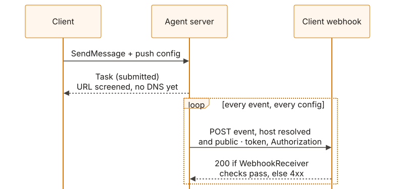
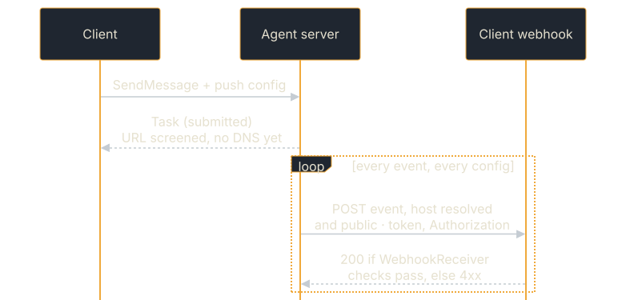

# Push Notifications

Push notifications let agents deliver results asynchronously via webhooks. Instead of the client holding an SSE connection open, the server POSTs events to a URL the client provides.

## How push notifications work

<figure class="diagram">

<figcaption>A push config registered with the first message, then one POST per event.</figcaption>
</figure>

1. Client sends a message with a push config inline
   (`configuration.taskPushNotificationConfig`, with no task ID;
   `returnImmediately: true` for async). The server creates the task and
   registers the config for it.
2. Alternatively, once it holds a task ID, the client registers a webhook with
   `CreateTaskPushNotificationConfig`; a config for a task that does not exist
   is refused with `TaskNotFoundError`.
3. The agent processes the message and pushes each event to every webhook
   registered for the task.

## Which page do I need

| You want to | Page |
|---|---|
| Turn push on in the server, or register webhooks from a client | [Setting up push notifications](./push-notifications/setup.md) |
| Know which URLs the agent will deliver to, how it retries, and what each outcome means | [Delivery and retries](./push-notifications/delivery.md) |
| Write the webhook that receives the events | [Receiving push notifications](./push-notifications/receiving.md) |
| Deliver somewhere other than an HTTP webhook | [Custom push sender](./push-notifications/custom-sender.md) |
| Keep push configs in a database, sealed | [Push config storage](./push-notifications/storage.md) |

## Next steps

- **[Interceptors & Middleware](./interceptors.md)** — Server-side request hooks
- **[Task & Config Stores](./stores.md)** — Persistent storage backends
