<!-- SPDX-License-Identifier: Apache-2.0 -->
<!-- Copyright 2026 Tom F. <tomf@tomtomtech.net> (https://github.com/tomtom215) -->

# Delivery and retries

What `HttpPushSender` does with each event: which URLs it will deliver to, how it guards against server-side request forgery, how often it retries, and what each delivery is counted as.

## What `HttpPushSender` checks

The built-in `HttpPushSender` includes:

- **HTTPS delivery** — With the `tls-rustls` feature (on by default) it delivers to both `http://` and `https://` webhooks. In a build with the feature disabled it is plaintext-HTTP only and fails fast on an `https://` target with a clear error; it follows the same proxy variables, pins and connection settings (until 0.16.0 that build read no proxy variable, audit NEW-b-3).
- **SSRF protection** — Resolves the host at delivery and rejects a URL that is, or resolves to, a private, loopback, link-local, CGNAT, multicast, reserved or benchmarking address (among them `0.0.0.0/8`, `192.0.0.0/24`, `198.18.0.0/15` and everything from `224.0.0.0` up; in IPv6 also site-local, multicast, Teredo, discard-only and local-use NAT64 ranges, and an IPv4 address inside a mapped, NAT64 or 6to4 one; the documentation ranges stay allowed), a numeric IPv4 spelling such as `0x7f.1`, or an internal name (`localhost`, `*.localhost`, `*.local`, `*.internal`, `*.home.arpa`, a name with no dot such as `metadata`, or one with an empty label); a trailing dot changes none of it (`url_guard::resolve_public_addrs`, public for your own senders). Resolving before validating prevents DNS rebinding attacks where a hostname initially resolves to a public IP but later resolves to a private IP, and the delivery then connects only to the addresses it checked, never to a second lookup of the name: the client's resolver is told, for the length of the delivery, that the name is those addresses, so the request still names the host (its `Host` header, and for `https://` the name the certificate is verified against) and the proxy rules are matched against the name. Until 0.16.0 an `http://` URL was rewritten to one of the addresses instead, so `NO_PROXY` saw the address and not the name (audit NEW-b-4). Until 0.16.0 `https://` was not pinned and relied on TLS alone, which stops a rebound server from impersonating the host but not a TCP connection and a `ClientHello` to an internal address. A host with several addresses (an `A` and an `AAAA` record, or several `A` records) is tried in turn: the connector goes on to the next within each attempt. An address that drops packets rather than refusing costs its share of the 10 s connect bound, which the connector divides across the host's addresses. Behind a proxy there is no pin, since the proxy resolves the name (see below). A config is also screened when it is created, without a DNS lookup, so a hostname that resolves privately is stored but never delivered to. At most 32 lookups hold a thread of the blocking pool at once, counting those whose caller has timed out, so a domain whose name server answers slowly cannot fill it; one past that waits for a slot inside the 5 s lookup bound. `with_allowed_hosts([..])` restricts webhooks to listed hosts (checked at creation and at delivery); `allow_private_urls()` turns the screen off for tests.
- **Bounded concurrency** — At most `HandlerLimits::push_max_in_flight` deliveries (512) run at once across all tasks, at most `push_max_in_flight_per_host` (64) to one destination, and at most `push_max_in_flight_per_partition` (256) for one tenant, or one caller where callers are isolated. The destination bound is counted by name and port before the lookup and by address after it, so a caller who registers webhooks at a third party's address, or at a thousand names that resolve to it, cannot make this agent open a connection per config per task; and one caller's slow webhooks leave at least half the overall bound to everyone else. A delivery over a bound waits rather than being dropped, so every webhook is still attempted. The wait does not spend the webhook's time: it is bounded by `push_delivery_timeout` of its own, the webhook has the whole of `push_delivery_timeout` from when the delivery is let through, and a delivery never let through is counted as `throttled` and not held against its webhook's health. Each delivery that waited is counted once as the error `push_throttled` on method `PushDelivery`. So a delivery can take up to twice `push_delivery_timeout` end to end. The bounds sit in front of whatever sender the handler was given, a custom one included. These numbers are choices, not measurements: raise the per-host bound for a single receiver that takes every agent's callbacks.
- **A delivery id** — Every request carries `A2A-Delivery-Id`, one UUID per event per webhook, the same on every attempt of it. A receiver that sees an id twice knows the sender is retrying (the first attempt may have been handled and its answer lost). `push::webhook::delivery_id(&headers)` reads it. It is not kept across a restart and not shared between the paths that can send one event, so it deduplicates retries, not every duplicate; `WebhookReceiver` in the client crate deduplicates by body and is unchanged.
- **Header injection prevention** — Validates credentials contain no `\r` or `\n`
- **HTTPS only, if you ask** — `HttpPushSender::new().https_only()` refuses an `http://` webhook (spec §13.2: webhook URLs SHOULD use HTTPS). A push config with one is refused at creation with `InvalidParams`, and a delivery to one is refused before connecting. Off by default.

## Behind a proxy or a private CA

`HttpPushSender` follows the environment a container or a corporate network
sets, with no code: `HTTPS_PROXY`, `HTTP_PROXY`, `ALL_PROXY` and `NO_PROXY`
(upper or lower case; curl's `NO_PROXY` rules) choose the way out, and
`SSL_CERT_FILE` and `SSL_CERT_DIR` add roots to Mozilla's, which is how a
webhook behind a private CA is trusted. An `https://` webhook is reached over
an `HTTP CONNECT` tunnel with TLS inside it; an `http://` one is a forward
request, with `Proxy-Authorization` from the proxy URL's login. Until
2026-10-31 none of this applied to push delivery (only telemetry read the
proxy variables), so behind a proxy webhooks were never delivered and the log
said only `client error (Connect)`; the log now names the cause.

**The proxy resolves the name, so make it enforce egress.** The SSRF screen
above resolves the webhook's host in this process and refuses a private
answer, and pins the checked addresses for a direct connection. Through
a proxy the pin does not apply: an `https://` webhook is a `CONNECT host:port`
and an `http://` one a forward request, and it is the proxy that resolves
`host`: the screen checked one answer, the proxy may dial another. Deny private, loopback and link-local ranges (and the cloud metadata
address) in the proxy's own policy, and use `NO_PROXY` for the hosts that must
be reached directly. `NO_PROXY` is matched against the webhook's host name, as
written in its URL, for `http://` and `https://` alike.

**When only the proxy can resolve names.** The screen resolves each webhook's
host in this process, and by default a host it cannot resolve fails the
delivery, with an error that says a proxy carries it. Where the local resolver
answers only internal names and the proxy resolves everything else (Squid,
Zscaler), `HttpPushSender::new().with_proxy_resolved_names()` sends such a
webhook to the proxy by name instead: the name is still screened by its form,
and a name that does resolve here is still refused for a private answer. The
proxy is then the only screen for names only it can resolve, so turn this on
only when the proxy denies private destinations itself (ADR 0043).

## Retries and time limits

<figure class="diagram">

<figcaption>One delivery to one webhook at the defaults, and the outcome label it is counted under.</figcaption>
</figure>

Every config of a task is attempted for every event,
concurrently (`HandlerLimits::push_delivery_budget`, 30 s, sets how many at
once; at the defaults, all). One attempt is bounded by the sender's request
timeout, 10 s (`HttpPushSender::with_timeout`), after a DNS lookup bounded by
5 s (`with_dns_timeout`). `PushRetryPolicy` (`with_retry_policy`) allows 3
attempts with 1 s then 2 s between them (a shorter `backoff` list repeats its
last entry; 0 attempts counts as 1). A transport error, a timeout, `408`,
`429` and any `5xx` are retried with the same body; any other status, a
redirect included (it is not followed), fails the delivery at once, and the
response body is not read. A whole delivery, retries included, is bounded by
`HandlerLimits::push_delivery_timeout` (30 s); a webhook that never answers
needs up to 38 s at the defaults, so the third attempt can be cut short (the
`timeout_truncated` outcome of `a2a.server.push_deliveries`). A failed delivery
is counted (and logged, with the `tracing` feature) and does not fail the task.

**Delivery is at most that many tries, held in memory.** Nothing is written down: an event still being retried when the process stops, or dropped from a full lane (below), is not delivered later, by this replica or another. A `404` is final for that event, and the config is kept and tried for the next one; what a webhook that is gone or down for good costs is in the next section. A receiver that must not miss an event reads the task (`GetTask`,
or `ListTasks` for what it missed) after a gap; the push is a prompt to look,
not a log.

## A webhook that is gone, or down for good

A webhook that answers `410 Gone` has said its address is permanently gone.
Its config is removed (`HandlerLimits::push_remove_gone`, on by default), the
delivery is counted `gone`, and the client's list of its configs no longer
shows it. Only `410`: a `404` can be a deploy in progress and counts as any
other failure.

A webhook that fails `push_suspend_after` deliveries in a row (5 by default;
each of them has had the sender's retries) is **suspended**. The events after
that are not sent to it, each counted `suspended`, for `push_suspend_for`
(30 s); then one is tried. A success ends the suspension, and a failure doubles
the next pause, up to 32 times as long. A delivery that `push_delivery_timeout` cuts off before the webhook answers counts as failed: that is what a webhook that never answers looks like. An event that ends a turn (a terminal
or interrupted status) is always tried, so a webhook that comes back is told
how a task ended. The config is kept. Spec §4.3.3 allows an agent to stop
attempting delivery after a number of consecutive failures; this is that
number, and the pause is how a webhook that recovers is found again.

The counts are per replica and held in memory, as delivery is: a replica that
restarts starts from none, and two replicas count apart. `push_suspend_after`
of 0 turns suspension off, and `push_remove_gone(false)` keeps the config of a
webhook that answered `410`. A sender of your own gets both rules; it asks for
the `410` one by putting `{"httpStatus": 410}` in its error's `data`. A durable
outbox, which would survive a restart and share the counts, is proposed in
[ADR 0037](https://github.com/tomtom215/a2a-rust/blob/main/docs/adr/0037-push-outbox.md)
and not built.

## Order, and a webhook slower than the agent

Each task's deliveries go through one lane, on a task of their own: an event
is stored, its delivery is handed to the lane, and the next event is stored
without waiting for any webhook. The lane runs its deliveries one after
another, so a webhook is sent a task's events in the order they were stored.
A blocking `SendMessage` hands over the whole request's events as one
delivery in the same lane, so this holds across turns whichever send path ran
each one. Lanes are per task: a webhook that hangs holds back its own task's
notifications and nothing else, not the task's state, its event log, its
streams, or a continuation sent to another replica. Shutdown waits for the
lanes as it waits for executors, within the same grace period.

A lane holds up to `HandlerLimits::push_queue_capacity` deliveries waiting
behind the one under way (1,024). When it is full, the oldest waiting
delivery that does not end a turn is dropped and counted as `dropped`, so a
webhook that cannot keep up loses intermediate events (artifact chunks,
`working`) and is still sent the terminal or interrupted status that ends
each turn. Spec §4.3.3 allows an agent to stop delivering after a configured
number of failures; this bound is that number, counted in waiting deliveries.

Before 2026-10-30 the streaming path delivered inline: a webhook that did not
answer held each later event out of the store for up to
`push_delivery_timeout`, back-pressured the executor once 1,024 events were
buffered, and held the turn's claim, so a continuation sent to another
replica was refused as "already being processed".

## Durable delivery: the outbox

Everything above is held in memory: a delivery waiting in a lane, or being
retried, when the process stops is not delivered by this replica or any
other, terminal events included. `RequestHandlerBuilder::with_push_outbox`
keeps them in a store instead (ADR 0037): open one, for example
`PostgresPushOutbox::new(&database_url).await?`, and pass it as
`.with_push_outbox(Arc::new(outbox))` next to `.with_push_sender(...)`.

- **What is stored.** One row per event and webhook (`a2a_push_outbox`), in
  event order. A row names the config, not its credentials, so a config that
  is deleted, or removed after a `410`, ends its rows. The event body is in the
  row; `with_cipher` seals it with the push configs' `PushConfigCipher`.
- **Written before the event is stored.** The handler reserves an event's rows
  before its first durable write, and arms them once the event is stored (or
  removes them if it was not). A reserved row is never claimed, but it holds
  its webhook's place, so deliveries stay in event order. A process that is
  killed between the two leaves rows that are settled from the task store: was
  the event stored (the position the stored task has reached, and the event at
  that position in the log)? Stored, it is delivered under the delivery id it
  was given; not stored, it is removed and no webhook is told of an event the
  task does not have. **Where turn claims are on, the claim reaper settles a
  dead replica's reservations as soon as it takes the task's claim** (taking it
  fences the dead replica off, so the store's answer is final): the stored event
  and then the reaper's ending reach the webhook about one claim time to live
  after the kill (30 s in the live run). Anywhere else, any replica's worker
  settles a reservation after its hold, three store-write retries and a minute
  (150 s by default). Each settlement is counted `reservation_settled`: a rate
  above zero means replicas are dying mid-event (two replicas that settle one
  reservation at once each count it). This needs a task store with an event log
  (the SQLite, PostgreSQL and in-memory stores have one) and an outbox that
  keeps reservations (all three here do); with either missing, the row is
  written after the event is stored, by the task's lane, and a crash between
  the two writes loses that event's deliveries. Without the outbox every queued
  delivery and every retry is lost with the process.
- **Endings.** A task's ending that no queued event carries (a cancel taken
  on another replica, a task the claim reaper ends, an executor that
  panicked) is recorded in the outbox before it is written to the log, behind
  any rows a stopped replica still has reserved for the task, so a webhook
  sees it after the events that were stored before it. An executor's panic is
  reserved before it is saved, like an event. A stop in between leaves the log
  without the ending, which the reaper completes, at worst delivering it twice.
- **If the outbox is down** when an event is reserved, that event is recorded
  in order once the task stores it, and nothing is durable until the outbox
  returns: a process that stops in that time loses what it held in memory.
- **Not covered.** Without turn claims there is no reaper, so a stopped
  replica's last event reaches the webhook after the hold. A custom outbox
  that wraps another must forward `reserve`, `arm`, `release`, `held`,
  `held_for_task`, `supports_renewal` and `renew` as well as the original
  methods, or the handler falls back to the defaults for the ones it misses.
- **Who delivers.** A worker per handler claims rows that are due, under a
  lease, from whichever replica: PostgreSQL's claim is `FOR UPDATE SKIP LOCKED`,
  so replicas never take the same row or wait on each other. A worker claims for
  30 s and renews every 10 s while it delivers (an outbox that cannot renew keeps
  a lease of three times `push_delivery_timeout` plus 30 s), so the rows of a
  worker that was killed are free after 30 s, and a delivery that outlasts the
  lease is not taken from a worker that is alive. A webhook's later row is not
  claimed while an earlier one is unfinished, so it sees a task's events in
  order. At shutdown the worker releases what it holds.
- **Retries.** A delivery that fails, times out or is throttled is due again
  after 1 s, doubling to `push_outbox_backoff_max` (1 h), less up to a fifth
  of jitter; a suspended webhook's rows wait the same way. A `2xx` ends the
  row, and so does a refusal no retry will change (a `4xx` other than `408`
  and `429`). A row older than `push_outbox_max_age` (24 h) when it is next
  due is dropped and counted `expired`. At most `push_queue_capacity` rows
  wait per webhook of a task, dropping as the lanes drop.
- **At least once.** A delivery whose answer was lost, or whose process
  stopped after sending it, is sent again, from any replica, with the same
  `A2A-Delivery-Id`: deduplicate on it. The id is the row's: it is the same
  across attempts, replicas, a restart, and an event recorded again after its
  reservation was settled early. A custom `PushSender` reads the row's
  id with `push::current_delivery_id()`.
- **Stores.** `PostgresPushOutbox` for a fleet, `SqlitePushOutbox` for one
  process with a file, `InMemoryPushOutbox` where nothing survives a restart
  anyway (its retries still outlast one delivery). `PushOutbox::pending`
  counts what waits, for a gauge.

## Outcomes

Each delivery is counted once in `a2a.server.push_deliveries`, labelled with
its outcome:

| `outcome` | Meaning |
|---|---|
| `delivered` | The webhook answered `2xx`. |
| `failed` | The webhook refused it with a status that is not retried, every attempt failed, or the sender refused the delivery (a screened URL, an unsendable credential). |
| `timeout` | `push_delivery_timeout` expired before the sender finished. |
| `dropped` | Never started: the task's lane was full (`push_queue_capacity`), because the webhook is slower than the agent. Counted once per dropped event (or blocking request), not per webhook. |
| `timeout_truncated` | The same, for a sender whose own schedule (`PushSender::max_delivery_duration`) is longer than `push_delivery_timeout`, so its last attempts could never run in full. At the defaults (38 s against 30 s) every timeout is this one; the fix is to lengthen the timeout or shorten the schedule. |
| `suspended` | Not attempted: the webhook failed `push_suspend_after` deliveries in a row and is inside its pause. Counted once per skipped delivery. |
| `gone` | The webhook answered `410 Gone` and its config was removed (`push_remove_gone`). Counted for each delivery that learned it: a blocking send's batch reads its configs once, so the rest of that batch's events also reach the webhook and are counted. |
| `throttled` | Not attempted: the delivery waited `push_delivery_timeout` for a slot in the push gate and was not let through. Not held against the webhook. |
| `expired` | The push outbox gave up on it: older than `push_outbox_max_age` when next due. |
| `reservation_settled` | Not a delivery: a worker settled the reserved rows of an event whose replica stopped before arming or removing them. Counts crashes the outbox recovered from. |

`suspended` and `gone` are in `a2a:push_delivery_failure_ratio:rate5m` with
`failed`, as `dropped` is: it is the share of deliveries that did not reach a
webhook, and a suspended webhook is one that is not being reached.

## Security considerations

- **Always use HTTPS** for webhook URLs in production
- The built-in `HttpPushSender` rejects private IP addresses to prevent SSRF attacks. The screen knows the Internet's split between public and private addresses, not your network's: a cluster or VPC that uses addresses outside the private ranges (a public block used inside, or the documentation ranges, which are allowed), or reaches internal services by short names through search domains (`kubernetes.default`, `redis.prod`), is not seen as internal. In such a network name the hosts that may be webhook targets with `with_allowed_hosts`.
- Webhook credentials are validated for header injection characters
- Consider rate limiting webhook delivery to prevent abuse
