<!-- SPDX-License-Identifier: Apache-2.0 -->
<!-- Copyright 2026 Tom F. <tomf@tomtomtech.net> (https://github.com/tomtom215) -->

# Delivery and retries

What `HttpPushSender` does with each event: which URLs it will deliver to, how it guards against server-side request forgery, how often it retries, and what each delivery is counted as.

## What `HttpPushSender` checks

The built-in `HttpPushSender` includes:

- **HTTPS delivery** — With the `tls-rustls` feature (enabled by default via the `a2a-protocol-sdk` crate) it delivers to both `http://` and `https://` webhooks. In a build with the feature disabled it is plaintext-HTTP only and fails fast on an `https://` target with a clear error.
- **SSRF protection** — Resolves the host at delivery and rejects a URL that is, or resolves to, a private, loopback, link-local, CGNAT or IPv4-mapped address, a numeric IPv4 spelling such as `0x7f.1`, or an internal name (`url_guard::resolve_public_url`, public for your own senders). Resolving before validating prevents DNS rebinding attacks where a hostname initially resolves to a public IP but later resolves to a private IP. A config is also screened when it is created, without a DNS lookup, so a hostname that resolves privately is stored but never delivered to. For `http://` the validated IP is pinned at connect time; for `https://` the rebinding window is closed by TLS certificate verification instead (so the original hostname is preserved for SNI). `with_allowed_hosts([..])` restricts webhooks to listed hosts (checked at creation and at delivery); `allow_private_urls()` turns the screen off for tests.
- **Header injection prevention** — Validates credentials contain no `\r` or `\n`
- **HTTPS only, if you ask** — `HttpPushSender::new().https_only()` refuses an `http://` webhook (spec §13.2: webhook URLs SHOULD use HTTPS). A push config with one is refused at creation with `InvalidParams`, and a delivery to one is refused before connecting. Off by default.

## Retries and time limits

<figure class="diagram">

<figcaption>One delivery to one webhook at the defaults, and the outcome label it is counted under.</figcaption>
</figure>

Every config of a task is attempted for every event,
concurrently (`HandlerLimits::push_delivery_budget`, 30 s, sets how many at
once; at the defaults, all). One attempt is bounded by the sender's request
timeout, 10 s (`HttpPushSender::with_timeout`), after a DNS lookup bounded by
5 s (`with_dns_timeout`). `PushRetryPolicy` (`with_retry_policy`) allows 3
attempts with 1 s then 2 s between them (a shorter `backoff` list repeats its
last entry; 0 attempts counts as 1). A transport error, a timeout, `408`,
`429` and any `5xx` are retried with the same body; any other status, a
redirect included (it is not followed), fails the delivery at once, and the
response body is not read. A whole delivery, retries included, is bounded by
`HandlerLimits::push_delivery_timeout` (30 s); a webhook that never answers
needs up to 38 s at the defaults, so the third attempt can be cut short (the
`timeout_truncated` outcome of `a2a.server.push_deliveries`). A failed delivery
is counted (and logged, with the `tracing` feature) and does not fail the task.

## Outcomes

Each delivery is counted once in `a2a.server.push_deliveries`, labelled with
its outcome:

| `outcome` | Meaning |
|---|---|
| `delivered` | The webhook answered `2xx`. |
| `failed` | The webhook refused it with a status that is not retried, every attempt failed, or the sender refused the delivery (a screened URL, an unsendable credential). |
| `timeout` | `push_delivery_timeout` expired before the sender finished. |
| `timeout_truncated` | The same, for a sender whose own schedule (`PushSender::max_delivery_duration`) is longer than `push_delivery_timeout`, so its last attempts could never run in full. At the defaults (38 s against 30 s) every timeout is this one; the fix is to lengthen the timeout or shorten the schedule. |

## Security considerations

- **Always use HTTPS** for webhook URLs in production
- The built-in `HttpPushSender` rejects private IP addresses to prevent SSRF attacks
- Webhook credentials are validated for header injection characters
- Consider rate limiting webhook delivery to prevent abuse
