<!-- SPDX-License-Identifier: Apache-2.0 -->
<!-- Copyright 2026 Tom F. <tomf@tomtomtech.net> (https://github.com/tomtom215) -->

# The Tool Loop

A model that can call tools needs a loop around it: send the conversation and
the tool catalogue, run the calls the model asks for, send the results back,
and repeat until it answers. The `tool-loop` feature puts that loop in the SDK
([ADR 0022](https://github.com/tomtom215/a2a-rust/blob/main/docs/adr/0022-tool-calling-loop.md)),
so an agent that answers with a model and its tools is a set of tools, a model
client and a preamble, with no executor of your own.

A2A has no tool concept. It carries messages, tasks and artifacts between
agents; tool calling happens inside one task, between the executor and its
model. `ToolLoopExecutor` is that executor: one A2A task per message, as many
model turns inside it as the answer takes.

## Turning it on

The feature is off by default:

```toml
[dependencies]
a2a-protocol-sdk = { version = "0.15", features = ["tool-loop"] }
```

It adds nothing to a default build's dependency graph: the model client runs
on the hyper stack push delivery already uses, and each call's idempotency key
is derived with `ring`, which the default `tls-rustls` already brings. HTTPS
to the model needs `tls-rustls`, which the SDK enables by default.

## A minimal agent

One read-only tool, a model behind an OpenAI-compatible endpoint, and the
loop served over JSON-RPC:

```rust,no_run
use std::future::Future;
use std::pin::Pin;
use std::sync::Arc;

use a2a_protocol_sdk::prelude::*;
use a2a_protocol_sdk::server::tool_loop::{
    OpenAiChatModel, Tool, ToolError, ToolInvocation, ToolLoop, ToolLoopExecutor, ToolSet,
};

/// The current time. Read-only: calling it twice changes nothing.
struct Clock;

impl Tool for Clock {
    fn name(&self) -> &str { "utc_now" }
    fn description(&self) -> &str { "The current UTC time, RFC 3339." }
    fn parameters(&self) -> serde_json::Value {
        serde_json::json!({"type": "object", "properties": {}})
    }
    fn read_only(&self) -> bool { true }
    fn call<'a>(
        &'a self,
        _call: ToolInvocation,
    ) -> Pin<Box<dyn Future<Output = Result<String, ToolError>> + Send + 'a>> {
        Box::pin(async { Ok("2026-10-20T12:00:00Z".to_owned()) })
    }
}

# #[tokio::main]
# async fn main() -> Result<(), Box<dyn std::error::Error>> {
let model = OpenAiChatModel::new("http://127.0.0.1:8080/v1", "qwen3:1.7b")?;
let tools = ToolSet::new().with(Clock)?;
let tool_loop = ToolLoop::new(model, tools)
    .with_preamble("Call the tools yourself to answer.");

let card = AgentCard::new("clock-agent", "1.0.0", AgentInterface::jsonrpc("http://127.0.0.1:3000"))
    .with_description("Tells the time by calling a tool")
    .with_skill(AgentSkill::new("time", "Time", "Answers questions about the time").with_tags(["time"]));
let handler = Arc::new(
    RequestHandlerBuilder::new(ToolLoopExecutor::new(tool_loop))
        .with_agent_card(card)
        .build()?,
);
serve("127.0.0.1:3000", JsonRpcDispatcher::new(handler)).await?;
# Ok(())
# }
```

A client sees an ordinary task: `Working`, an `answer` artifact, a
`tool-trace` artifact when a tool ran, and `Completed`. The
[Tool-Loop Agent](../examples/tool-loop-agent.md) example is the same shape
with two tools, run end to end against a live model.

## What one run does

<figure class="diagram">
<a href="../images/diagrams/ba-tool-loop-run.light.svg"></a>
<a href="../images/diagrams/ba-tool-loop-run.dark.svg"></a>
<figcaption>One run of <code>ToolLoop</code>: turns until the model answers, or a bound ends it.</figcaption>
</figure>

- Each turn sends the preamble, the whole conversation and the whole
  catalogue: a provider keeps no state between turns.
- A tool's error goes back to the model as that call's result. "No service
  named 'billing'; call `list_services`" is how a model recovers, so only a
  failure no further turn can fix ends the run.
- A reply that is nothing but one JSON tool call, written as text, is run as
  that call: small models do that, and an answer of raw JSON helps nobody.
- A call identical to one that already succeeded in the run is not run
  again, unless its tool says it is read-only.
- The run ends with an answer, or when the turn bound, the caller's budget, a
  provider failure, a fatal tool error or cancellation stops it.

## Which page do I need

| You want to… | Page |
|---|---|
| Write a tool, report its errors, and make its side effects safe to repeat | [Tools and idempotency](./tool-loop/tools.md) |
| Point the loop at OpenAI, llama-server, vLLM or Ollama, or at a provider of your own | [Model clients](./tool-loop/models.md) |
| Bound the turns, honour the caller's budget, read the artifacts, and know how a run fails | [Running the loop](./tool-loop/running.md) |
| See each model turn and tool call in your traces and metrics | [Spans and metrics](./tool-loop/telemetry.md) |

## Next steps

- **[Tool-Loop Agent](../examples/tool-loop-agent.md)** — The loop end to end against a live model
- **[The AgentExecutor Trait](./executor.md)** — Writing an executor yourself, when the loop is not the shape you need
- **[Delegating to Another Agent](../client/delegation.md#a-parents-budget-deadlines-and-meters)** — The budget a parent agent hands to a child
