<!-- SPDX-License-Identifier: Apache-2.0 -->
<!-- Copyright 2026 Tom F. <tomf@tomtomtech.net> (https://github.com/tomtom215) -->

# Delegating to Another Agent

An agent that hands work to other agents creates tasks on them, and A2A does
not link those tasks to its own. Cancel the parent and its children keep
running unless the parent's code cancels each one. In `examples/swarm`,
every child kept running when its root was cancelled and the orchestrator
had not written that cascade.

`Delegation` is that cascade. It sends the child, learns the child's task id
from the first event that names it, and cancels the child when:

- the parent cancels: the `cancel` future passed to `wait` completes, or the
  parent calls `cancel()`;
- the child's stream is lost before the child settled and could not be
  [resumed](#a-cut-stream-and-a-restarted-parent); or
- the handle is dropped before the child settled. That happens when the
  parent's own future is aborted, or when its code returns early.

A child *settles* when it reaches a terminal state, or `input-required` or
`auth-required`. In those two it is waiting for the parent, so it is handed
back rather than cancelled.

The whole life of a child that was given a [budget](#a-parents-budget-deadlines-and-meters)
and a [lease](#a-crashed-parent-leases), the two sections below:

<figure class="diagram">
<a href="../images/diagrams/cl-delegation.light.svg"></a>
<a href="../images/diagrams/cl-delegation.dark.svg"></a>
<figcaption>A delegation with a budget and a lease (<code>start_budgeted</code> with <code>Some(ttl)</code>). <code>start</code> alone has no grant and no renewals.</figcaption>
</figure>

```rust,no_run
use std::sync::Arc;
use a2a_protocol_client::ClientBuilder;
use a2a_protocol_client::delegation::{Delegation, Outcome};
use a2a_protocol_types::{Message, MessageSendParams, Part};
use a2a_protocol_types::failure::FailureClass;
# async fn run(parent_cancelled: impl std::future::Future<Output = ()>)
#     -> Result<(), Box<dyn std::error::Error>> {

let worker = Arc::new(ClientBuilder::new("http://worker:8080").build()?);
let params = MessageSendParams::new(Message::user("m-1", vec![Part::text("summarise")]));

// Inside an executor, pass `ctx.cancellation_token.cancelled()`.
let child = Delegation::start(worker, params).await?;
let done = child.wait(parent_cancelled).await;

match done.outcome {
    Outcome::Completed(_) => { /* fetch its artifacts by done.task_id */ }
    Outcome::Failed { class: FailureClass::Transient, .. } => { /* retry elsewhere */ }
    Outcome::Interrupted(_) => { /* it needs input: continue it by task id */ }
    other => eprintln!("child {:?}: {other:?}", done.task_id),
}
# Ok(())
# }
```

To see the child's events as they arrive, call `next_event()` in a loop
instead of `wait`. The handle still tracks the child's id and state.

## Outcomes

| Outcome | Meaning |
|---|---|
| `Completed`, `Failed`, `Canceled` | The child reached that state. `Failed` covers `failed` and `rejected` and carries its [failure class](./failure-classes.md) (`Internal` if the child declared none). |
| `Interrupted` | `input-required` or `auth-required`. The child was not cancelled. |
| `Message` | The agent answered with a message and created no task. |
| `Lost` | The stream failed or closed before the child settled, and the [resume policy](#a-cut-stream-and-a-restarted-parent) was spent without getting it back. If the child's id was known, it was sent `CancelTask`. |
| `CancelRequested` | `CancelTask` was accepted. The task it returned was not yet terminal. |
| `CancelFailed` | `CancelTask` was refused or failed. |
| `Unreachable` | A cancel was asked for before any event named the child, and none did within the id wait (`with_id_wait`, 5 s by default). No `CancelTask` could be sent. |

A child is cancelled in the tenant it was sent to (`MessageSendParams::tenant`),
not the client's default.

## Keeping a child

`detach()` stops following the child without cancelling it, and returns its
id. Use it to hand the child over, for instance to a supervisor that records
the id and `last_event_id()` durably and later calls `Delegation::reattach`.

## A cut stream and a restarted parent

A connection that ends before the child settled (a reset, a proxy rollout,
the idle timeout) used to cancel the child, and in a tree of delegations
the cancel went on down. Now `wait` first reopens the stream from the last
event id, under a `ResumePolicy`: by default five attempts, 200 ms apart and
doubling to 5 s, inside 30 s of one loss. If the subscription is refused it
reads the task, because a task that settled while the stream was down cannot
be subscribed to and is reported as what it became, not as `Lost`. Only a
child still running after the policy is spent is cancelled.

- An attempt that gets a stream and loses it again without the position
  moving counts as spent, so a server that accepts and drops a subscription
  is not asked for ever. A stream that worked starts the count again.
- A stream has worked when its position advanced, or when it delivered an
  event and stayed open for `healthy_after` (five seconds by default). The
  second rule is for gRPC and WebSocket streams, which carry no event ids: a
  long, quiet child that an idle timeout cuts every minute is followed for as
  long as it lives, while a server that sends its snapshot and drops the
  stream at once still exhausts the policy.
- The waits are shortened by up to half, at random, so that a fleet whose
  streams a rollout cut in the same instant does not come back in the same
  instant. `ResumePolicy::with_jitter(false)` pins them.
- `with_resume(ResumePolicy::none())` restores the old behaviour: the first
  loss cancels the child.

A supervisor that restarts can follow its child again:

```rust,no_run
use std::sync::Arc;
use a2a_protocol_client::{A2aClient, delegation::Delegation};
# async fn run(
#     client: Arc<A2aClient>,
#     child: Delegation,
#     parent_cancelled: tokio::sync::oneshot::Receiver<()>,
# ) -> Result<(), Box<dyn std::error::Error>> {
// Before it stops: record these two.
let id = child.task_id().map(str::to_owned);
let position = child.last_event_id().map(str::to_owned);
child.detach();
// After it restarts:
if let Some(id) = id {
    let child = Delegation::reattach(client, None, id, position).await?;
    let done = child.wait(async { let _ = parent_cancelled.await; }).await;
    println!("{:?}", done.outcome);
}
# Ok(())
# }
```

A child that settled in the meantime comes back already settled. A budget
grant is not restored: the parent's meter died with the process, and the
reservation stays spent. A lease is renewed again if `reattach_with` is given
one (below).

## Remembering children across restarts: the journal

`reattach` needs the id and the position, and a supervisor that dies between
sending the message and recording them has neither. A `DelegationJournal`
(ADR 0030) is the record that outlives the process.
`Delegation::start_journaled` writes it before the message is sent, and sends
nothing if the journal cannot store it; the child's id and position follow as
events arrive, and the record is settled with the outcome however the
delegation ends.

```rust,no_run
use std::sync::Arc;
use a2a_protocol_client::{A2aClient, delegation::{Delegation, DelegationOptions}};
use a2a_protocol_types::delegation_journal::{DelegationJournal, InMemoryDelegationJournal};
use a2a_protocol_types::{Message, MessageSendParams, Part};
# async fn run(client: Arc<A2aClient>) -> Result<(), Box<dyn std::error::Error>> {
let journal: Arc<dyn DelegationJournal> = Arc::new(InMemoryDelegationJournal::new());

// Start: the record is written before the message goes out.
let params = MessageSendParams::new(Message::user("m-1", vec![Part::text("summarise")]));
let child = Delegation::start_journaled(
    Arc::clone(&client), params, Arc::clone(&journal), "orchestrator-1", "http://worker:8080",
).await?;
# drop(child);

// After a restart: pick up what is still open.
for record in journal.open("orchestrator-1").await? {
    if let Some(task_id) = record.task_id.clone() {
        let child = Delegation::reattach_with(
            Arc::clone(&client), record.tenant.clone(), task_id, record.last_event_id.clone(),
            DelegationOptions::new().with_journal_record(Arc::clone(&journal), &record.id),
        )
        .await?;
        let done = child.wait(std::future::pending()).await;
        println!("{:?}", done.outcome);
    }
    // A record with no task id died before the child was named: send the same
    // message again under `record.idempotency_key` to reach the child the
    // first send created.
}
# Ok(())
# }
```

A record holds ids, keys, positions and an outcome label: no message text and
no credentials. A write that fails after the start is logged and does not stop
the delegation, and neither does one that does not answer: each write is given
five seconds, then dropped, and none is tried again for two, so a journal
database that stops responding slows each delegation by that much and no more.
(The record is written before the first send within the same five seconds;
past it nothing is sent and the call returns a timeout.) The position can lag
the stream by up to two seconds, so a reattach may replay a few events. Settled records stay until
`purge_settled` removes them. `InMemoryDelegationJournal` serves one process; for a supervisor that must
survive its own death use `PostgresDelegationJournal` (the server crate's
`postgres` feature, table `a2a_delegations`), or implement the trait over a
store of your own. There is no SQLite journal.

### Shutting down on purpose: hand the children over

A parent that is stopped for a redeploy fires its cancellation token, and a
`wait` that is given that token as its cancel signal cancels the child. For a
child with a journal record that throws away what the record exists for.
`wait_or_hand_off` takes a second future, the supervisor's own shutdown signal:

```rust,no_run
use std::sync::Arc;
use a2a_protocol_client::delegation::{Delegation, Outcome};
# async fn run(
#     child: Delegation,
#     cancelled: impl std::future::Future<Output = ()>,
#     shutting_down: impl std::future::Future<Output = ()>,
# ) {
let done = child.wait_or_hand_off(cancelled, shutting_down).await;
if matches!(done.outcome, Outcome::HandedOff) {
    // The child still runs and its record is still open: the next supervisor
    // finds it with `journal.open(owner)` and follows it with `reattach_with`.
}
# }
```

When the hand-off future fires first and the delegation has a journal record,
the child is left running, the record is left open, and the outcome is
`Outcome::HandedOff`. Without a record nothing could find the child again, so
the hand-off cancels it as `wait` would. A cancel that is not a hand-off
still cancels and settles the record. `wait` is `wait_or_hand_off` with a
future that never fires.

### One value for what a delegation is given

A journal, a lease, a budget and a resume policy each had a constructor, and
no two of them could be asked for together. `DelegationOptions` holds them:

```rust,no_run
use std::sync::Arc;
use std::time::Duration;
use a2a_protocol_client::{A2aClient, delegation::{Delegation, DelegationOptions}};
use a2a_protocol_types::delegation_journal::DelegationJournal;
use a2a_protocol_types::MessageSendParams;
# async fn run(
#     client: Arc<A2aClient>,
#     params: MessageSendParams,
#     journal: Arc<dyn DelegationJournal>,
# ) -> Result<(), Box<dyn std::error::Error>> {
let child = Delegation::start_with(
    client,
    params,
    DelegationOptions::new()
        .with_journal(journal, "orchestrator-1", "http://worker:8080")
        .with_lease(Duration::from_secs(60)),
)
.await?;
# let _ = child;
# Ok(())
# }
```

`start_with` and `reattach_with` take the same value; `start_leased`,
`start_budgeted` and `start_journaled` call it. A reattach cannot restore a
budget grant and cannot write a new record, and says so with a configuration
error before anything is sent. A supervisor that restarts must give
`reattach_with` the lease (`.with_lease(ttl)`) of a child it started with one:
renewal restarts from the moment the handle exists, and the lease the child
was granted lapses after its time to live without it.

## A crashed parent: leases

The handle dies with its process, so on its own it cannot cancel the child
of a parent that crashed, hung or was partitioned away. A lease can
(ADR 0020): `Delegation::start_leased` grants the child a time to live and
renews it every third of that while the handle lives. An agent built with
`RequestHandlerBuilder::with_lease_store` stops a child whose lease lapses,
so a parent that goes quiet leaves a child that stops within about one
time to live.

```rust,no_run
use std::sync::Arc;
use std::time::Duration;
use a2a_protocol_client::{ClientBuilder, delegation::Delegation};
use a2a_protocol_types::{Message, MessageSendParams, Part};
# async fn run() -> Result<(), Box<dyn std::error::Error>> {
let worker = Arc::new(ClientBuilder::new("http://worker:8080").build()?);
let params = MessageSendParams::new(Message::user("m-1", vec![Part::text("summarise")]));
let child = Delegation::start_leased(worker, params, Duration::from_secs(30)).await?;
# let _ = child;
# Ok(())
# }
```

The agent side, sharing one store across replicas:

```rust,no_run
# use a2a_protocol_sdk::prelude::*;
# struct MyAgent;
# agent_executor!(MyAgent, |_ctx, _queue| async { Ok(()) });
# async fn agent(pool: sqlx::PgPool) -> Result<(), Box<dyn std::error::Error>> {
use a2a_protocol_server::store::PostgresLeaseStore;

let handler = RequestHandlerBuilder::new(MyAgent)
    .with_lease_store(PostgresLeaseStore::from_pool(pool).await?)
    .build()?;
# let _ = handler;
# Ok(())
# }
```

A renewal is a `GetTask` that activates the lease extension
(`A2aClient::renew_lease`); a plain read renews nothing. Over WebSocket
the extension header is sent only with the upgrade, so ask for the
extension when connecting. An agent that grants no leases ignores the
grant. One that does refuses a time to live under 1 second, or over its
`with_max_lease_ttl` (an hour by default), with `InvalidParams`, and starts no
child. `detach()` stops the renewals too: a detached leased child stops
once its lease lapses.

## A parent's budget: deadlines and meters

A child can also outlive its parent's *deadline*, or spend more than the
parent had. A budget prevents both (ADR 0023). Every agent built on this SDK
holds a turn to the deadline its caller sent, and a turn the deadline stops
ends `failed`, classed `budget-exhausted`. Inside an executor,
`ctx.budget()` is `Some` when the caller's message carried a budget and `None`
when it did not. When it is `Some`, it is the turn's account: what is left,
`charge` for what was spent, and `grant` to carve a child's budget out of it.

```rust,no_run
use std::sync::Arc;
use a2a_protocol_client::{A2aClient, delegation::Delegation};
use a2a_protocol_types::budget::{Budget, BudgetHandle};
use a2a_protocol_types::{Message, MessageSendParams, Part};
# async fn run(budget: &BudgetHandle, worker: Arc<A2aClient>)
#     -> Result<(), Box<dyn std::error::Error>> {
// Up to 20,000 of this turn's tokens, and all the time it has left less a
// reserve for transit and wrap-up.
let grant = budget.grant(&Budget::new().with_meter("tokens", 20_000)?)?;
let params = MessageSendParams::new(Message::user("m-1", vec![Part::text("summarise")]));
let child = Delegation::start_budgeted(worker, params, grant, None).await?;
let done = child.wait(std::future::pending()).await;
// The parent has been charged what the child reported spending.
# let _ = done;
# Ok(())
# }
```

A grant reserves each meter from the parent at once, so ten children
cannot each be given the whole. A meter the request does not name goes to
the child as 0, so a child cannot spend outside the parent's budget by
leaving it out. Each status update the child's agent writes carries what is
left and spent, under `a2a-rust.com/budget` in its `metadata`. When the
update that settles the child reports its spend, the parent is charged that
in place of the reservation. Any other ending (a lost stream, a cancel, a
detached or dropped handle) refunds nothing. If `start_budgeted` itself fails,
the reservation goes back to the parent only when the error shows the agent
refused the send (an A2A error, an HTTP error status, an authentication
challenge or an unusable endpoint); after a transport error or a timeout a
child may be running, and the reservation is kept as spent. Pass `Some(ttl)` as
the last argument to grant a lease as well.

The SDK's tool loop charges each model reply's reported token usage to the
`tokens` meter and stops the run once it is spent.

## What it does not cover

- **An agent that does not implement the budget.** It ignores the budget
  and reports no spend, so its child is bounded only by its own limits,
  and the parent is charged the whole reservation.
- **A drop outside a Tokio runtime.** A drop-time cancel is sent from a
  task spawned on the current runtime. Without a runtime nothing is sent; the
  drop is logged when the `tracing` feature is on.
- **A child that stays silent.** A child the agent created but never
  announced cannot be cancelled by id. The handle waits up to the id wait
  for its first event, then reports `Unreachable`.
