# Agent Cards & Discovery

An **Agent Card** is the machine-readable discovery document that describes an A2A agent. Clients fetch the card to learn what the agent can do, how to connect, and what security is required.

## The Agent Card

Agent cards are served at `/.well-known/agent-card.json` and contain:

```json
{
  "name": "Calculator Agent",
  "description": "Evaluates arithmetic expressions",
  "version": "1.0.0",
  "supportedInterfaces": [
    {
      "url": "https://agent.example.com/rpc",
      "protocolBinding": "JSONRPC",
      "protocolVersion": "1.0"
    },
    {
      "url": "https://agent.example.com/api",
      "protocolBinding": "HTTP+JSON",
      "protocolVersion": "1.0"
    }
  ],
  "defaultInputModes": ["text/plain"],
  "defaultOutputModes": ["text/plain"],
  "skills": [
    {
      "id": "calc",
      "name": "Calculator",
      "description": "Evaluates expressions like '3 + 5'",
      "tags": ["math", "calculator"],
      "examples": ["3 + 5", "10 * 2"]
    }
  ],
  "capabilities": {
    "streaming": true,
    "pushNotifications": false
  }
}
```

The card a client fetches from a server built with `RequestHandlerBuilder` is
the card you supplied plus the extension declarations the server adds to
`capabilities.extensions`: the failure-taxonomy and budget extensions always,
and the idempotency, lease and approval extensions when the matching store or
gate is configured. An entry you declared yourself is kept as written.
`build()` refuses a card that carries a signature and would need an entry
added, because the edit would invalidate the signature: declare the
extensions, then sign.

## From card to connection

A client reads the card, checks it, picks an interface from it, and from then
on holds its calls to the capabilities the card declares. "Supports" means a
binding the client implements, on an interface whose `protocolVersion` has
major version 1:

<figure class="diagram">
<a href="../images/diagrams/con-card-discovery.light.svg"></a>
<a href="../images/diagrams/con-card-discovery.dark.svg"></a>
<figcaption>Discovery on the client side.</figcaption>
</figure>

## In this chapter

| You want to | Read |
|---|---|
| Know which fields a card needs, name a binding, describe skills, set capability flags, order interfaces | [Card fields, skills and interfaces](./agent-cards/fields.md) |
| Show authenticated clients more, or a different card per caller | [Extended and per-caller cards](./agent-cards/extended.md) |
| Serve a static card, one built per request, or one reloaded from a file | [Serving a card](./agent-cards/serving.md) |
| Understand `ETag` and `Cache-Control`, cache a card on the client, and what a client refuses | [HTTP caching and client checks](./agent-cards/caching.md) |
| Declare security schemes and requirements, and see what `build()` checks | [Security schemes](./agent-cards/security.md) |

## Next Steps

- **[Tasks & Messages](./tasks-and-messages.md)** — The data model for agent communication
- **[Streaming with SSE](./streaming.md)** — Real-time event delivery
