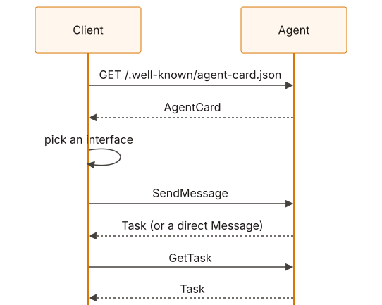
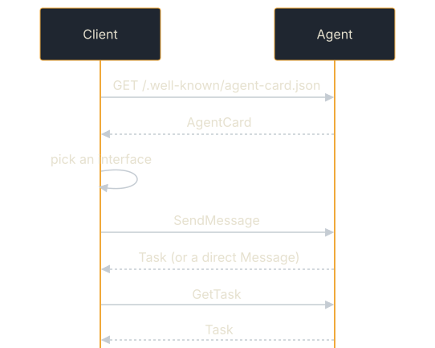
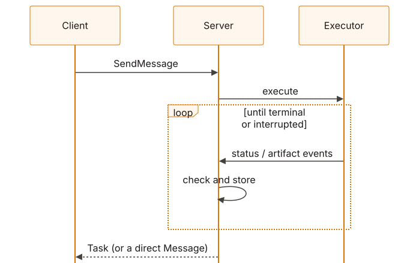
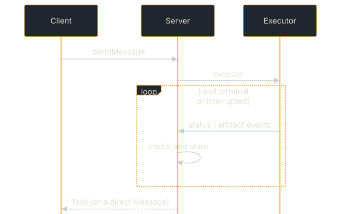
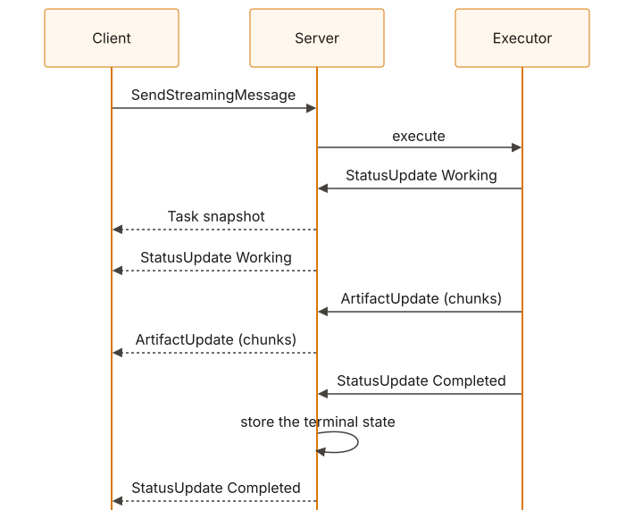
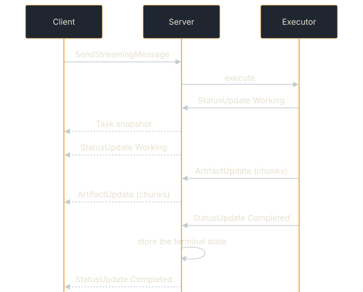

# Protocol Overview

The Agent2Agent (A2A) protocol defines how AI agents discover each other, exchange messages, manage task lifecycles, and stream results. This page covers the conceptual model — the "what" before the "how."

## The Big Picture

An A2A interaction follows this flow:

<figure class="diagram">

<figcaption>Discovery, then communication, then management.</figcaption>
</figure>

1. **Discovery** — The client fetches the agent's card from `/.well-known/agent-card.json`
2. **Communication** — The client sends a message and receives results
3. **Management** — The client can query, cancel, or subscribe to tasks

## Core Entities

### Tasks

A **Task** is the central unit of work. When a client sends a message, the server creates a task that progresses through well-defined states:

<figure class="diagram">

<figcaption>Task states. Any move is valid except out of a terminal state or into Submitted.</figcaption>
</figure>

`TaskState::can_transition_to` enforces two rules, and only these two:

1. **Terminal states are final.** `Completed`, `Failed`, `Canceled` and
   `Rejected` transition nowhere, not even to themselves.
2. **`Submitted` is the entry state.** Nothing transitions into it, or into
   the proto default `Unspecified`.

Everything else is allowed: `Submitted → Completed` for an agent that answers
in one step, `Working → Working` for progress updates, `InputRequired →
AuthRequired`, and so on. The diagram shows the usual paths; the interrupted
states `InputRequired` and `AuthRequired` are where a blocking `SendMessage`
returns early and the client is expected to send the next message. A status
update or task snapshot that breaks a rule is not applied; see
[Valid transitions](./tasks-and-messages.md#valid-transitions) for what the
server does with it.

### Messages

A **Message** is a structured payload sent between agents. Each message has:

- A unique **ID** (`MessageId`)
- A **role** — `User` (from the client) or `Agent` (from the server)
- One or more **Parts** — the actual content

### Parts

A **Part** is a content unit within a message. Four content types are supported:

| Type | Description | Example |
|------|-------------|---------|
| `Text` | Plain text | `"Summarize this document"` |
| `Raw` | Inline base64-encoded bytes | Image data, binary content |
| `Url` | URI reference | `"https://example.com/doc.pdf"` |
| `Data` | Structured JSON | `{"table": [...], "columns": [...]}` |

### Artifacts

An **Artifact** is a result produced by an agent. Like messages, artifacts contain parts. Unlike messages, artifacts belong to a task and can be delivered incrementally via streaming.

### Agent Cards

An **Agent Card** is the discovery document that describes an agent — its name, capabilities, skills, and how to connect. Think of it as a machine-readable business card.

## Request/Response Model

A2A supports two communication styles:

### Synchronous (SendMessage)

The client sends a message and blocks until the task reaches a terminal or interrupted (`InputRequired`, `AuthRequired`) state:

<figure class="diagram">

<figcaption>A blocking send: one request, one answer.</figcaption>
</figure>

The reply is the `Task`, or a direct `Message` when the agent answers without tracking a task.

### Streaming (SendStreamingMessage)

The client sends a message and receives events in real time (via SSE on the HTTP bindings):

<figure class="diagram">

<figcaption>A streaming send: the events reach the client as the executor writes them.</figcaption>
</figure>

If the agent answers with a single `Message`, the stream is exactly that one `Message` and has no `Task` snapshot.

Streaming is ideal for long-running tasks where the client wants progress updates.

## Contexts and Conversations

Tasks exist within a **Context** — a conversation thread. Multiple tasks can share the same context, allowing agents to maintain conversational state across interactions.

When a client sends a message with a `context_id`, the server groups that task with previous tasks in the same context. If the message names only a `task_id`, the server takes that task's context. If it names neither, the server creates a new context. A `context_id` that differs from the named task's is `InvalidParams`.

## Multi-Tenancy

A2A supports **multi-tenancy** via an optional `tenant` field on all requests. This allows a single agent server to serve multiple isolated tenants, each with their own tasks and configurations. A client **must** send the tenant its selected `AgentInterface` declares on every request (spec §8.3.2 rule 4); `ClientBuilder::from_card` does this for all eleven methods.

In the REST transport the client sends the tenant as the leading path segment, `/{tenant}/tasks/...`, and the server also accepts `?tenant=` on `GET`/`DELETE` and the body field on `POST`. See [Transport Layers](./transport-layers/rest.md#multi-tenant-paths).

## Next Steps

- **[Transport Layers](./transport-layers.md)** — JSON-RPC vs REST, and when to use each
- **[Agent Cards & Discovery](./agent-cards.md)** — How agents describe themselves
- **[Tasks & Messages](./tasks-and-messages.md)** — Deep dive into the data model
