# Streaming with SSE

A2A uses **Server-Sent Events (SSE)** for real-time streaming. This enables agents to deliver progress updates, partial results, and artifacts as they're produced — instead of making the client wait for the complete response.

## How a stream is fed

The executor writes each event once. The queue writer gives it its position in
the task's event log, which is the SSE `id:` a reader sees, and hands it to two
channels: the persistence channel, which stores the task and appends the event
to the log, and a broadcast channel that every open stream for the task reads.
A stream that falls behind the broadcast channel does not slow the others; it
catches up from the log, or, when the log no longer holds what it missed, ends
with a `streamLagged` error and can be resumed.

<figure class="diagram">

<figcaption>One writer, two channels: live delivery and the stored log.</figcaption>
</figure>

## In this chapter

| You want to | Read |
|---|---|
| See the SSE framing and the four event types, and how artifact chunks merge | [Events on the wire](./streaming/events.md) |
| Write events from an executor, and size the queue | [Writing events and queue limits](./streaming/server.md) |
| Read a stream on the client, and know how errors arrive | [Consuming a stream](./streaming/client.md) |
| Reconnect to a task, resume with `Last-Event-ID`, and know why the last frame matches the store | [Resubscribing and resuming](./streaming/resubscribe.md) |

The client API for streams (event ordering, chunked artifacts, timeouts) is
in [Streaming Responses](../client/streaming.md).

## Streaming vs synchronous

| Aspect | SendMessage | SendStreamingMessage |
|--------|-------------|---------------------|
| Response | Complete task | SSE event stream |
| Progress | No intermediate updates | Real-time updates |
| Long tasks | Client waits | Client sees progress |
| Network | Single request/response | Held connection |
| Complexity | Simple | Requires event handling |

Use streaming when:
- Tasks take more than a few seconds
- You want to show progress to users
- You need incremental artifact delivery

Use synchronous when:
- Tasks complete quickly
- You don't need progress updates
- Simplicity is more important than responsiveness

## Next Steps

- **[Building a Client](../client/builder.md)** — Client configuration for streaming
- **[Streaming Responses](../client/streaming.md)** — Advanced client streaming patterns
- **[The AgentExecutor Trait](../building-agents/executor.md)** — Writing streaming executors
