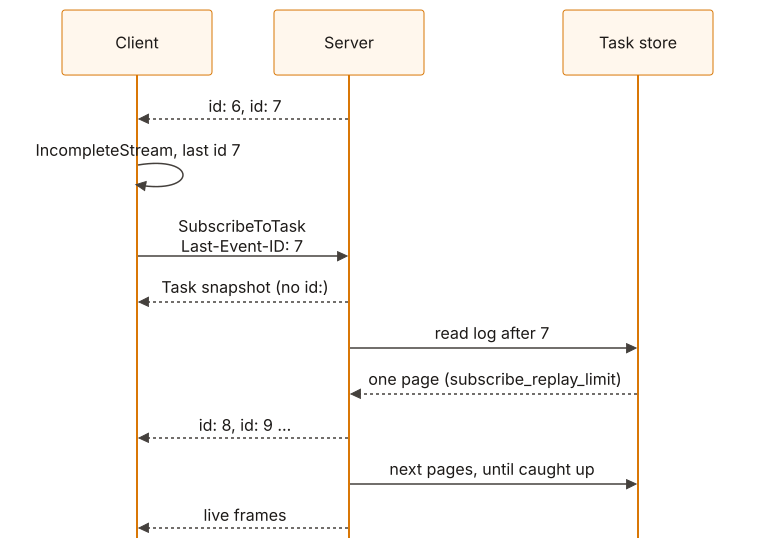
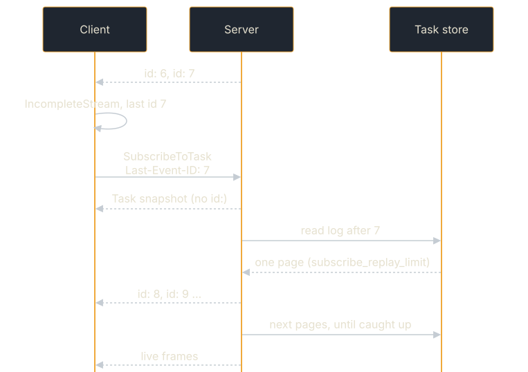

<!-- SPDX-License-Identifier: Apache-2.0 -->
<!-- Copyright 2026 Tom F. <tomf@tomtomtech.net> (https://github.com/tomtom215) -->

# Resubscribing and resuming

This page covers getting a stream back: resubscribing to a task, resuming
from the last event you saw with `Last-Event-ID`, and why the last frame of a
stream always agrees with the store.

## Resubscribing

If a stream disconnects, re-subscribe to an existing task:

```rust,no_run
# use a2a_protocol_sdk::prelude::*;
# async fn f(client: A2aClient) {
let mut stream = client
    .subscribe_to_task("task-abc")
    .await
    .expect("resubscribe");
# }
```

The server creates a new broadcast subscriber and immediately emits a `Task`
snapshot as the first event, allowing the client to recover the current state.
Multiple SSE connections can be active simultaneously for the same task — each
receives all events published after it subscribes. A reader that falls behind
by more than the queue capacity catches up from the task's event log; only when
the log cannot supply what it missed does its stream end with a `streamLagged`
error frame. Either way it never blocks other readers or the writer; after a
`streamLagged`, resubscribe with `subscribe_to_task_from` to continue.

> **Terminal tasks:** Subscribing to a task in a terminal state
> (`Completed`, `Failed`, `Canceled`, `Rejected`) returns an
> `UnsupportedOperation` error immediately. No stream is opened: on JSON-RPC
> the answer is a plain `application/json` error response (see
> [Errors on the wire](./client.md#errors-on-the-wire)).

> **Parked tasks:** Subscribing to a task that is waiting in `INPUT_REQUIRED`
> or `AUTH_REQUIRED` keeps the stream open. By default the server sets no idle
> bound (`HandlerLimits::with_subscribe_max_idle` sets one). When the next
> turn starts, the stream carries that turn's events, replayed from the event
> log if the turn ran before the stream noticed it.

## Resuming from where you left off

With `a2a-protocol-client`, a broken stream tells you: `next()` yields
`ClientError::IncompleteStream` when the body ends before the stream's final
event, carrying the last `id:` received (also available as
`EventStream::last_event_id()`). Pass it to
`client.subscribe_to_task_from(task_id, id)`, which sends it as
`Last-Event-ID` on JSON-RPC and HTTP+JSON. The wire contract underneath:

A snapshot tells you where the task *is*, not what happened while you were
disconnected. An agent that emitted three progress updates during the outage
folds them into one state, and a client polling or resubscribing sees one.

Every frame carrying an event the agent emitted therefore also carries an SSE
`id:`, which is that event's position in the task's event log:

```text
id: 7
event: message
data: {"statusUpdate":{"taskId":"task-abc", ...}}
```

Send the last one you saw back as `Last-Event-ID` on the resubscribe, and the
server replays the log from exactly there — after the snapshot, before the
live stream:

```text
POST /tasks/task-abc:subscribe
Last-Event-ID: 7
```

<figure class="diagram">
<a href="../../images/diagrams/con-stream-resume.light.svg"></a>
<a href="../../images/diagrams/con-stream-resume.dark.svg"></a>
<figcaption>Resuming after a dropped stream: snapshot, replay in pages, then live.</figcaption>
</figure>

Details worth knowing:

- **The offset is exclusive.** `Last-Event-ID: 7` returns 8 onward. `0` asks
  for the whole history.
- **Frames without an `id:` are not in the log.** The `Task` snapshot and the
  terminal frame the server rebuilds from stored state are server-synthesized
  rather than agent-emitted, so they carry no position and do not move your
  offset.
- **Each read of the log is bounded** by `HandlerLimits::subscribe_replay_limit`
  (default 1,000). A longer replay is read a page at a time, each page
  delivered before the next is read, so `Last-Event-ID: 0` delivers the whole
  retained history on one connection. Memory stays bounded by the limit, not
  by the history.
- **It needs a store that keeps a log.** Every store this crate ships does
  (`TaskStore::supports_event_log`). A custom store that does not gets the
  snapshot and the live stream, which is the behaviour from before resumption
  existed — the header is ignored rather than refused.
- **A malformed `Last-Event-ID` is ignored**, not rejected, so echoing back an
  id from an unrelated stream costs you a replay, not the connection.

## The terminal frame is the stored one

Every frame but the last is broadcast as soon as the agent emits it, without
waiting for the store. The frame carrying a terminal state is held until the
server has persisted it (bounded by the queue's write timeout, 5 s by
default), and it goes out as the store ruled: the agent's own frame when it
persisted, or the state the store already holds when another writer finished
the task first — a `CancelTask` handled by another replica, typically. The
log records the same frame at that position, so a resumed stream ends the way
the live one did, and a `GetTask` made after reading the terminal frame
agrees with it. If the store has not answered within the timeout, the frame
goes out as the agent wrote it, which is how every frame behaved before.

The trade is latency on that one frame: it now waits for the store write, and
for the processing of any events queued ahead of it.
