<!-- SPDX-License-Identifier: Apache-2.0 -->
<!-- Copyright 2026 Tom F. <tomf@tomtomtech.net> (https://github.com/tomtom215) -->

# Running More Than One Replica

Two replicas behind a load balancer sharing a database is the first
architecture most people reach for, and until recently this book said nothing
about it. Most of what follows is measured by
`crates/a2a-protocol-server/tests/multi_replica.rs`, which runs two handlers
over one PostgreSQL instance; turn claims by `tests/turn_claims/` (two
handlers over one SQLite file or one PostgreSQL database) and
`tests/replica_processes.rs` (separate OS processes, one of them killed
mid-turn); the cancel rows by `tests/cross_replica_cancel/`, the lost-save row
by `tests/stale_write_position/`, the schema lock by
`tests/postgres_store_tests.rs`, and the load figures by
`tests/soak_multi_replica.rs`. Where something does not work, there is a test
pinning that too — so if a future release changes it, the test fails rather
than this page quietly becoming wrong.

## The short version

| Behaviour | Across replicas | What makes it so |
|---|---|---|
| Replicas can start together against an empty database | **Yes** | Schema creation takes one advisory lock |
| A task created on one replica is readable on another | **Yes** | The store holds it |
| `GetTask` / `ListTasks` see every replica's tasks | **Yes** | Same |
| A subscription terminates when the task finishes elsewhere | **Yes** | The reattach hook polls the store |
| A subscriber sees intermediate events from another replica | **Yes, up to a poll late** | The reattach hook replays them from the store's event log |
| Rate limiting enforces the configured limit | **Only with a shared counter** | Otherwise each replica counts alone |
| A second send to a running task is refused | **Yes** | The turn's claim, a row in the shared database ([Continuations and cancellation](./horizontal-scaling/turn-claims.md)) |
| A continuation of a parked task starts from what the last turn stored | **Yes** | It waits for the claim, then reads the task again |
| A task one replica finished stays finished | **Yes** | The store refuses to move a terminal task |
| `CancelTask` stops an executor running on another replica | **Within about a second** | The cancel marks the turn's claim; the owner's next renewal (every second) fires the executor's token. With `with_halt_store(PostgresHaltStore)` it is also pushed at once (ADR 0024) |
| A continuation's save keeps what another replica's turn wrote meanwhile | **Yes** | The claim serialises the turns; without claims it loses it (`tests/stale_write_position`) |
| A replica that dies mid-turn holds its tasks | **For one claim time to live (15 s)** | Then the next send takes the claim over and continues the task |
| A replica that stalled past its claim writes over the task's next turn | **No** | Every write of a turn is fenced by its claim's token |
| A halt (`halt` / `resume`) stops every replica | **Only with a halt store** | `with_halt_store(PostgresHaltStore)` writes and pushes it (ADR 0019, 0024); without one it holds in one process |
| A delegated child stops when the agent that delegated it goes quiet | **Only with a lease store** | `with_lease_store(PostgresLeaseStore)` keeps the deadline where every replica reads it, so a renewal on any replica counts (ADR 0020) |

The halt and lease rows are covered in [Human oversight](./oversight.md).

Sharing a task store gets you most of the way, and with the bundled SQL
stores it gets you all of it except rate limiting, which needs a shared
counter, and streaming latency, which is up to a poll late across replicas.

**What is supported.** One replica, or several sharing a PostgreSQL database
(or several processes on one host sharing a SQLite file), with **no session
affinity**: each turn of a task claims it in the database, so two replicas
never run one task at once ([Continuations and cancellation](./horizontal-scaling/turn-claims.md)). Before turn claims (2026-10-28) the
shared store did not do this, and the guidance was to route every turn of a task to one replica;
affinity still saves a cross-replica stream its poll, but it is no longer what
keeps tasks correct, and an upgrade from 0.15 does not need it either
([below](#upgrading-a-fleet-to-this-release)).

<figure class="diagram">

<figcaption>What replicas share and what they do not. Event queues stay in the process running the task; everything else that must agree across replicas lives in the database.</figcaption>
</figure>

## Which page do I need

| You want to | Read |
|---|---|
| Point every replica at one database, and survive it restarting or a pooler in front | [Sharing the store](./horizontal-scaling/shared-stores.md) |
| Make a rate limit hold across replicas | [A shared rate-limit counter](./horizontal-scaling/rate-limiting.md) |
| Know what a client streaming from the wrong replica sees | [Streaming across replicas](./horizontal-scaling/streaming.md) |
| Understand how one task runs on one replica at a time, and how a cancel reaches it | [Continuations and cancellation](./horizontal-scaling/turn-claims.md) |
| Know how it behaves under load, and stop the `tasks` table growing | [Sustained load and table growth](./horizontal-scaling/sustained-load.md) |
| Replace 0.15 replicas with this release | [Upgrading a fleet](#upgrading-a-fleet-to-this-release), below |

## Upgrading a fleet to this release

Replace replicas one at a time, in any order, with no session affinity: a
Kubernetes `RollingUpdate` as it comes. Replicas on 0.15.1 or earlier take no
claims and fence no writes, so on PostgreSQL the database keeps them and the
new replicas off each other's turns (`store::claim::upgrade`):

- **Every write a new replica makes is marked** with a setting local to its
  transaction (`a2a.claims`), in the statement itself. A trigger on `tasks`,
  `task_events`, `tenant_tasks` and `tenant_task_events` checks every
  unmarked write, which is an old replica's.
- **An old replica cannot write a task a new replica is running.** Its write
  is refused (SQLSTATE `A2A01`, "task … is running on a replica that takes
  turn claims"), and its client gets an internal error for that send; the
  task goes on, on the new replica. A cancel is the exception: it wins, as a
  cancel between new replicas does, and marks the new replica's claim so its
  executor stops within about a second.
- **A new replica waits for an old replica's turn.** An old replica's write
  that leaves a task `submitted` or `working` claims it, and a new replica
  waits for that claim as it waits for another new replica's, then refuses
  the send as "already being processed". A write that leaves the task
  anywhere else (parked, finished) releases it, so the next turn runs at once
  and starts from everything the old turn stored. An old replica killed
  mid-turn holds its task for 5 minutes after its last write
  (`ALTER DATABASE … SET a2a.legacy_claim_ttl = '1 minute'` changes it).
- **Neither acts on a stale view of the other**: both take one lock per task
  (`pg_advisory_xact_lock`) before they look.

The first new replica installs this when it starts (or `PgMigrationRunner`
does, as migration 9); old replicas keep running against the migrated
database, since they skip migrations they do not know. Once the last old
replica is gone nothing is left to do: a marked write skips the triggers in
their `WHEN` condition, without calling them. Measured with the soak on
[Continuations and cancellation](./horizontal-scaling/turn-claims.md#what-it-costs), direct to the database, three 30 s runs each way: 334 ± 31 pairs/s with the
triggers, 344 ± 41 with them disabled, a difference three runs cannot tell
from noise.

What it does not cover:

- **Two old replicas on one task**, which 0.15 did not cover either. If your
  0.15 fleet ran with session affinity, as 0.15 required, keep it until the
  last old replica is gone; the new replicas do not need it.
- **SQLite.** It has no per-session setting a trigger can read. Processes
  sharing one SQLite file are on one host: replace them together.
- **SQL of your own** that writes those tables is treated as an old replica's
  unless it runs `SET LOCAL a2a.claims = 'on'` first.

Measured, 2026-10-28, against a real 0.15.0 replica: the same program built
twice, once against tag `v0.15.0` and once against this release, both on one
PostgreSQL 17 database, the old one started first. A task the new replica ran
could not be written by the old one (its send got `-32603`, and the stored
task was unchanged); a cancel sent to the old replica stopped the new
replica's executor 1.01 s later; a continuation sent to the new replica while
the old one ran the task was refused after its 5 s wait; and a task the old
replica parked continued on the new one in 0.03 s with both of the old turn's
artifacts. With the triggers disabled, the same run failed three of those
four: the old replica overwrote the running task, the cancel never reached
the new executor, and the new replica ran a second turn at once.
`tests/turn_claims/upgrade.rs` replays 0.15.0's own statements, copied from
the tag, for the same cases, and checks that every write this release makes
is marked.

## What is still unevidenced

`tests/replica_processes.rs` runs replicas as separate processes over one
database, and kills one; the tests otherwise run two handlers in one
process. Everything here ran on one machine: the latency and the partitions
these pages report are toxiproxy's on loopback, not a real network, and no managed
database's failover has been tried.

Running through PgBouncer has been tested; see
[Behind PgBouncer](./horizontal-scaling/shared-stores.md#behind-pgbouncer).

If you are running this at scale and have measurements, they would be
welcome.
