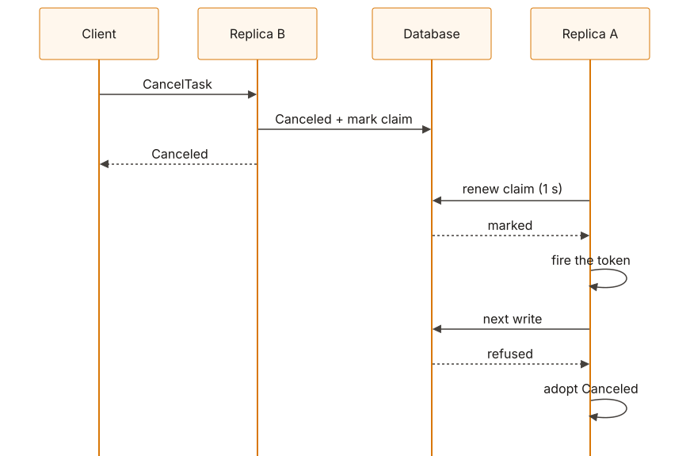
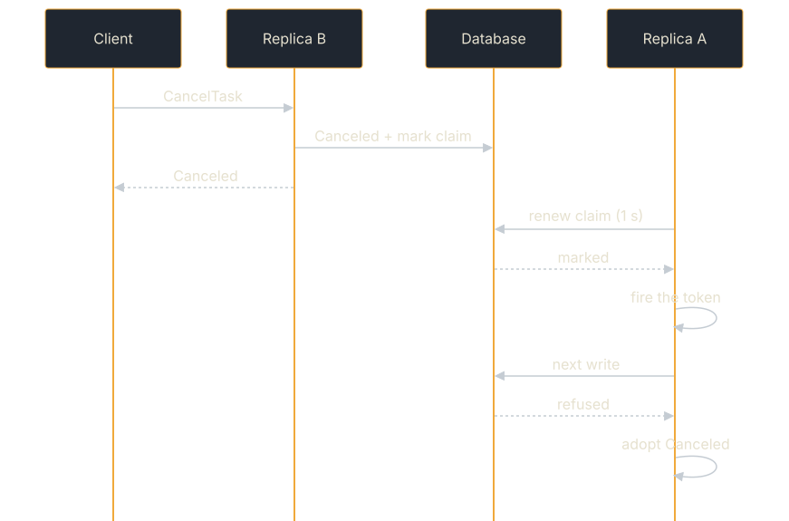

<!-- SPDX-License-Identifier: Apache-2.0 -->
<!-- Copyright 2026 Tom F. <tomf@tomtomtech.net> (https://github.com/tomtom215) -->

# Continuations and Cancellation

How several replicas keep one task to one turn at a time, what that costs,
how it behaves when the network to the database fails, and how a cancel
taken by one replica stops an executor running on another.

## One turn of a task at a time, on whichever replica

Within one replica, a second `SendMessage` naming a task whose executor is
still running is refused, and a continuation of a task parked at
`input-required` waits for the turn that parked it to store its last events.
Both decisions read state the replica keeps in memory, so on their own they
did not cross replicas: before turn claims a continuation that reached replica B
while the task's turn ran on replica A was admitted, B started a second
executor, and B's save replaced what A stored after B read the task.

**Turn claims** close it. The PostgreSQL and SQLite stores (plain and
tenant-aware) keep a table, `a2a_task_claims`, in the same database as the
tasks, and the handler takes a row in it for each turn:

1. **A send claims its task** once it knows which task that is, after an
   idempotent replay has been answered (so a retried send replays rather than
   waits). The row names this replica (`HOSTNAME`, the process id and a random
   suffix; `with_replica_name` overrides the first) and a random token for the
   turn.
2. **A claim another turn holds is waited for**, for up to
   `executor_drain_timeout` (5 s by default), the same bound the in-process
   wait for a parked turn has. If it is still held then, the send is refused
   exactly as on the replica running the task: `UnsupportedOperation`, "task …
   is already being processed". A send that waits gives up its idempotency
   key for the wait and claims it again once it holds the turn, so a retry of
   it that reaches a third replica meanwhile is not answered "accepted" for a
   send that is then refused: the retry claims the key and waits its own turn,
   and the first of the two to hold the turn runs while the other replays it.
3. **A continuation reads the task again** once it holds the claim, and starts
   from that read, so it keeps everything the last turn stored, wherever that
   turn ran.
4. **The claim is released when the turn's last write is done**: the
   executor's future and its event consumer (the background processor, or a
   blocking send's collector) both hold it, and it is deleted when the last of
   them ends.
5. **Every write a turn makes carries its token**, and the store refuses it,
   in the same statement, unless the token still holds a claim. A replica that
   stalled for longer than the claim's time to live (a long pause, a partition
   from the database) and wakes up after another replica took the task over
   is refused on its first write; its executor is then cancelled and it writes
   nothing more (`ClaimLost`). On PostgreSQL the check locks the claim row
   (`FOR KEY SHARE`). Without the lock, under READ COMMITTED, a write that
   started before a takeover and then waited on the task row was checked
   against the claim as it stood when the statement began, passed, and landed
   over the new turn's write (reproduced with two `psql` sessions). Renewals
   and cancel marks change no key column and never wait on the lock.
6. **A replica renews the claims it holds** every second, in one statement
   naming each one, while it holds any. A claim it no longer tracks (a release
   the database did not answer, a request dropped while its claim was being
   written) is not renewed and expires. A replica that dies stops renewing;
   after the time to live (15 s by default) the next send for one of its tasks
   takes the claim over and continues the task, which is still `Working` in
   the store. That is the longest a task waits after its replica dies.
7. **A replica that shuts down releases its claims** (`shutdown`,
   `shutdown_with_timeout`), so a rolling restart does not hold its tasks for
   the time to live. An executor still running then has its next write
   refused, as after a takeover.

`with_turn_claim_timing(ttl, renewal)` changes the two durations; `build`
refuses a time to live under 3 s, or a renewal interval that is not at most a
third of it. `without_turn_claims()` turns them off, for a store only one
replica uses: each turn then saves its two statements (the claim and its
release) and the renewal. A custom store several replicas share provides
claims by overriding `TaskStore::turn_claims` and fencing its writes with
`store::claim::current_fence` ([Stores shared by replicas](../../building-agents/stores/replicas.md#turn-claims-one-replica-at-a-time-per-task)), or is
given them with `with_turn_claims`. `build` refuses `with_turn_claims` over a
store that has claims of its own, the bundled ones included: their writes are
fenced against their own table, so claims kept anywhere else would refuse
every write.

An approval toward a quorum (`with_approval_gate`, `with_quorum`) is counted
under the claim, so two approvals arriving at two replicas at once are
counted one after the other and the executor resumes once.

## What it costs

`tests/soak_multi_replica.rs`: two replicas, one
PostgreSQL 17 database, eight clients each sending a new task to one replica
and reading it from the other, release build, one 4-vCPU Linux container,
2026-10-28. The database was reached directly, then through toxiproxy 2.12.0
adding latency each way; the round trip is what was measured on the link
(the smallest of 20 PostgreSQL SSL-request exchanges), not what was set.
Three 30 s runs per row, alternating (the first run of the 1 ms row with
claims overlapped a compile and was run again):

| Round trip to the database | With claims | Without | Median per pair, with / without |
|---|---|---|---|
| direct | 532 ± 11 pairs/s | — | 14.6 ms |
| 1.0 ms (proxy alone) | 390 ± 13 | 443 ± 13 | 19.8 / 17.4 ms |
| 2.8 ms | 166 ± 1 | 181 ± 8 | 48.5 / 43.7 ms |
| 11.2 ms | 54 ± 0 | 59 ± 0 | 148 / 134 ms |

The claim adds one to two round trips to a turn (2.4 ms at 1.0 ms, 4.8 ms at
2.8 ms, 13.4 ms at 11.2 ms): 8% to 12% fewer pairs. What dominates on a real
network is the rest of the send path, so put the database close to the
replicas. Counted at the wire (a proxy logging each time the client waited
on the server), a send that starts a task and a read of it make 8
statements, a send that continues one and a read 11; each is followed by
the ping sqlx makes as the connection returns to the pool, off the request's
path, and a connection idle for a second or more is pinged before it is
used. Both made 45 round trips before 2026-10-28, when the same soak
measured 334 ± 31 pairs/s direct, 238 ± 3 at 1.2 ms, 67 ± 1 at 2.6 ms and
21 ± 1 at 11.1 ms, with claims. Every claim was released by the end of
every run, and no run had a failed request or a task one replica could not
read from the other.

What the stores do when the database drops a connection mid-turn is on
[Sharing the store](./shared-stores.md#when-a-connection-drops).

## When the network fails

Measured 2026-10-28, with two replicas as separate processes,
each reaching PostgreSQL through its own toxiproxy link, default timing:

- Cut the running replica's link for 5 s, under the claim's 15 s time to
  live: a continuation sent to the other replica meanwhile was refused after
  its 5 s wait; when the link came back the turn went on writing (its
  artifact grew from 5 parts to 23 in the next 9 s, none lost), and a cancel
  sent to the other replica stopped its executor 0.71 s later.
- Cut it for 20 s, past the time to live: the other replica ran a
  continuation 16.1 s after the cut, to `completed`; the cut-off replica's
  executor, still running, had every write refused once its link was back (the
  artifact stayed at the 4 parts it had at the takeover), and was stopped on
  its first renewal, about 2.5 s after the link returned.
- Restart PostgreSQL mid-turn: the turn went on writing once the database was
  back (5 parts before, 15 five seconds after it was ready).

## Cancelling a task that runs elsewhere

`CancelTask` can arrive at any replica. On replica B, for a task whose
executor runs on replica A:

1. B finds no executor of its own to signal. It calls its own executor's
   `cancel` (so an override that releases in-process resources releases B's,
   not A's), writes `Canceled`, and answers the client `Canceled`.
2. B marks A's claim on the task. A's next renewal, within about a second,
   reads the mark and fires the executor's cancellation token. With a halt
   store (`with_halt_store(PostgresHaltStore)`) the cancel is also pushed to A
   at once (ADR 0024).
3. Whatever A's executor writes after B's `Canceled` is refused by the store,
   because the task is terminal in another state. From that refusal A
   **cancels its executor's token** (if the renewal has not already),
   adopts the stored task, and stops writing, pushing and logging the
   executor's events. A client streaming from A ends on `Canceled`, not on
   whatever A's executor emitted; a blocking `SendMessage` waiting on A is
   answered with the `Canceled` task; A delivers `Canceled` to the task's
   webhooks, which nothing else would, because B has no processor for the
   task.

The client B answered is therefore never contradicted: before this was
enforced, all three stores let A overwrite `Canceled` with `Completed`, and
`tests/cross_replica_cancel/` reproduced it on each.

<figure class="diagram">

<figcaption>A cancel taken by replica B for a task running on replica A, which still runs it. With a halt store the cancel is also pushed to A at once.</figcaption>
</figure>

What this does **not** give you:

- **A clean stream on A.** Non-terminal frames A's executor emitted between
  the cancel and its next write still reach a client streaming from A —
  though never the store. The terminal frame is held until the store has
  ruled on it, so the ending is right.
- **An executor that honours the token.** Cancellation is cooperative. An
  executor that ignores `RequestContext::cancellation_token` keeps running on A
  until it returns, with its writes refused.
