<!-- SPDX-License-Identifier: Apache-2.0 -->
<!-- Copyright 2026 Tom F. <tomf@tomtomtech.net> (https://github.com/tomtom215) -->

# Observability

Three signals, often confused: **logs** say what happened in one request,
**traces** say how one request travelled — through this agent and every agent
it called — and **metrics** say what is happening across all of them. This SDK
records all three, and all of it is on by default: spans and metrics are
recorded through the OpenTelemetry API (the `otel` feature), and the SDK crate
ships the OTLP exporter (`otlp`). What stays the application's choice is where
they go. `Telemetry` builds one exporter per signal from the standard `OTEL_*`
environment, and `Telemetry::install_subscriber` makes the process say, on
standard error, where each signal goes or that nothing is exported.

If you see no metrics, the answer is almost always the
[quick start](#quick-start-pick-your-deployment) below or
[Debugging telemetry](./observability/debugging.md).

<figure class="diagram">
<a href="../images/diagrams/obs-pipeline.light.svg"></a>
<a href="../images/diagrams/obs-pipeline.dark.svg"></a>
<figcaption>Where telemetry goes: the Collector path the compose stack runs, and the alternatives to it.</figcaption>
</figure>

## Which page do I need

| You want to | Read |
|---|---|
| Turn telemetry on for your environment: laptop, Docker, Kubernetes | [Quick start by environment](./observability/quick-start.md) |
| See every signal end to end on your machine, with dashboards | [Walkthrough: the local stack](./observability/walkthrough.md) |
| Configure `Telemetry` in code: features, builder, subscriber, shutdown | [Configuring `Telemetry`](./observability/telemetry.md) |
| Look up an `OTEL_*` variable, its builder method and which one wins | [Environment variables](./observability/environment.md) |
| Name the service and tell replicas apart | [Resource attributes](./observability/resource.md) |
| Export through a proxy, to a private CA, or compressed | [TLS, proxies and compression](./observability/tls-proxies.md) |
| Get the metrics into Prometheus, by scrape or by push | [Prometheus](./observability/prometheus.md) |
| Know a metric's attributes, label values, buckets or Prometheus name | [Metrics reference](./observability/metrics.md) |
| Know what a span is called and what it carries | [Spans reference](./observability/spans.md) |
| Follow one request across several agents | [Distributed tracing across agents](./observability/trace-context.md) |
| Export logs, filter them, link them to traces | [Logs](./observability/logs.md) |
| Use the shipped Grafana dashboards, alerts and recording rules | [Dashboards, alerts and recording rules](./observability/dashboards.md) |
| Find out why nothing arrives | [Debugging telemetry](./observability/debugging.md) |
| Send traces to Langfuse | [Langfuse](./langfuse.md) |

## Quick start: pick your deployment

The code is the same everywhere; the environment changes. This is what
`hello-agent` does:

```rust,no_run
use a2a_protocol_sdk::prelude::*;

# async fn serve(dispatcher: JsonRpcDispatcher) -> Result<(), Box<dyn std::error::Error>> {
let telemetry = Telemetry::builder()
    .with_default_service_name("my-agent") // OTEL_SERVICE_NAME wins over it
    .with_export_where_configured()        // export only what the environment names
    .build()?;
telemetry.install_subscriber(); // warnings to stderr, and one line saying where each signal goes

let server = Server::bind("0.0.0.0:3000").await?;
server.serve_with_shutdown(dispatcher, shutdown_signal()).await; // returns on SIGTERM or Ctrl-C
// `telemetry` is dropped as this function returns, and that flushes.
# Ok(())
# }
```

Then set the environment for where the agent runs:

| Where | Set |
|---|---|
| Your machine, no collector | Nothing: nothing is exported, and the startup line says so. `OTEL_TRACES_EXPORTER=console` (and `OTEL_METRICS_EXPORTER`, `OTEL_LOGS_EXPORTER`) prints a signal on standard output |
| The whole stack on your machine | `docker compose -f deploy/observability/docker-compose.yml up -d`, then `OTEL_EXPORTER_OTLP_ENDPOINT=http://localhost:4318`; Grafana is on `http://localhost:3001` |
| A collector on your machine | `OTEL_EXPORTER_OTLP_ENDPOINT=http://localhost:4318` (OTLP/HTTP); for gRPC, port 4317 and `OTEL_EXPORTER_OTLP_PROTOCOL=grpc` |
| Docker | The collector's service name on a shared network (`http://otel-collector:4318`), or `http://host.docker.internal:4318` |
| Kubernetes | The collector's Service, and a per-pod `service.instance.id` from the downward API |
| HTTPS, a private CA, mutual TLS | `https://` in the endpoint; `OTEL_EXPORTER_OTLP_CERTIFICATE` for a private CA |
| Behind a proxy | `HTTPS_PROXY` / `HTTP_PROXY`, and `NO_PROXY` for an in-cluster collector |
| Prometheus scraping the pod | Build with `otel-prometheus`, set `OTEL_METRICS_EXPORTER=prometheus` and `OTEL_EXPORTER_PROMETHEUS_HOST=0.0.0.0` |

[Quick start by environment](./observability/quick-start.md) has each of
these in full, with the Kubernetes manifest block, what a clean shutdown costs,
and what each recipe was run against.

## The catalogue

The instruments the server records for its calls, its handler and its task
stores, with their units (the client's call metric and the card, webhook and
tool-loop instruments are in the [Metrics reference](./observability/metrics.md)).
These are the names 0.15 ships; `STABILITY.md` does not list metric names as
stable, so a rename is announced in the CHANGELOG, as 0.15's was.

| Metric | Type | Unit | Meaning |
|---|---|---|---|
| `rpc.server.call.duration` | histogram | s | Every inbound call, on every binding, by method and outcome |
| `a2a.server.requests` | counter | `{request}` | Inbound A2A requests |
| `a2a.server.responses` | counter | `{response}` | Outbound A2A responses |
| `a2a.server.errors` | counter | `{error}` | Request errors |
| `a2a.server.request.duration` | histogram | s | Request duration (named `a2a.server.latency` before 0.15) |
| `a2a.server.queue_depth` | gauge | `{queue}` | Active event queues |
| `a2a.server.persistence_errors` | counter | `{error}` | Store writes that failed |
| `a2a.server.store_retries` | counter | `{retry}` | Store operations run again after a failure that passed, by `operation` and `cause` (`unavailable`: the store said not now; `connection_lost`: a PostgreSQL statement ran again on a new connection) |
| `a2a.server.push_deliveries` | counter | `{delivery}` | Push attempts, by `outcome` |
| `a2a.server.pool.active` | gauge | `{connection}` | In-use HTTP connections |
| `a2a.server.pool.idle` | gauge | `{connection}` | Idle HTTP connections |
| `a2a.server.pool.created` | counter | `{connection}` | Connections created since start |
| `a2a.server.pool.closed` | counter | `{connection}` | Connections closed on error or timeout |
| `db.client.operation.duration` | histogram | s | Each operation of a task store that names its database, by `db.operation.name` and outcome |
| `a2a.server.executor.duration` | histogram | s | How long an agent executor's run took, by `outcome` (`completed`, `error`, `budget_exhausted`, `canceled`, `aborted`); the run, which usually outlives the call that started it |

Each instrument's attributes, their possible values, its histogram buckets and
its Prometheus name are in the [Metrics reference](./observability/metrics.md),
together with the client, GenAI, agent-card and webhook instruments and what is
not measured.

## The dashboards

[`deploy/observability/`](https://github.com/tomtom215/a2a-rust/tree/main/deploy/observability)
ships three Grafana dashboards — **A2A server**, **A2A client** and
**A2A agents: GenAI** — with 13 Prometheus recording rules and 8 alerts built on
the metrics above, `promtool` tests for every alert, and a Compose file that
starts a Collector, Prometheus, Tempo, Loki and Grafana with all of it
provisioned.


[Dashboards, alerts and recording rules](./observability/dashboards.md)
describes every panel, every alert and what it means when it fires, and every
recording rule; [Walkthrough: the local stack](./observability/walkthrough.md)
takes you from `docker compose up` to a dashboard with data, a trace in Tempo
and the log lines written inside it.

## History

What changed in the 0.15 line, for a reader comparing with an older
deployment. The renames and changed defaults that need action are in the
[upgrade guide](../reference/upgrading.md#014--015); this list is the rest.

* **0.15.0.** Export is on by default in `a2a-protocol-sdk`: `otel` and `otlp`
  are default features (before 0.15, `otel` carried the exporter and was not a
  default). A handler given no `with_metrics`, and the client's
  `rpc.client.call.duration`, record to the global meter provider as it stands
  at each measurement; before 0.15 such a handler recorded nothing until given
  `with_metrics`, and the client histogram recorded nothing all its life. A
  streaming call is measured until its stream ends; before, it was timed only
  up to the stream being established and recorded as a success whatever the
  stream did next. A WebSocket call's span is a root of its own with a span
  link to the upgrade; before, every call on a connection was a child of the
  upgrade. The finish reason is the span attribute
  `gen_ai.response.finish_reasons`; before, it was a `finish_reason` inside
  the output message. `a2a.server.executor.duration` exists; before, only the
  `invoke_agent` span's duration showed the run. Units are UCUM
  (`{request}`, where they were bare words such as `request`); the Prometheus
  names did not change, because the exporter translates neither form.
* **0.15.1.** New, and absent from 0.15.0: proxy support, gzip compression,
  the `console` and `prometheus` exporters, resource detection,
  `OTEL_PROPAGATORS`, `Telemetry::describe` and `notices`, the printed startup
  line and lost-export warnings (with the transport's cause, and a hint where
  the failure names the fix), the percent-decoding of
  `OTEL_RESOURCE_ATTRIBUTES`, and `shutdown_signal`. Before 0.15.1 a lost
  export was silent (with `hello-agent` pointed at a port nothing listened on,
  nine seconds produced no output at all), `OTEL_EXPORTER_OTLP_COMPRESSION` was
  ignored without a word, an OTLP/HTTP endpoint without a scheme failed as
  "invalid format", and no proxy variable was read, so a process with
  `HTTP_PROXY` set exported direct.

See also [Troubleshooting](./troubleshooting.md) for the symptom-first version
of this chapter, and [Production Hardening](./production.md) for health checks.
