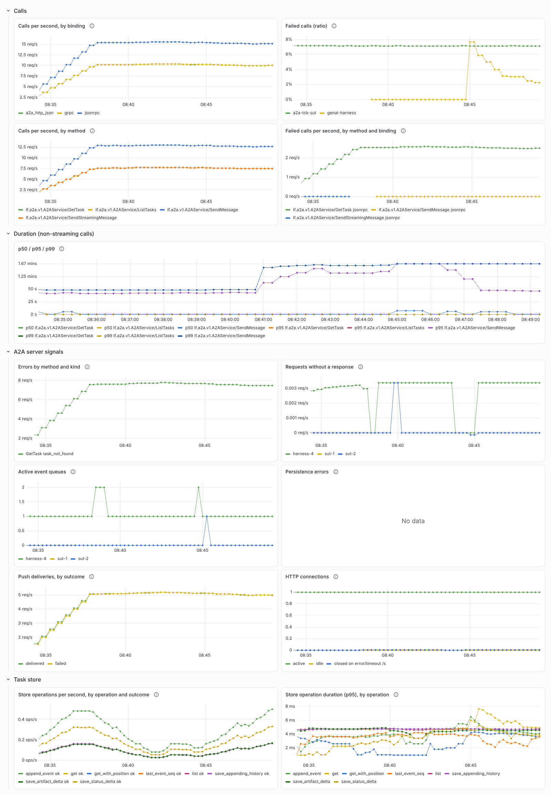
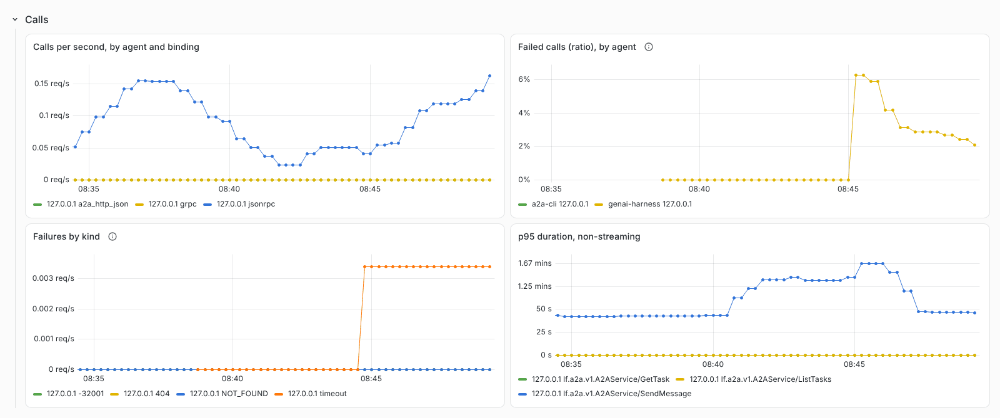
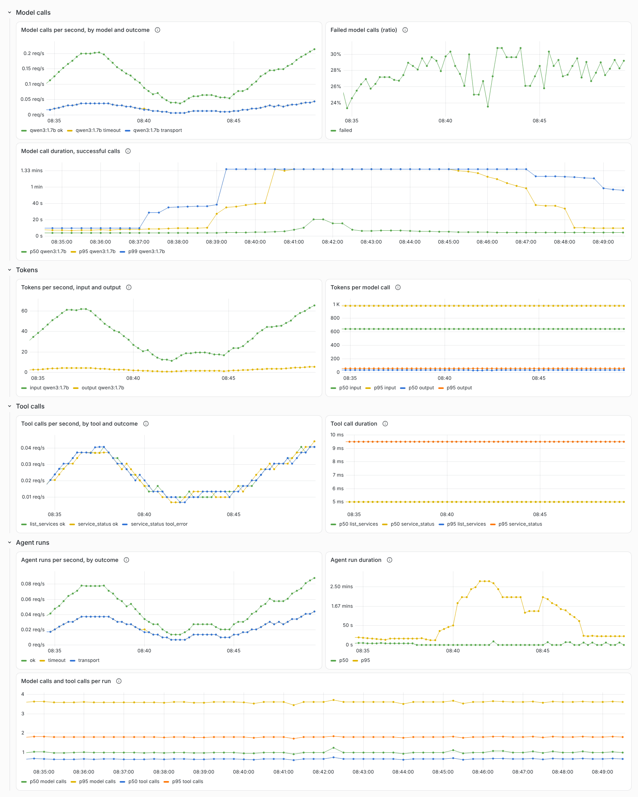

<!-- SPDX-License-Identifier: Apache-2.0 -->
<!-- Copyright 2026 Tom F. <tomf@tomtomtech.net> (https://github.com/tomtom215) -->

# Dashboards, alerts and recording rules

[`deploy/observability/`](https://github.com/tomtom215/a2a-rust/tree/main/deploy/observability)
ships what turns the [metrics](./metrics.md) into something to watch: three
Grafana dashboards, 13 Prometheus recording rules, 8 alerts with `promtool`
unit tests, and the provisioning that loads them. This page describes each
panel, each alert and what to do when it fires, and each recording rule. To
run them, see [Walkthrough: the local stack](./walkthrough.md).

| File | What it is |
|---|---|
| `grafana/dashboards/a2a-server.json`, `a2a-client.json`, `a2a-genai.json` | The three dashboards, folder "A2A", data source uid `a2a-prometheus` |
| `grafana/provisioning/dashboards/a2a.yml`, `datasources/prometheus.yml` | Dashboard and Prometheus data source provisioning; set `A2A_DASHBOARDS_DIR` and `PROMETHEUS_URL` (both are required: unset, Grafana substitutes an empty string and the dashboards or the data source are missing) |
| `grafana/provisioning/traces-and-logs.yml` | Tempo and Loki data sources, linked both ways; set `TEMPO_URL` and `LOKI_URL` |
| `prometheus/rules/a2a-recording.yml` | The 13 recording rules |
| `prometheus/rules/a2a-alerts.yml` | The 8 alerts |
| `prometheus/tests/a2a-alerts.test.yml` | `promtool` unit tests: each alert fires on the input it is for and not on a control |
| `scripts/check_dashboards.py` | The live check: rules healthy and recording rules populated; every dashboard query returns data through Grafana's query API (or Prometheus's) |

The rules and dashboards use the names Prometheus gives the metrics on every
supported path ([Prometheus](./prometheus.md)): `job` is the agent's
`service.name` and `instance` its `service.instance.id`.

## The dashboards

Every panel on the server and GenAI dashboards, and two of the four on the
client dashboard, carries a description of what it shows; hover the ⓘ beside
its title. Each has a `job` variable; the server and GenAI dashboards add
`instance`, the client dashboard `server` (the agent called). The screenshots
are the dashboards as they ship, over 15 minutes of traffic from this
repository's test harness: three tool-loop agents against a local model (one
whose model answers, one whose model is unreachable, one whose model calls
time out), and the `a2a` CLI calling the TCK's agent on every binding with
push notifications to a working webhook and an unreachable one.

### A2A server

| Row | Panels | From |
|---|---|---|
| Calls | Calls per second by binding; failed calls (ratio); calls per second by method; failed calls per second by method and binding | `rpc.server.call.duration` through `a2a:rpc_server_*` |
| Duration (non-streaming calls) | p50 / p95 / p99 by method | `a2a:rpc_server_unary_latency:*` |
| A2A server signals | Errors by method and kind; requests without a response; active event queues; persistence errors by operation and error; push deliveries by outcome; HTTP connections (active, idle, closed per second) | `a2a.server.*` |
| Task store | Store operations per second by operation and outcome; store operation duration (p95) by operation | `db.client.operation.duration` |
| Agent executor | Executor run duration (p50 / p95) by outcome; executor runs per second by outcome | `a2a.server.executor.duration` |

A call with no `rpc.method` (refused before it named one) is shown as
`(unrouted)`. Persistence errors are empty in the screenshot because no store
write failed; the HTTP connections panel needs an agent served by the SDK's
`serve`, `serve_with_addr` or `Server::serve_with_shutdown`.



The screenshot predates the *Agent executor* row, which sits below *Task store*.

### A2A client

Calls per second by agent and binding, failed calls (ratio) by agent,
failures by kind (`error_type`), and the p95 of non-streaming calls, from
`rpc.client.call.duration`.



### A2A agents: GenAI

From the tool loop's `gen_ai.*` metrics:

| Row | Panels |
|---|---|
| Model calls | Model calls per second by model and outcome; failed model calls (ratio); duration of successful calls (p50 / p95 / p99) by model |
| Tokens | Tokens per second, input and output, by model; tokens per model call (p50 / p95) |
| Tool calls | Tool calls per second by tool and outcome; tool call duration (p50 / p95) by tool |
| Agent runs | Agent runs per second by outcome; agent run duration (p50 / p95); model calls and tool calls per run (p50 / p95) |



**A process that exits after one call cannot feed these panels.** Each series
a short-lived process exports has one or two samples, so `rate()` over it
tapers to nothing within the window, and a ratio over it is undefined. Feed
them from a process that lives at least one window, and confirm its series in
Prometheus before reading the panels
(`count by (job, instance) ({__name__=~"gen_ai.*"})`). A quantile cannot read
above its histogram's top bucket: the server's p99 flattens at 100 s, and the
GenAI model-call p99 at 81.92 s.

## The alerts

`prometheus/rules/a2a-alerts.yml`, group `a2a-alerts`. Thresholds are starting
points: tune `for:` and the ratios to your traffic.

| Alert | Severity | Fires when | What it means |
|---|---|---|---|
| `A2AServerErrorRatioHigh` | warning | `a2a:rpc_server_error_ratio:rate5m > 0.05` for 10 m | More than 5% of a job's calls failed, by the RPC conventions' definition (`error_type` set: every JSON-RPC error, an HTTP 5xx, six server-side gRPC codes) — not `errors / requests`. Split by method and binding with `a2a:rpc_server_errors:rate5m` |
| `A2APersistenceErrors` | critical | `rate(a2a_server_persistence_errors_total[5m]) > 0`, by job and operation, for 1 m | Task writes are failing. A streaming client already received these events, so the stored task and what clients saw have diverged; a later `GetTask` returns the wrong answer |
| `A2ARequestsUnanswered` | warning | `a2a:server_unanswered:rate5m > 0.01` for 15 m | Requests that produced neither a response nor an error: a panicking executor, dropped connections, a process exiting mid-request. The threshold sits above floating-point noise, since the rule is a difference of rates |
| `A2AQueueDepthGrowing` | warning | `deriv(a2a_server_queue_depth[30m]) > 0` and the depth above 100, for 30 m | Each open stream holds a queue; a depth that never comes down is subscribers that stopped reading without disconnecting |
| `A2APushDeliveryTruncated` | warning | Any `timeout_truncated` push delivery over 15 m, for 5 m | `push_delivery_timeout` is shorter than the sender's retry schedule, so deliveries are given up with attempts remaining. A configuration problem: it will not resolve on its own and no webhook reports it |
| `A2APushDeliveryFailing` | warning | `a2a:push_delivery_failure_ratio:rate5m > 0.2` for 15 m | Over 20% of push deliveries failed, timed out or were truncated. Split by outcome with `a2a:push_deliveries:rate5m` |
| `A2AUnaryLatencyHigh` | warning | `a2a:rpc_server_unary_latency:p99_5m > 2.5` for 15 m | The p99 of non-streaming calls, per job and method, is above 2.5 s. A blocking `SendMessage` includes the executor's work: set the threshold per method if your agents run long turns |
| `A2AAgentSilent` | critical | A job with `target_info` in the last day and none from any instance in the last 10 m | The agent, or its exporters, have stopped. Over OTLP there is no scrape and so no `up` series; `target_info` comes with every export |
| `A2AAgentInstancesLost` | warning | Fewer instances of a job sent `target_info` in the last 10 m than in the same 10 m an hour before, for 5 m | An instance stopped and was not replaced, or the job was scaled in |

`A2AAgentSilent` is keyed on the job, so a rollout or a restart, which
replaces instances, does not fire it, and a job that stays down keeps it
firing for a day. Until 2026-10-30 it was keyed on the instance over an
hour: every instance a rollout retired paged, and a fleet that was really
down stopped paging after an hour (audit C-04). `A2AAgentInstancesLost`
compares counts, so it too ignores a rollout; it resolves within the hour,
once the smaller fleet is what the hour before saw. A stable
`service.instance.id` per replica
([Resource attributes](./resource.md#one-identity-per-replica)) keeps a
restart from being a new series.

### What each signal tells you

The alerts above cover these signals:

* **Failed calls** (`A2AServerErrorRatioHigh`). Split by `rpc_method`: a rising
  error rate confined to `SendStreamingMessage` is a different incident from
  one across everything.
* **Persistence errors above zero, at all** (`A2APersistenceErrors`). A store
  write that fails means the task's recorded state and its actual state have
  diverged. Streams recover from loss by refetching; this is the case where
  refetching returns the wrong answer. The alert fires on any non-zero rate
  rather than a threshold.
* **Requests without a response** (`A2ARequestsUnanswered`).
* **Queue depth that does not come down** (`A2AQueueDepthGrowing`).
* **`push_deliveries{outcome="timeout_truncated"}`** (`A2APushDeliveryTruncated`).
  Not a network failure; see the [outcome labels](./metrics.md#the-a2aserver-counters).
* **Push deliveries failing** (`A2APushDeliveryFailing`), **unary latency**
  (`A2AUnaryLatencyHigh`) and **an agent gone silent** (`A2AAgentSilent`).

One signal is worth watching and is **not** covered by a shipped rule or panel:
**`a2a.server.store_retries` rising**. Each retry is a write or statement that
failed once and then succeeded, so nothing was lost; a failover shows as a
burst. A rate that keeps rising is the store degrading before
`persistence_errors` starts counting what it lost. Neither the alert file nor
any dashboard queries `a2a_server_store_retries_total`; if you want it, a rule
in the style of the others is
`sum by (job, operation, cause) (rate(a2a_server_store_retries_total[5m]))`,
with a threshold you choose for your store.

## The recording rules

`prometheus/rules/a2a-recording.yml`, evaluated every 30 s. Every rule is a
five-minute rate. The latency quantiles are over non-streaming calls only,
because a streaming method's duration is its stream's.

| Rule | By | What it is |
|---|---|---|
| `a2a:rpc_server_calls:rate5m` | job, binding, method | Calls per second, from `rpc_server_call_duration_seconds_count` |
| `a2a:rpc_server_errors:rate5m` | job, binding, method | Failed calls per second (`error_type` set) |
| `a2a:rpc_server_error_ratio:rate5m` | job | Failed calls over all calls |
| `a2a:rpc_server_unary_latency:p50_5m` | job, method | p50 of non-streaming calls |
| `a2a:rpc_server_unary_latency:p95_5m` | job, method | p95 of non-streaming calls |
| `a2a:rpc_server_unary_latency:p99_5m` | job, method | p99 of non-streaming calls |
| `a2a:server_unanswered:rate5m` | job, instance | `requests − responses − errors` per second: requests that produced neither (an instance with no errors counts zero errors rather than dropping out) |
| `a2a:server_errors_by_kind:rate5m` | job, method, error | `a2a_server_errors_total` per second |
| `a2a:push_deliveries:rate5m` | job, outcome | Push deliveries per second |
| `a2a:push_delivery_failure_ratio:rate5m` | job | Deliveries not `delivered` over all deliveries |
| `a2a:rpc_client_calls:rate5m` | job, binding, method, agent | Client calls per second, from `rpc_client_call_duration_seconds_count` |
| `a2a:rpc_client_error_ratio:rate5m` | job, agent | Failed client calls over all client calls |
| `a2a:rpc_client_unary_latency:p95_5m` | job, agent, method | p95 of non-streaming client calls |

"Binding" is the `rpc_system_name` label, "method" `rpc_method` (or `method`
on the `a2a_server_*` series), and "agent" `server_address`.

## Testing the rules

```bash
promtool check config deploy/observability/prometheus/prometheus.yml
promtool check rules deploy/observability/prometheus/rules/*.yml
promtool test rules deploy/observability/prometheus/tests/a2a-alerts.test.yml
```

The tests feed each alert the series it is for and check it fires, with a
control for `A2AServerErrorRatioHigh` and `A2AAgentSilent` that must not.
When they were written, each alert's expression was broken in turn (a
threshold, the outcome label, a range) and the tests failed every time (8 of
8 caught); a ninth case proves the unanswered-requests rule subtracts errors.
Against a live stack, `scripts/check_dashboards.py` checks that every rule is
healthy, every recording rule has data and every dashboard query returns data:

```bash
python3 deploy/observability/scripts/check_dashboards.py \
  --grafana http://127.0.0.1:3001 --prometheus http://127.0.0.1:9090 \
  deploy/observability/grafana/dashboards \
  --expect-empty "Persistence errors" "HTTP connections"
```

`--expect-empty` names panels allowed to have no data (no store failed; the
agent did not report connections). `deploy/observability/README.md` records
each run: on 2026-10-23 all 21 rules were healthy and every query returned
data but the two named; on 2026-10-24, with the GenAI agents, every query but
"Persistence errors". Alerts fired live on that traffic:
`A2AServerErrorRatioHigh` (11% of calls were a deliberate task-not-found), and
`A2AAgentSilent` for CLI runs made before they were given an instance id. The
check found two defects before anything was committed: the unanswered-requests
rule first subtracted only responses, which counts every error as unanswered;
and a Collector comment named port 4317 for an exporter that defaults to
HTTP/protobuf on 4318.
