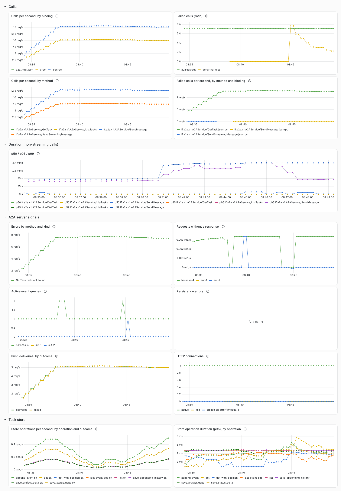
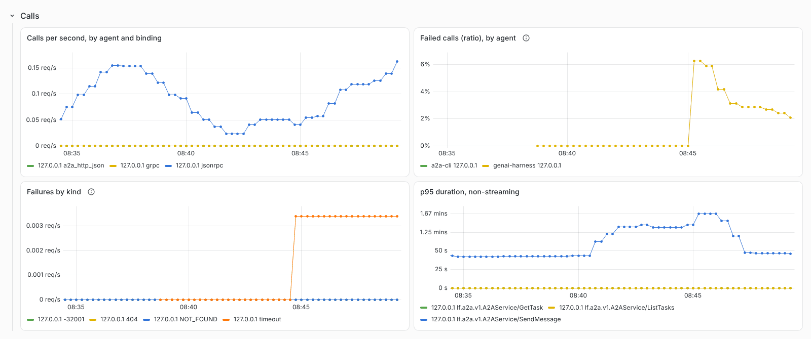
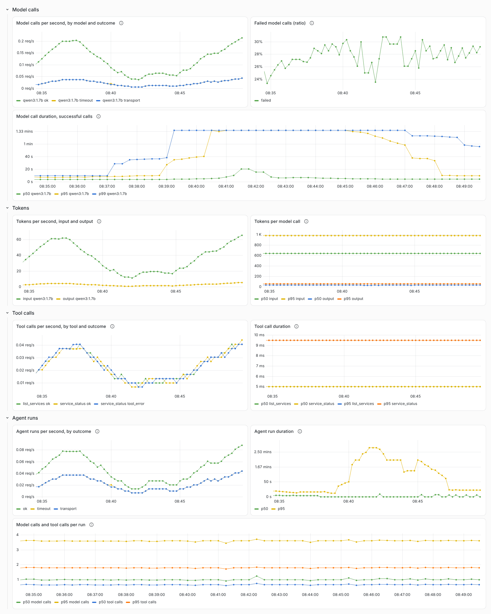

<!-- SPDX-License-Identifier: Apache-2.0 -->
<!-- Copyright 2026 Tom F. <tomf@tomtomtech.net> (https://github.com/tomtom215) -->

# Dashboards, alerts and recording rules

[`deploy/observability/`](https://github.com/tomtom215/a2a-rust/tree/main/deploy/observability)
ships what turns the [metrics](./metrics.md) into something to watch: three
Grafana dashboards, 22 Prometheus recording rules, 20 alerts with `promtool`
unit tests, and the provisioning that loads them. This page describes each
panel, the alerts in brief, and each recording rule; [Alerts and
runbooks](./alerts.md) says what each alert means and what to check first.
To run them, see [Walkthrough: the local stack](./walkthrough.md).

| File | What it is |
|---|---|
| `grafana/dashboards/a2a-server.json`, `a2a-client.json`, `a2a-genai.json` | The three dashboards, folder "A2A", data source uid `a2a-prometheus` |
| `grafana/provisioning/dashboards/a2a.yml`, `datasources/prometheus.yml` | Dashboard and Prometheus data source provisioning; set `A2A_DASHBOARDS_DIR` and `PROMETHEUS_URL` (both are required: unset, Grafana substitutes an empty string and the dashboards or the data source are missing) |
| `grafana/provisioning/traces-and-logs.yml` | Tempo and Loki data sources, linked both ways; set `TEMPO_URL` and `LOKI_URL` |
| `prometheus/rules/a2a-recording.yml` | The 22 recording rules |
| `prometheus/rules/a2a-alerts.yml` | The 14 alerts on the agents |
| `prometheus/rules/stack-alerts.yml` | The 6 alerts on the stack itself: the Collector, Prometheus's rule evaluation and alert delivery |
| `prometheus/tests/*.test.yml` | `promtool` unit tests: each alert fires on the input it is for and not on a control |
| `alertmanager/alertmanager.yml` | Alertmanager: grouping, inhibit rules, and one receiver that notifies nobody until you add an integration |
| `grafana/provisioning/alertmanager.yml` | The Alertmanager data source; set `ALERTMANAGER_URL` |
| `scripts/check_stack.py` | Static checks CI runs: the rules' caller-class pattern against the crates' error codes, compose image digests, the compose Prometheus file against `prometheus.yml`, and the generated Kubernetes manifests |
| `scripts/check_dashboards.py` | The live check: rules healthy and recording rules populated; every dashboard query returns data through Grafana's query API (or Prometheus's) |

The rules and dashboards use the names Prometheus gives the metrics on every
supported path ([Prometheus](./prometheus.md)): `job` is the agent's
`service.name` and `instance` its `service.instance.id`.

## The dashboards

Every panel on the server and GenAI dashboards, and two of the four on the
client dashboard, carries a description of what it shows; hover the ⓘ beside
its title. Each has a `job` variable; the server and GenAI dashboards add
`instance`, the client dashboard `server` (the agent called). The screenshots
are the dashboards as they ship, over 15 minutes of traffic from this
repository's test harness: three tool-loop agents against a local model (one
whose model answers, one whose model is unreachable, one whose model calls
time out), and the `a2a` CLI calling the TCK's agent on every binding with
push notifications to a working webhook and an unreachable one.

### A2A server

| Row | Panels | From |
|---|---|---|
| Calls | Calls per second by binding; failed calls (ratio); calls per second by method; failed calls per second by method and binding; caller errors per second by method and binding; server span duration (p95) from traces, with exemplars | `rpc.server.call.duration` through `a2a:rpc_server_*`; Tempo's span metrics |
| Duration (non-streaming calls) | p50 / p95 / p99 by method | `a2a:rpc_server_unary_latency:*` |
| A2A server signals | Errors by method and kind; requests without a response; active event queues; persistence errors by operation and error; push deliveries by outcome; HTTP connections (active, idle, closed per second) | `a2a.server.*` |
| Task store | Store operations per second by operation and outcome; store operation duration (p95) by operation | `db.client.operation.duration` |
| Agent executor | Executor run duration (p50 / p95) by outcome; executor runs per second by outcome | `a2a.server.executor.duration` |

A call with no `rpc.method` (refused before it named one) is shown as
`(unrouted)`. *Failed calls* counts the server's failures, not the caller's
mistakes ([what counts as a failure](./alerts.md#what-counts-as-a-failure));
those are *Caller errors*. *Server span duration* comes from Tempo's metrics
generator (`traces_spanmetrics_latency_bucket`), not the SDK's histogram: its
diamonds are exemplars, each one span, and clicking one opens its trace in
Tempo. It needs traces sent to Tempo. The quantiles under *Duration* are
interpolated inside a bucket, and the default buckets jump from 1 s to 5 s,
so a value between them is a straight-line estimate. Persistence errors are empty in the screenshot because no store
write failed; the HTTP connections panel needs an agent served by the SDK's
`Server::serve_with_shutdown` (or the deprecated `serve` and `serve_with_addr`, which run on it).



The screenshot predates the *Agent executor* row, which sits below *Task
store*, and the two panels added to *Calls* in 0.16.0.

### A2A client

Calls per second by agent and binding, failed calls (ratio) by agent,
failures by kind (`error_type`), the p95 of non-streaming calls, and calls in
the range by processes that started in it, from `rpc.client.call.duration`.
The ratio counts the agent's failures and calls that got no answer; a `404` or
`TaskNotFound` is the caller's own mistake and shows under *Failures by kind*
only.

**A short-lived client** (the `a2a` CLI, a batch job) exports once, at exit,
under a fresh `instance` (a random `service.instance.id` per process), and
`rate()` needs two samples of a series (audit L11). With Prometheus's
`created-timestamp-zero-ingestion` flag, which the compose stack sets, each
point also writes a zero at the process's start time, so such a process does
show on the rate panels ([Prometheus](./prometheus.md#the-prometheus-feature-flags)).
Without the flag the rate panels never show it. *Calls in the range by
processes that started in it* counts their calls either way: each series that
first appears inside the dashboard's range contributes its last value (a
process's whole count, since its counter started at zero), so 50 CLI runs in
the last hour read 50 over a one-hour range. A process already running when
the range begins is not counted there. Each run is still a new set of series
(13 buckets, `+Inf`, sum and count per method, agent and error); a CI job
that runs the CLI thousands of times a day grows the series count by that
much. Give a batch job a stable `service.instance.id` only with the flag on:
otherwise each run restarts the counter under the same series and its rate
reads near zero. Tempo has every call either way, as a trace.



### A2A agents: GenAI

From the tool loop's `gen_ai.*` metrics:

| Row | Panels |
|---|---|
| Model calls | Model calls per second by model and outcome; failed model calls (ratio); duration of successful calls (p50 / p95 / p99) by model |
| Tokens | Tokens per second, input and output, by model; tokens per model call (p50 / p95) |
| Tool calls | Tool calls per second by tool and outcome; tool call duration (p50 / p95) by tool |
| Agent runs | Agent runs per second by outcome; agent run duration (p50 / p95); model calls and tool calls per run (p50 / p95) |



**A process that exits after one call cannot feed these panels.** Each series
a short-lived process exports has one or two samples, so `rate()` over it
tapers to nothing within the window, and a ratio over it is undefined. Feed
them from a process that lives at least one window, and confirm its series in
Prometheus before reading the panels
(`count by (job, instance) ({__name__=~"gen_ai.*"})`). A quantile cannot read
above its histogram's top bucket: the server's p99 flattens at 100 s, and the
GenAI model-call p99 at 81.92 s.

## The alerts

`prometheus/rules/a2a-alerts.yml` and `stack-alerts.yml`. [Alerts and
runbooks](./alerts.md) has a section for each, linked from its `runbook_url`
annotation; this table is the summary. Prometheus sends them to Alertmanager,
which in the shipped configuration **notifies nobody** until you give its
receiver an integration ([where alerts go](./alerts.md#where-alerts-go)).

| Alert | Severity | Fires when |
|---|---|---|
| `A2AServerErrorRatioHigh` | warning | Over 5% of a job's calls failed for 10 m (the server's failures: not abandoned calls, not the caller's mistakes), above 0.1 calls/s |
| `A2APersistenceErrors` | warning | A task write failed in the last hour |
| `A2APersistenceFailing` | critical | Task writes failed in every 5-minute window for 10 m |
| `A2ARequestsUnanswered` | warning | `a2a:server_unanswered:rate5m > 0.01` for 15 m |
| `A2AQueueDepthGrowing` | warning | Event queues above 100 and rising for 30 m |
| `A2APushDeliveryTruncated` | warning | Any `timeout_truncated` push delivery over 15 m, for 5 m |
| `A2APushDeliveryFailing` | warning | Over 20% of push deliveries not delivered for 15 m |
| `A2AUnaryLatencyHigh` | warning | Over 1% of a method's non-streaming calls slower than 5 s for 15 m, above 0.1 calls/s (read from the bucket bound, not an interpolated quantile) |
| `A2AAgentSilent` | critical | A job seen in the last day with no instance exporting for 10 m |
| `A2AAgentInstancesLost` | warning | Fewer instances exporting than an hour before, for 5 m |
| `A2AStoreRetriesHigh` | warning | Store retries above 0.1/s for 15 m, by cause |
| `A2AExecutorFailureRatioHigh` | warning | Over 10% of executor runs `error` or `aborted` for 15 m, above 0.05 runs/s |
| `A2AModelCallsFailing` | warning | Over 10% of the tool loop's model calls failed for 15 m, above 0.05 calls/s |
| `A2AClientErrorRatioHigh` | warning | Over 5% of a client job's calls to one agent failed for 10 m, above 0.1 calls/s |
| `OTelCollectorDown` | critical | The Collector's telemetry endpoint unscraped for 2 m |
| `OTelCollectorExportFailing` | warning | An exporter gave up on items in every 5-minute window for 10 m |
| `OTelCollectorRefusing` | warning | A receiver refused or failed items for 10 m |
| `OTelCollectorQueueFilling` | warning | An exporter queue over 80% full for 5 m |
| `PrometheusRuleEvaluationFailing` | warning | A rule group failed to evaluate for 10 m |
| `PrometheusNotificationsFailing` | warning | Sending to Alertmanager failed for 10 m |

`A2AAgentSilent` is keyed on the job, so a rollout or a restart, which
replaces instances, does not fire it, and a job that stays down keeps it
firing for a day. Until 2026-10-30 it was keyed on the instance over an
hour: every instance a rollout retired paged, and a fleet that was really
down stopped paging after an hour (audit C-04). A stable
`service.instance.id` per replica
([Resource attributes](./resource.md#one-identity-per-replica)) keeps a
restart from being a new series.

Changed in 0.16.0 (audit C-14, NEW-c-1, C-15): the error ratios leave out the
caller's mistakes; `A2AUnaryLatencyHigh` reads the 5 s bucket bound instead of
comparing an interpolated p99 with 2.5 s; one failed write is a warning that
stays for the hour (`A2APersistenceErrors`), and sustained failures page
(`A2APersistenceFailing`); and the store-retry, executor, model-call,
client, Collector and Prometheus alerts are new.

## The recording rules

`prometheus/rules/a2a-recording.yml`, evaluated every 30 s. Every rule is a
five-minute rate. The latency quantiles are over non-streaming calls only,
because a streaming method's duration is its stream's.

| Rule | By | What it is |
|---|---|---|
| `a2a:rpc_server_calls:rate5m` | job, binding, method | Calls per second, from `rpc_server_call_duration_seconds_count` |
| `a2a:rpc_server_errors:rate5m` | job, binding, method | The server's failed calls per second: `error_type` set, not `cancelled`, not a caller-class status |
| `a2a:rpc_server_caller_errors:rate5m` | job, binding, method | Calls refused as the caller's mistake, on every binding (a status A2A maps to a 4xx) |
| `a2a:rpc_server_error_ratio:rate5m` | job | The two rules above: failed calls over all calls |
| `a2a:rpc_server_cancelled:rate5m` | job, system, method | Streams the client abandoned before the agent finished |
| `a2a:rpc_server_unary_calls:rate5m` | job, method | Non-streaming calls per second |
| `a2a:rpc_server_unary_over_5s:ratio_rate5m` | job, method | The share of non-streaming calls slower than 5 s, from the `le="5"` bucket (exact) |
| `a2a:rpc_server_unary_latency:p50_5m` | job, method | p50 of non-streaming calls |
| `a2a:rpc_server_unary_latency:p95_5m` | job, method | p95 of non-streaming calls |
| `a2a:rpc_server_unary_latency:p99_5m` | job, method | p99 of non-streaming calls |
| `a2a:server_unanswered:rate5m` | job, instance | `requests − responses − errors` per second: requests that produced neither (an instance with no errors counts zero errors rather than dropping out) |
| `a2a:server_errors_by_kind:rate5m` | job, method, error | `a2a_server_errors_total` per second |
| `a2a:push_deliveries:rate5m` | job, outcome | Push deliveries per second |
| `a2a:push_delivery_failure_ratio:rate5m` | job | Deliveries not `delivered` over all deliveries |
| `a2a:store_retries:rate5m` | job, operation, cause | Store operations run again after a failure that passed |
| `a2a:executor_runs:rate5m` | job, outcome | Executor runs per second |
| `a2a:executor_failure_ratio:rate5m` | job | Runs ending `error` or `aborted` over all runs |
| `a2a:rpc_client_calls:rate5m` | job, binding, method, agent | Client calls per second, from `rpc_client_call_duration_seconds_count` |
| `a2a:rpc_client_error_ratio:rate5m` | job, agent | The agent's failures and calls with no answer, over all client calls (not abandoned calls, not the caller's mistakes) |
| `a2a:rpc_client_unary_latency:p95_5m` | job, agent, method | p95 of non-streaming client calls |
| `a2a:gen_ai_inference_calls:rate5m` | job | The tool loop's model calls per second |
| `a2a:gen_ai_inference_error_ratio:rate5m` | job | Failed model calls over all model calls |

"Binding" is the `rpc_system_name` label, "method" `rpc_method` (or `method`
on the `a2a_server_*` series), and "agent" `server_address`.

## Testing the rules

```bash
cd deploy/observability/prometheus
for f in prometheus.yml prometheus-compose.yml prometheus-collector.yml; do promtool check config "$f"; done
promtool check rules rules/*.yml
promtool test rules tests/*.test.yml
amtool check-config ../alertmanager/alertmanager.yml
python3 ../scripts/check_stack.py
```

CI runs exactly these (`.github/workflows/observability.yml`, with promtool
3.16.0 and amtool 0.34.2 from their release tarballs, pinned by SHA-256 in
`scripts/install_tools.sh`), and `scripts/prove_workflow_gates_fail.py` proves
in ci.yml that the test step fails on an empty tests directory, an unmet
expectation and a broken rule. Until 0.16.0 no workflow ran promtool at all. The tests feed each alert the
series it is for and check it fires, with a control that must not; the
cases for the 0.16.0 changes (`tests/a2a-failure-classes.test.yml`) each
failed against the rules before them. Each new or changed rule was then
broken in turn by `scripts/hand_mutate.py` (a threshold, a `for:`, an entry
of the caller-class pattern, a label filter, one arm of an `or`) and every
mutant failed the tests or `check_stack.py`: 22 of 22 in the recording
rules, 17 of 17 in `a2a-alerts.yml`, 14 of 14 in `stack-alerts.yml`.
Against a live stack, `scripts/check_dashboards.py` checks that every rule is
healthy, every recording rule has data and every dashboard query returns data:

```bash
python3 deploy/observability/scripts/check_dashboards.py \
  --grafana http://127.0.0.1:3001 --prometheus http://127.0.0.1:9090 \
  deploy/observability/grafana/dashboards \
  --expect-empty "Persistence errors" "HTTP connections"
```

`--expect-empty` names panels allowed to have no data (no store failed; the
agent did not report connections). `deploy/observability/README.md` records
each run: on 2026-10-23 all 21 rules were healthy and every query returned
data but the two named; on 2026-10-24, with the GenAI agents, every query but
"Persistence errors". Alerts fired live on that traffic:
`A2AServerErrorRatioHigh` (11% of calls were a deliberate task-not-found, which
since 0.16.0 is a caller error and no longer counts), and `A2AAgentSilent`
for CLI runs made before they were given an instance id. On 2026-11-04 the
0.16.0 stack ran with `hello-agent` and the CLI: every panel whose traffic was
sent had data, `OTelCollectorExportFailing` went pending with Loki stopped,
and the 42 rules were healthy once a first draft of `OTelCollectorRefusing`
had been fixed (`PrometheusRuleEvaluationFailing` caught it). The
check found two defects before anything was committed: the unanswered-requests
rule first subtracted only responses, which counts every error as unanswered;
and a Collector comment named port 4317 for an exporter that defaults to
HTTP/protobuf on 4318.
