<!-- SPDX-License-Identifier: Apache-2.0 -->
<!-- Copyright 2026 Tom F. <tomf@tomtomtech.net> (https://github.com/tomtom215) -->

# Spans reference

Every span the SDK records, what it is named, its kind, where it sits in the
tree and the attributes it carries. With the `tracing` feature — on by
default — they are `tracing` spans; with `otel` and `Telemetry`'s layer
installed they become OpenTelemetry spans and are exported. How a trace
crosses from one agent to the next is [Distributed tracing across
agents](./trace-context.md).

<figure class="diagram">

<figcaption>The span tree of one request an orchestrator delegates to a worker, across three processes (method names without their <code>lf.a2a.v1.A2AService/</code> prefix; store, event-processing and webhook spans left out).</figcaption>
</figure>

| Span | Kind | Parent | Section |
|---|---|---|---|
| `lf.a2a.v1.A2AService/{Method}` | `SERVER` | The caller's span, by `traceparent` | [The call](#the-call) |
| `invoke_agent {card name}` (or `a2a.execute`) | `INTERNAL` | The call | [The executor's run](#the-executors-run) |
| `a2a.process_events`, `a2a.deliver_push`, `a2a.sse` | `INTERNAL` | The call | [Work spawned for the call](#work-spawned-for-the-call) |
| `chat {model}` | `CLIENT` | `invoke_agent` | [The tool loop](#the-tool-loop) |
| `execute_tool {tool}` | `INTERNAL` | `invoke_agent` | [The tool loop](#the-tool-loop) |
| `POST` | `CLIENT` | `a2a.deliver_push` or `a2a.process_events` | [Push notifications](#push-notifications) |
| `{db.operation.name} {db.namespace}` | `CLIENT` | Whatever called the store | [Task-store operations](#task-store-operations) |
| `GET /.well-known/agent-card.json` | `SERVER` | The caller's span, by `traceparent` | [Agent-card requests](#agent-card-requests) |
| `lf.a2a.v1.A2AService/{Method}` | `CLIENT` | The current span | [Client calls](#client-calls) |
| `GET` | `CLIENT` | The current span | [Fetching a card](#fetching-a-card) |
| `a2a.webhook.receive` | `INTERNAL` | The integrator's HTTP span, or the sender's `traceparent` | [Receiving a push notification](#receiving-a-push-notification) |

## The call

Every inbound call, on every binding, runs in one span of kind `SERVER`, named
for the method as the gRPC service spells it:
`lf.a2a.v1.A2AService/SendMessage`. A method the server does not serve is
named for its binding (`jsonrpc`), with `rpc.method` `_OTHER`; the v0.3
`message/stream` is one of them.

| Attribute | Value |
|---|---|
| `rpc.system.name` | `jsonrpc`, `a2a_http_json`, `grpc`, or a custom binding's |
| `rpc.method` | `lf.a2a.v1.A2AService/SendMessage`, or `_OTHER` |
| `rpc.method_original` | The name the peer sent, cut to 128 bytes, for `_OTHER`; on JSON-RPC, the method as sent (`SendMessage`) |
| `rpc.status_code` | When the binding sent one: the JSON-RPC code, HTTP status or gRPC status name |
| `error.type` | When the call failed by its binding's rule ([Metrics reference](./metrics.md#rpcservercallduration)); the span's status is then error |
| `jsonrpc.protocol.version` | `2.0`, on JSON-RPC over HTTP or WebSocket |
| `jsonrpc.request.id` | The request's id, on JSON-RPC (not for a notification or a `null` id) |
| `network.peer.address`, `network.peer.port` | The connection the call arrived on, when the binding knows it (what `CallContext::peer_addr` returns) |
| `server.address`, `server.port` | The address the client used: the request's `Host`, with the port only when `Host` names one. Unset on gRPC, whose metadata does not carry `:authority`, and for a `Host` that is not a valid authority |

The first five are the same values as `rpc.server.call.duration`. The address
attributes follow `docs/rpc/rpc-spans.md`
(`open-telemetry/semantic-conventions@55c98cf`), and JSON-RPC's follow
`docs/rpc/json-rpc.md`. None of the four address attributes is on the metric:
`Host` is the caller's to choose, and a metric attribute it chose is
unbounded.

It also carries the attributes of the **draft OpenTelemetry A2A
conventions** — `open-telemetry/semantic-conventions-genai` pull request
#195, read at `842a839`; open, and every attribute `development`, so these
names may still change:

| Attribute | Value |
|---|---|
| `a2a.method.name` | `SendMessage`, `GetTask`, … |
| `a2a.protocol.version` | `1.0` |
| `a2a.tenant` | The request's `tenant`, when set |
| `a2a.message.id` | The request's message, when it carries one |
| `a2a.message.reference_task_ids` | Its `referenceTaskIds` (string array; `otel` feature) |
| `a2a.task.id` | The task the call ran or named |
| `a2a.task.state` | `TASK_STATE_COMPLETED` …, when the response carries a task |
| `gen_ai.conversation.id` | The A2A `contextId` |
| `gen_ai.agent.name`, `.description`, `.version` | From the handler's agent card |

The draft asks HTTP server spans to be renamed `{a2a.method.name}`; this SDK
keeps one name per call on every binding (ADR 0013), as its gRPC rule does.

The span's parent is the caller's `traceparent` under the default
`InboundTracePolicy::Continue`; `Restart` makes it a new root and `Drop`
records no span at all (the call's metric is still recorded). A WebSocket
call is a root of its own with a span link to the upgrade's trace
([Distributed tracing across agents](./trace-context.md#websocket)).

**A binding outside `a2a-protocol-server`** records the same span and metric
through `BindingSpan`: it names itself with a `CustomBinding` — its own
`rpc.system.name` and the function that turns a `ServerError` into the status
it sends — and runs each `RequestHandler` call inside
`BindingSpan::open(..).run(..)`. `a2a-protocol-slimrpc` does this at all eleven
methods, as `slimrpc`. Its `tests/telemetry.rs` checks the span and the
metric over a real in-process SLIM fabric for two of them, `SendMessage` and
`GetTask`.

## The executor's run

The executor's span follows the OpenTelemetry GenAI agent conventions
(`docs/gen-ai/gen-ai-agent-spans.md` in
`open-telemetry/semantic-conventions-genai`, also `development`). It is named
`invoke_agent {card name}`, an `INTERNAL` child of the call.

| Attribute | Value |
|---|---|
| `gen_ai.operation.name` | `invoke_agent` |
| `gen_ai.agent.name`, `.description`, `.version` | From the agent card |
| `gen_ai.conversation.id` | The A2A `contextId` |
| `a2a.task.id`, `a2a.context.id` | The task and context |
| `a2a.task.state` | The task's final state |
| `error.type` | For a run that ends `Failed`: `internal`, `invalid-request`, `transient`, `policy-refusal`, or `budget-exhausted` (which a timeout is); the span's status is then error |
| `gen_ai.response.finish_reasons` | `["stop"]` for a completed turn, `["error"]` for a failed one (string array) |
| `gen_ai.input.messages`, `gen_ai.output.messages` | Only with content capture ([below](#message-content)) |

That is what an agent-aware backend keys on: Langfuse shows the run as an
agent and groups a context's runs into one session ([Langfuse](../langfuse.md#what-you-see)).
A run that ends `Failed` is the executor's own status, or the one written for
an executor that returned `Err` or ran past its timeout. If an agent framework
inside your executor reports its own `invoke_agent` span, turn this one off
with `RequestHandlerBuilder::with_agent_span_conventions(false)`; the span is
then `a2a.execute`, as in 0.14, with `a2a.task.id` and `a2a.context.id`.

### Message content

Message content is opt-in. With
`RequestHandlerBuilder::with_span_content_capture(true)`, the executor's span
records the request's message as `gen_ai.input.messages` and the agent's
replies and artifacts as `gen_ai.output.messages`, in the conventions' JSON
message format. That copies what users and agents say into your traces and
wherever they are exported, which is why it is off. Each attribute holds at
most 64 KiB of text and data, cut with a marker beyond that; raw file bytes
are never recorded, only their media type, file name and length. The finish
reason is not content and is recorded either way.

## Work spawned for the call

Work spawned for the call runs in `INTERNAL` children of its span:
`a2a.process_events` (the background event processor), `a2a.deliver_push`
(push delivery for a blocking send), `a2a.sse` (an SSE stream's forwarder),
and the executor's run. Events and spans you emit from inside an executor
inherit that context.

## The tool loop

An executor built on `server::tool_loop` (feature `tool-loop`) records one
span per model turn and one per tool call, as the OpenTelemetry GenAI
conventions name them (`client-inference.md` and `gen-ai-spans.md` at
`9ffc7e0`, all `development`). Both open inside whatever span is current,
which for `ToolLoopExecutor` is `invoke_agent`.

**A model turn** is a `CLIENT` span named `chat {gen_ai.request.model}`:

| Attribute | Value |
|---|---|
| `gen_ai.operation.name` | `chat` |
| `gen_ai.provider.name` | The model's provider |
| `gen_ai.request.model` | The model asked for |
| `server.address`, `server.port` | When the model says where it is served (`ToolModel::server`) |
| `gen_ai.response.model` | The model that answered, when reported |
| `gen_ai.response.id` | The provider's id for the completion, when reported |
| `gen_ai.usage.input_tokens`, `gen_ai.usage.output_tokens` | The token counts, when reported |
| `gen_ai.response.finish_reasons` | Why the model stopped; `["error"]` for a turn that ends without a reply |
| `error.type` | On failure, `ModelError::error_type`; `cancelled` when abandoned |

**A tool call** is an `INTERNAL` span named `execute_tool {gen_ai.tool.name}`:

| Attribute | Value |
|---|---|
| `gen_ai.operation.name` | `execute_tool` |
| `gen_ai.tool.name` | The tool |
| `gen_ai.tool.call.id` | The model's id for the call |
| `gen_ai.tool.type` | `function` |
| `gen_ai.tool.description` | The tool's description, when it has one |
| `error.type` | On failure: `unknown_tool`, `invalid_arguments`, `tool_error`, `tool_fatal`; `cancelled` when abandoned |

Both get `Error` status when they fail, and `error.type` `cancelled` when they
are abandoned unfinished — the loop's cancellation token fired or its future
was dropped. **Neither records content**: the prompt, the tool arguments and
the tool result are opt-in in the conventions, and
`with_span_content_capture` is the handler's and reaches no executor. Each
also records its [metrics](./metrics.md#the-tool-loop).

## Push notifications

Each push-notification POST is an HTTP `CLIENT` span, named `POST`, a child of
`a2a.deliver_push` or `a2a.process_events`:

| Attribute | Value |
|---|---|
| `http.request.method` | `POST` |
| `url.full` | The webhook's origin and `/REDACTED`, since a webhook's path or query is often its secret |
| `server.address`, `server.port` | The webhook's host and port |
| `http.response.status_code` | When a response came back |
| `http.request.resend_count` | On a retry |
| `error.type` | For a failed attempt: the status, `timeout` or `transport` |

With the `otel` feature the POST carries that span as its `traceparent` (and
`tracestate`), so a receiver that continues the trace is a child of a span
your backend has; when no span is recorded — no OpenTelemetry layer, or
`InboundTracePolicy::Drop` — none is sent.

## Task-store operations

A task store that names its database through `TaskStore::database` gets a
`CLIENT` span around each of its operations (`docs/db/database-spans.md`,
`open-telemetry/semantic-conventions@55c98cf`). The SQLite and PostgreSQL
stores, their tenant-aware forms, and the encrypted and audited wrappers
around them name theirs; the in-memory stores run against no database and
record no span. A custom store opts in by returning a `StoreDatabase`.

One span is one `TaskStore` operation as the handler called it, whatever
queries the store ran for it, as the conventions recommend for a
higher-level API:

| Attribute | Value |
|---|---|
| span name | `{db.operation.name} {db.namespace}`, or `{db.operation.name} {server.address}[:{server.port}]` without a namespace, or the operation alone |
| `db.system.name` | `postgresql`, `sqlite`, or the custom store's |
| `db.operation.name` | The trait method: `get`, `save_status_delta`, `append_event`, … |
| `db.namespace` | PostgreSQL: the database name |
| `server.address`, `server.port` | PostgreSQL: the host or socket path in the pool's options; the port only when it is not 5432 |
| `error.type` | On failure: `unavailable` for a temporary one (a pool with no free connection, a locked SQLite file, a PostgreSQL connection error), otherwise the A2A error code the store answered (`-32603` internal); the span's status is set to error |

`error.type` is not the database's SQLSTATE or result code, which the
conventions prefer: the stores turn a database error into an `A2aError`
before it reaches the trait, and whether it was temporary, and its A2A
code, are what survive. An operation whose future is dropped before it
finishes ends its span without a status. The statements inside an operation
have no span of their own ([What is not measured](./metrics.md#what-is-not-measured)).

## Agent-card requests

A request for the card at `/.well-known/agent-card.json`, on any listener that
serves it (JSON-RPC, HTTP+JSON, the axum router, WebSocket, gRPC), is an HTTP
`SERVER` span named `GET /.well-known/agent-card.json` (or `HTTP` and the
route for a method the conventions do not know, with
`http.request.method_original`):

| Attribute | Value |
|---|---|
| `http.request.method` | `GET`, … |
| `url.path`, `url.scheme`, `http.route` | The path; `https` when this server's TLS ended the connection; the route |
| `url.query` | `REDACTED`, when there is a query |
| `http.response.status_code` | The status |
| `network.protocol.version` | The HTTP version |
| `network.peer.*` | When the listener knows the connection |
| `server.address`, `server.port` | From `Host` |
| `user_agent.original` | The `User-Agent` |
| `error.type` | For a 5xx, the status, with the error status; a 4xx, as the conventions require of a server span, sets neither |

The span follows `InboundTracePolicy` as a call's does, and the request is
measured in `http.server.request.duration` ([Metrics
reference](./metrics.md#agent-card-and-webhooks)).

## Client calls

Each call through the client is a `CLIENT` span with the same name as the
server span it causes (for a method outside the A2A service, `_OTHER`, it is
named for its `rpc.system.name` and carries `rpc.method_original`), the same
A2A attributes as far as the request and response show them, the agent's
name, description and version when the client was built from its card, and
`server.address` and `server.port`. A JSON-RPC call's span, over HTTP or
WebSocket, carries what the server's does: `jsonrpc.protocol.version`
(`2.0`), the method as sent as `rpc.method_original`, and the request's id as
`jsonrpc.request.id` — after a retry, the id of the request the response
answered. A streaming call's span covers consuming the stream, and is exported
when the stream is dropped; it carries `rpc.status_code` as the client's
metric does, and the error a stream ended on. As the draft conventions require
of A2A instrumentation, the client reports no `invoke_agent` span of its own.

A `Delegation`'s lease renewals and the cancel it sends when dropped run on
spawned tasks, in the span and ambient trace current when the delegation
started, so their calls are in the delegating task's trace.

## Fetching a card

Fetching a card is a `GET` span, the HTTP conventions' `CLIENT` span for a
plain HTTP request: `http.request.method`, `url.full` (scheme, host, port and
path; userinfo and the query are dropped), `server.address`, `server.port`,
`http.response.status_code` (`304` for a revalidated card), and on failure
`error.type` — the status, or `invalid_response` for a card a2a.proto's field
rules refuse. The fetch sends no `traceparent`, so on the agent's side it is a
trace of its own.

## Receiving a push notification

Checking a push notification (`WebhookReceiver::receive`) is an `INTERNAL`
span, `a2a.webhook.receive`, under whatever span the integrator's HTTP server
recorded; when none is recorded it continues the `traceparent` the agent's
push sender sent, so a notification is found under the task that caused it.
It records `a2a.webhook.outcome` (`accepted`, `duplicate`, `rejected`), the
task once the request authenticated, and for a rejection its kind as
`error.type` (`unknown_token`, `bad_authorization`, …) — never the token, the
credentials or the body.

## When a span is exported, and what it costs

A span is exported when it closes, and `tracing` holds a span open until its
children close, so a call's span reaches your backend once the work it
spawned has finished — with its own end time, the call's, not theirs; a
streaming call's is its stream's. Every attribute is recorded once:
`tracing-opentelemetry` 0.34.0 exports a field recorded twice as two
attributes with one key, and the SDK's observability gate fails on any span
that carries one.

Recording is not free. On a loopback JSON-RPC round trip with a trivial
executor, a `tracing-opentelemetry` layer recording every span cost about
65 µs a call more than before these spans and attributes (323 → 388 µs, the
median of three rounds; ADR 0013 has the conditions). With no layer
installed, and `tracing` and `otel` on as they are by default, a blocking
send cost 4.6% and 6.6% more CPU than the same build without them (two
runs, one pinned core; `docs/readiness-bar.md`, "the CPU cost of a blocking
send"), the ranges overlapping; `default-features = false` removes it.
