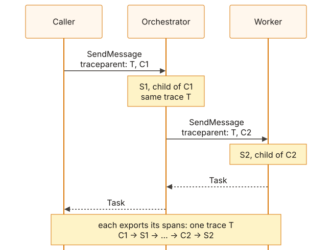
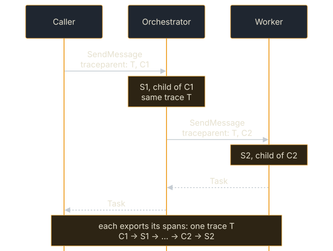

<!-- SPDX-License-Identifier: Apache-2.0 -->
<!-- Copyright 2026 Tom F. <tomf@tomtomtech.net> (https://github.com/tomtom215) -->

# Distributed tracing across agents

One request often crosses several agents: a caller asks an orchestrator,
which delegates to a worker. This page explains how the SDK keeps all of them
in one trace, what you write to make it happen (usually nothing), when to
refuse the caller's trace, and where propagation stops.

**Logs alone do not join a delegation chain.** Two processes produce two span
trees, and correlating by task id does not rescue it because each agent mints
its own. What joins them is the trace id.

The SDK carries [W3C Trace Context](https://www.w3.org/TR/trace-context/)
across an A2A hop. It is propagation: it works whether or not anything records
spans. What it guarantees is that, under the default `Continue` policy and
with propagation on, every agent in a chain sees the same trace id, so
whatever does record spans can stitch them together.

<figure class="diagram">
<a href="../../images/diagrams/obs-trace-propagation.light.svg"></a>
<a href="../../images/diagrams/obs-trace-propagation.dark.svg"></a>
<figcaption>Each hop's traceparent names the sender's own CLIENT span, so every agent's spans land in one trace.</figcaption>
</figure>

## With `Telemetry`: nothing to write

With the `otel` feature and a `tracing-opentelemetry` layer recording — what
`Telemetry` installs — a well-formed inbound `traceparent` is the `SERVER`
span's remote parent, and every outgoing call's `traceparent` names the call's
own `CLIENT` span, so the agent called becomes its child: from inside an
executor, under the executor's span; from anywhere else, under whatever span
is current. A downstream agent's trace therefore points at a parent your
backend has. No propagation code is needed in either agent: the
[Langfuse](../langfuse.md#what-you-see) measurement shows a seven-span chain
across two agents built this way.

`ClientBuilder::with_trace_propagation(false)` turns sending off for a client
calling agents that should not learn your trace ids. It applies to the
transports the client builds for JSON-RPC, HTTP+JSON and gRPC, not to one
supplied through `with_custom_transport`. Such a transport names the
`rpc.system.name` its calls' spans carry through `Transport::rpc_system`
(`jsonrpc` for `WebSocketTransport`, `slimrpc` for `SlimRpcTransport`); the
span keeps the agent from the card either way.

## Without a recording layer

Without the `otel` feature the spans are ordinary `tracing` spans, and the id
sent onward is minted for the hop. The server parses an inbound
`traceparent`, advances the span, and hands it to the executor, which can
send it on explicitly:

```rust
# use a2a_protocol_client::{A2aClient, ClientResult, CurrentTrace};
# use a2a_protocol_server::RequestContext;
# use a2a_protocol_types::params::MessageSendParams;
# async fn delegate(
#     ctx: &RequestContext,
#     downstream: &A2aClient,
#     params: MessageSendParams,
# ) -> ClientResult<()> {
// `ctx.trace_context()` names *this* hop's span, so sending it verbatim
// makes the callee a child of this agent.
if let Some(trace) = ctx.trace_context().cloned() {
    CurrentTrace::scope(trace, async {
        downstream.send_message(params).await
    })
    .await?;
}
# Ok(())
# }
```

Without a recording `tracing-opentelemetry` layer, `None` means the caller
sent no `traceparent`, or sent one the SDK refused; under
`InboundTracePolicy::Drop` it is `None` for every call, even one with a valid
header. With a recording layer the value names this server's own recorded
span, a new root when the caller sent no `traceparent`. The SDK never repairs
a header: a malformed one is dropped, because attaching work to a guessed-at
trace is a wrong answer where a missing trace is only an absent one.

On the calling side, add `TracePropagationInterceptor` to the client and it
writes the ambient `CurrentTrace` onto every request over JSON-RPC, REST or
gRPC. An agent that is the first hop starts one with
`CurrentTrace::start_root()`. With both a recording layer and the interceptor,
a `CurrentTrace` scope is the client span's parent when no recorded span is
current.

## WebSocket

Not over the `websocket` transport, which has no per-request header channel —
it carries headers only on the HTTP upgrade, and a `traceparent` fixed there
would report every request on the connection as one span, which W3C §3.4
forbids. The interceptor is silently ineffective on an established WebSocket
connection; the transport warns once per connection when it drops one. Send
traced calls over one of the other three. On the server, for the same reason,
a WebSocket call's span is not a child of the upgrade request's
`traceparent`: each call is a root span of its own, with a span link to the
upgrade's trace (under `InboundTracePolicy::Continue`).

## Trusting the caller's trace

The inbound `traceparent` is read while the `CallContext` is built, which is
before your interceptors run — so on a public endpoint the peer choosing the
`trace-id` and the sampling bit has not been authenticated yet. W3C §7.2 names
what that allows: forged `trace-id` collisions that make the data unusable,
and an anonymous caller deciding what your tracing vendor bills you for. A
front gate sets
`RequestHandlerBuilder::with_inbound_trace_policy(InboundTracePolicy::Restart)`
to mint its own ids (§3.4's "Restart trace"), or `Drop` to refuse to trace an
unauthenticated request at all.

| `InboundTracePolicy` | The `SERVER` span | Use it for |
|---|---|---|
| `Continue` (default) | Joins the caller's trace: same `trace-id`, a fresh span | A trusted mesh; the reason A2A delegation chains are readable end to end |
| `Restart` | A new root: new `trace-id` and `parent-id`, `trace-flags` reset, `tracestate` dropped | A front gate: this hop and everything below it stay correlated, but the caller chooses nothing |
| `Drop` | No span at all, and `ctx.trace_context()` is `None`; the call's metric is still recorded | A front gate where the tracing bill is what is being protected |

The agent card's span follows the same policy.

## What is not done

Nothing *interprets* `tracestate` — the SDK adds no vendor entry of its own
and reads nobody else's; it only truncates whole entries when a list exceeds
the documented 4096-character or 32-member cap (W3C §3.3.1.5). The SDK adds no
sampler of its own: with `Telemetry`, sampling is the OpenTelemetry SDK's
(`OTEL_TRACES_SAMPLER`, default `parentbased_always_on`), and under that
parent-based default and `Continue` the caller's sampled flag decides, which
is why a front gate uses `Restart` or `Drop`. Each hop's `a2a.task.id` is on
its own `invoke_agent` span; nothing links one hop's task id to the next
hop's. The agent-card fetch sends no `traceparent`, so on each side it is a
trace of its own.

## Across languages

Because `traceparent` is a wire format rather than a Rust type, agents in
other languages should join the same trace; that has not been run against the
Python, JavaScript, Go and Java agents under `itk/` (the Integration Test
Kit). It was run between this repository's own processes, 2026-10-26: the
`a2a` CLI's `SendMessage` span and the server's spans carried one trace id.
