<!-- SPDX-License-Identifier: Apache-2.0 -->
<!-- Copyright 2026 Tom F. <tomf@tomtomtech.net> (https://github.com/tomtom215) -->

# Graceful Shutdown

How to stop a replica, during a rolling deploy or a scale-down, without cutting
the streams it is serving or leaving delegated work running. The SDK does the
ordering for you if you let it; this page says what that order is, how long
each step may take, and what your executor has to do for it to work.

A graceful shutdown has to end in-flight work before it waits for sockets.
An open SSE stream is a connection that does not close until its task ends,
so a drain that runs first just waits out its timeout on tasks nobody has
cancelled — and whatever an executor delegated to other agents is still
running when the process exits. `Server::serve_with_shutdown` does it in the
order that works:

1. stop accepting;
2. let in-flight tasks finish on their own for up to `completion_grace`
   (default 5 s), then cancel the rest and wait up to `task_grace` (default
   10 s) for the executors to act on it — cancel what they delegated,
   return. An executor that returns without a terminal state has its `cancel`
   hook called, for what it releases, and its task ends `failed` with
   failure class `transient`, so its open streams end with a terminal event
   that tells the caller it may send again; one still running when the grace
   ends is counted in `still_running` and cut off when the process exits;
3. drain connections, for up to `drain_timeout` (default 15 s).

From the start of step 2 a send (`SendMessage`, `SendStreamingMessage`) is
refused before any work begins: HTTP `503` with `Retry-After`, gRPC
`UNAVAILABLE`, and a `RetryInfo` detail on every binding. This SDK's client
repeats a send only on such a refusal, which proves nothing ran, so with a
retry policy its next attempt reaches another replica. Reads, cancels and
subscriptions are still served.

A task stopped by shutdown is not `canceled`: nobody cancelled it, and a
client does not repeat a cancelled task. A `canceled` that the `cancel` hook
writes during shutdown is written as the transient failure instead. A halt
([operator oversight](../oversight.md)) still ends tasks `canceled`.

<figure class="diagram">
<a href="../../images/diagrams/dep-shutdown-order.light.svg"></a>
<a href="../../images/diagrams/dep-shutdown-order.dark.svg"></a>
<figcaption>The order <code>Server::serve_with_shutdown</code> follows, with its default bounds, then what <code>main</code> does after it returns.</figcaption>
</figure>

```rust,no_run
use std::sync::Arc;
use std::time::Duration;
use a2a_protocol_server::dispatch::JsonRpcDispatcher;
use a2a_protocol_server::serve::{ServeConfig, Server, shutdown_signal};
use a2a_protocol_server::RequestHandler;

async fn run(handler: Arc<RequestHandler>) -> std::io::Result<()> {
    let server = Server::bind("0.0.0.0:3000").await?.with_config(
        ServeConfig::new()
            .with_completion_grace(Duration::from_secs(5))
            .with_task_grace(Duration::from_secs(10))
            .with_drain_timeout(Duration::from_secs(15)),
    );
    let report = server
        .serve_with_shutdown(JsonRpcDispatcher::new(Arc::clone(&handler)), shutdown_signal())
        .await;
    // Last, the executor's cleanup hook.
    let handler_report = handler.shutdown().await;

    if let Some(tasks) = report.tasks.filter(|t| !t.finished) {
        eprintln!("{} task(s) ignored cancellation", tasks.still_running);
    }
    if !report.drained || !handler_report.is_graceful() {
        eprintln!("unclean shutdown: {report:?} {handler_report:?}");
    }
    Ok(())
}
```

Your executor has to take part: `execute` must watch
`ctx.cancellation_token` and, when it fires, cancel whatever it started
elsewhere and return. One that never looks at its token cannot be stopped
early; `ServeReport::tasks` counts it in `still_running`.

To serve on a socket bound elsewhere — inherited from systemd socket
activation, handed over for a restart without downtime, or built with options
such as `SO_REUSEPORT` — use `Server::from_listener(listener)` in place of
`Server::bind`. A `std::net::TcpListener` needs `set_nonblocking(true)` before
`tokio::net::TcpListener::from_std`.

## With Axum or another server

With Axum (or anything else that owns the sockets), call
`handler.finish_in_flight(completion, grace)` at the end of the future you pass to
`with_graceful_shutdown`, so it runs before Axum starts draining, and
`handler.shutdown()` after
`serve` returns. The gRPC and WebSocket dispatchers have their own
`serve_with_shutdown(listener, signal)`, which runs the same three steps and
returns the same `ServeReport`; set the three durations with
`with_completion_grace`, `with_task_grace` and `with_drain_timeout` on the
dispatcher. Two differences follow from the transports. gRPC connections are
sent `GOAWAY` when accepting stops, so they take no new calls during the
completion window, where HTTP and WebSocket connections still take reads and
cancels (sends are refused, as above). And a
WebSocket carries many requests on one connection, so once the tasks have
ended each connection finishes the requests it has already read and is closed
with a Close frame. `finish_in_flight` first lets tasks finish on
their own for up to `completion` — so a short call in flight during a rolling
deploy is answered rather than failed — and then does what
`cancel_in_flight(grace)` does alone: cancels the rest and waits for them.

`examples/deploy-agent` is the worked case, on `Server`: its own diagram and
the budget behind its `terminationGracePeriodSeconds: 60` are on
[its page](../../examples/deploy-agent.md).

## Fitting inside Kubernetes' grace period

Kubernetes sends `SIGKILL` `terminationGracePeriodSeconds` after `SIGTERM`
(30 seconds unless the pod sets it). The three phases of
`serve_with_shutdown` are bounded by 30 seconds together at their defaults,
exactly that default, and what follows them runs on top: `handler.shutdown()`
gives the turn claims and your `on_shutdown` hook up to 10 seconds between
them, and the telemetry flush as `main` returns can take up to 15 seconds when
the collector accepts connections and never answers (1.8 seconds when it
refuses them; measured on `hello-agent`, 2026-10-26). So either set
`terminationGracePeriodSeconds` above the sum, or shorten the phases. Each
phase ends as soon as its work does, so the bound is rarely reached; when it
is, `SIGKILL` cuts the shutdown short wherever it is.

Stop the process with `shutdown_signal()`, as the snippets in this chapter
do, so that a pod stopped by `SIGTERM` flushes the telemetry it has not yet
exported.

## Cleaning up in the executor

Implement `on_shutdown` in your executor for cleanup:

```rust
# use std::future::Future;
# use std::pin::Pin;
# use a2a_protocol_sdk::prelude::*;
# struct MyAgent { db_pool: sqlx::PgPool, cancel_token: a2a_protocol_sdk::server::CancellationToken }
# impl AgentExecutor for MyAgent {
# fn execute<'a>(&'a self, _: &'a RequestContext, _: &'a dyn EventQueueWriter)
#     -> Pin<Box<dyn Future<Output = A2aResult<()>> + Send + 'a>> { Box::pin(async { Ok(()) }) }
fn on_shutdown<'a>(&'a self) -> Pin<Box<dyn Future<Output = ()> + Send + 'a>> {
    Box::pin(async move {
        self.db_pool.close().await;
        self.cancel_token.cancel();
    })
}
# }
```
