# Agent Team

The project's primary integration test and SDK dogfood. Deploys five specialized agents over JSON-RPC, REST and gRPC, runs **100 end-to-end tests** against them, then sweeps every A2A method over every binding against a sixth agent that serves all four: 102 results in all. That is what a plain `cargo run -p agent-team` reports: WebSocket, gRPC, Axum, SQLite, signing and OTel are the example's `default` features, so the default run is the full run. `--no-default-features` compiles all six out and runs 87 tests (four agents, no sweep).

**Source:** [`examples/agent-team/`](https://github.com/tomtom215/a2a-rust/tree/main/examples/agent-team)

If this passes, every SDK feature listed below works in-process. It does not
exercise PostgreSQL, JWT, tool calling, encryption or a real model. Run it
when you are evaluating the SDK; read it when you want to see one way of
testing a team of agents end to end. The
[Dogfooding](../deployment/dogfooding.md) chapter tells the story behind it:
why the suite exists, how it is laid out, and the bugs it found.

## What it shows

| Agent | Transport | Role | Key features exercised |
|-------|-----------|------|----------------------|
| **CodeAnalyzer** | JSON-RPC | File analysis, LOC counting | Streaming, artifacts, multi-part messages |
| **BuildMonitor** | REST | Simulated cargo builds | Streaming, cancellation, push notifications |
| **HealthMonitor** | JSON-RPC | Agent health checks | Push notifications, interceptors |
| **Coordinator** | REST | Orchestration, delegation | A2A client calls, task aggregation, metrics |
| **GrpcAnalyzer** | gRPC | Same as CodeAnalyzer | gRPC transport (`grpc` feature) |
| **Surface agent** | all four | Exists to be swept | Every method over every binding (`src/surface.rs`; needs `websocket` and `grpc`) |

The suite exercises **40+ SDK features**, including:

- `AgentExecutor` trait (5 implementations)
- `RequestHandlerBuilder` (executor timeout, event-queue capacity, max concurrent streams, metrics, interceptors, extended card, push sender)
- `JsonRpcDispatcher` + `RestDispatcher`
- `ClientBuilder` (JSON-RPC + REST bindings; `from_card` + `build_grpc` on a bare `host:port` gRPC target)
- Sync and streaming `SendMessage`
- `GetTask`, `ListTasks` (pagination, context, status filters)
- `CancelTask` with executor override
- Push notification config CRUD + `HttpPushSender` delivery
- `ServerInterceptor` (audit logging + auth)
- Custom `Metrics` observer
- Agent card discovery (correct URLs via pre-bind)
- Multi-part messages (text + data + file)
- Artifact append mode + multiple artifacts
- Batch JSON-RPC (single, multi, empty, mixed, streaming rejection)
- Dynamic agent cards + HTTP caching (ETag + 304)
- `TenantAwareInMemoryTaskStore` isolation
- State transition validation + backpressure (lagged event queue)
- Executor timeout + error propagation

## Run it

No services, keys or other languages: everything runs in-process.

```bash
# The full run — 100 tests, 102 results. WebSocket, gRPC, Axum, SQLite, signing and OTel
# are this example's DEFAULT features, so nothing is compiled out here:
cargo run -p agent-team

# With structured logging. `tracing` is the only non-default feature:
RUST_LOG=debug cargo run -p agent-team --features tracing

# Identical — 102 results. --all-features adds only `tracing`, which changes output
# volume and not coverage:
cargo run -p agent-team --all-features

# All six compiled out — 87 tests. Exits 2: a narrowed build leaves claimed
# feature areas unexercised, and that is reported rather than passed over:
cargo run -p agent-team --no-default-features

# Individual features on top of that narrowed build:
cargo run -p agent-team --no-default-features --features websocket   # +2 WebSocket tests
cargo run -p agent-team --no-default-features --features grpc        # +3 gRPC tests
cargo run -p agent-team --no-default-features --features axum        # +3 Axum framework tests
cargo run -p agent-team --no-default-features --features sqlite      # +2 SQLite store tests
cargo run -p agent-team --no-default-features --features axum,sqlite # the two above, +1 combined test
cargo run -p agent-team --no-default-features --features signing     # +1 JWS signing test
cargo run -p agent-team --no-default-features --features otel        # +1 OpenTelemetry test
cargo run -p agent-team --no-default-features --features websocket,grpc  # +2 WebSocket, +3 gRPC, and +2 surface results
```

The 87 plus those per-feature figures is 100. The last 2 of the 102 are the method ×
binding surface matrix, which runs against a separate agent serving all four
bindings and so needs `websocket` and `grpc` together. CI runs the example
with `--all-features` (`ci.yml`, job `dogfood`).

Exit codes: `0` everything passed and every claimed area was built; `1` a test
failed or the printed feature table drifted from the tests behind it; `2` a
matrix gap or a feature area not built.

## What you'll see

The run prints each agent's address, the test results, each agent's metrics,
the push notifications received, the feature table and the sweep. The
example's README records a bare run on 2026-10-15 ending in these lines,
quoted from it:

```text
All 102 tests passed
Every claimed SDK feature was exercised
44 exercised, 0 not applicable, 0 missing, of 44 cells
```

The [Dogfooding](../deployment/dogfooding.md#running-the-agent-team) chapter
shows the shape of the whole run. In the feature table each claim names the
tests behind it, and its marker is computed from their outcomes, not written
by hand:

| Marker | Meaning |
|---|---|
| `[x]` | Every backing test ran and passed |
| `[FAIL]` | At least one backing test ran and failed |
| `[ ] NOT RUN` | The backing tests did not run (feature not compiled in) |

The table is checked in both directions: a claim with no test that ran, or a
test that ran with no claim naming it, prints `CLAIM TABLE DRIFT` and exits
`1`. Until 2026-08-11 the table was a hardcoded list that printed `[x]` for
tests that had failed.

## Key code

The Coordinator builds one client per agent it delegates to, once, and reuses
it. The binding has to match what each agent serves, so BuildMonitor, which
serves REST, gets an HTTP+JSON client:

```rust,no_run
# use a2a_protocol_client::ClientBuilder;
# fn client_for(name: &str, url: &str) {
let builder = if name == "build_monitor" {
    ClientBuilder::new(url).with_protocol_binding("HTTP+JSON")
} else {
    ClientBuilder::new(url)
};
# let _ = builder.build();
# }
```

The 100 tests are grouped by range:

| Range | Category | What it covers |
|-------|----------|---------------|
| 1-10 | Basic | Sync/stream send, REST/JSON-RPC, get/list tasks, push config, multi-part |
| 11-20 | Lifecycle | Orchestration, metadata, cancel, agent cards, pagination |
| 21-30 | Edge cases | Cancel nonexistent, return_immediately, concurrent requests, metrics |
| 31-40 | Stress | High concurrency, mixed transport, large payloads, event ordering |
| 41-50 | Dogfood | Agent card correctness, push events, multiple artifacts, history |
| 51-58 | Transport | WebSocket, gRPC, multi-tenancy |
| 61-99 | Coverage gaps | Batch JSON-RPC, auth, dynamic cards, caching, backpressure, Axum, SQLite, signing |

For the full test matrix, see [Test Coverage Matrix](../deployment/dogfooding-tests.md).

## How it fits together

<figure class="diagram">
<a href="../images/diagrams/ex-agent-team.light.svg"></a>
<a href="../images/diagrams/ex-agent-team.dark.svg"></a>
<figcaption>The agents one run starts. Dashed: the Coordinator's delegation.</figcaption>
</figure>

`main()` runs in a fixed order: start a webhook receiver for the push tests,
pre-bind every agent's listener so the cards carry real addresses, build the
cards, build the handlers with their interceptors and metrics, start the
agents, run the 100 tests, run the 44-cell surface sweep, and print the
results and the metrics summary. The sweep and its counter-tests come from
the shared [example harness](./harness.md). The
[Dogfooding](../deployment/dogfooding.md#the-agent-team-architecture) chapter
has the capabilities each agent exercises.

## What it does not cover

PostgreSQL, JWT, tool calling, encryption and a real model are out of scope.
For those:

- [Incident-Response Team](./incident-response.md): JWT and PostgreSQL among
  its sixteen production-hardening checks.
- [Resilient Agent](./resilient-agent.md): restarts, failures and two
  replicas over a shared PostgreSQL store.
- [Live Model](./live-model.md): the SDK end to end against a real model.
- [Bugs Found & Fixed](../deployment/dogfooding-bugs.md): what dogfooding
  turned up.
