# Genai Agent

Wraps the [genai](https://crates.io/crates/genai) multi-provider LLM client
behind the A2A protocol. Each incoming A2A message goes to the model, and the
reply comes back as an A2A artifact. It is the smallest LLM integration in the
book: one `AgentExecutor`, one model call, no tools.

**Source:** [`examples/genai-agent/`](https://github.com/tomtom215/a2a-rust/tree/main/examples/genai-agent)
(package `genai-a2a-agent`)

## What it shows

- An `AgentExecutor` that calls an LLM: extract the text, report `WORKING`,
  call the model, emit an artifact, complete.
- Failure through the task state: in server mode a provider error fails the
  task rather than hiding inside a "successful" artifact.
- One model name reaching a hosted provider or a local server, with no code
  change.
- A server-mode agent with authentication, a concurrency cap and the webhook
  SSRF guard, which passes the in-repo TCK.

## Run it

`GENAI_MODEL` picks the model and, through its name, the provider. It defaults
to `qwen3.5:0.8b`, a local model.

| Provider | Model example (check the provider for current names) | Env var |
|----------|--------------|---------|
| OpenAI | `gpt-4o`, `gpt-4o-mini` | `OPENAI_API_KEY` |
| Anthropic | `claude-sonnet-4-20250514` | `ANTHROPIC_API_KEY` |
| Google Gemini | `gemini-1.5-flash` | `GEMINI_API_KEY` |
| Ollama / any local server on `:11434` | any other model name | (local, no key) |
| Groq | `llama3-70b-8192` | `GROQ_API_KEY` |
| Cohere | `command-r-plus` | `COHERE_API_KEY` |

```bash
# Hosted provider:
export OPENAI_API_KEY=sk-...
GENAI_MODEL=gpt-4o-mini cargo run -p genai-a2a-agent

# Fully local, no API key, with llama.cpp's llama-server:
curl -L -o model.gguf \
  'https://huggingface.co/ggml-org/Qwen3.5-0.8B-GGUF/resolve/main/Qwen3.5-0.8B-Q4_0.gguf'
llama-server -m model.gguf --port 11434 --alias qwen3.5:0.8b \
  -c 8192 --reasoning off &   # direct answers, no thinking preamble; 8K context bounds memory
GENAI_MODEL=qwen3.5:0.8b cargo run -p genai-a2a-agent
```

Model names that don't match a hosted provider go to the OpenAI-compatible API
at `http://localhost:11434/v1/` (`src/local_model.rs`), which `llama-server`,
vLLM and Ollama all serve. genai on its own would send them to its Ollama
adapter, which calls Ollama's native `/api/chat`; `llama-server` answers that
`404`.

Every model call is capped at `GENAI_MAX_TOKENS` output tokens (default 1024)
and, unless `GENAI_THINKING=1`, asks the server not to reason first
(`chat_template_kwargs`). Set `GENAI_THINKING=1` for a hosted provider that
refuses that field.

### vLLM

vLLM serves the same OpenAI-compatible API, from the unquantized weights
rather than a GGUF. Use it when you want throughput or a GPU; llama.cpp is the
lighter option for a laptop CPU.

```bash
pip install vllm
vllm serve Qwen/Qwen3.5-0.8B --port 11434 --served-model-name qwen3.5:0.8b
```

`--served-model-name` matters: the example sends the model name in the request
body, and vLLM rejects a name it was not started with. Setting it to the string
llama.cpp's `--alias` uses means the same `GENAI_MODEL` works against either
server. Ollama works too: `ollama pull qwen3.5:0.8b`, then the same
`cargo run`.

### Two modes

**The default run checks itself and exits.** It serves all four bindings on
random loopback ports, says whether a model answered, drives every A2A method
over every binding, prints the coverage matrix, and exits `0` when all 44 cells
ran (11 methods by 4 bindings), `1` when a call failed, or `2` when a cell never
ran. With no model reachable, each task completes with a labelled mechanical
answer (`[no model reachable — mechanical fallback, not an LLM answer]`), so
the protocol surface is measured either way.

**Server mode** starts when `A2A_BIND_ADDR` is set, and serves JSON-RPC there
until Ctrl+C. It is the deployment shape: an unreachable model fails the task
(`TASK_STATE_FAILED`) unless `A2A_ALLOW_FALLBACK=1`, and the webhook SSRF guard
is on.

| Variable | Effect |
|---|---|
| `A2A_BIND_ADDR` | Serve JSON-RPC here, until Ctrl+C |
| `A2A_GRPC_ADDR`, `A2A_WS_ADDR` | Also serve gRPC, WebSocket on the same handler (`echo-agent` names these `A2A_GRPC_BIND_ADDR` and `A2A_WS_BIND_ADDR`) |
| `A2A_ALLOW_PRIVATE_WEBHOOKS=1` | Permit push-notification URLs on loopback, private or link-local addresses |
| `A2A_ALLOW_FALLBACK=1` | Complete a task with a labelled mechanical answer when no model is reachable, instead of failing it |
| `A2A_MAX_CONCURRENT_TASKS` | Cap on tasks a tenant runs at once; a request past it is refused with `Overloaded` |
| `A2A_BEARER_TOKEN` | Require `Authorization: Bearer <token>` |
| `A2A_API_KEY` | Require `x-api-key: <key>` |
| `A2A_JWT_HS256_SECRET` | Require an HS256 JWT; the secret must be at least 32 bytes. `A2A_JWT_ISS` and `A2A_JWT_AUD` add issuer and audience checks |

Set one authentication scheme: each adds an interceptor, and several would all
have to pass. The plain agent card stays public.

## What you'll see

The repository records no transcript of this example. The default run prints a
banner with the model and the four bindings' URLs, then says whether the model
answered, then prints the coverage matrix and repeats the verdict at the end.
The verdict is one of these (the strings in `src/main.rs`, `<model>` standing
for `GENAI_MODEL`):

```text
LLM leg: EXERCISED — '<model>' answered a real request.
```

```text
LLM leg: NOT EXERCISED — no model reachable on the configured
  endpoint, so every answer below is the labelled mechanical
  fallback. The A2A surface is still fully measured; the model
  integration is not. Start llama-server/vLLM/Ollama to cover it.
```

In server mode, with `A2A_BIND_ADDR=127.0.0.1:8080`, talk to it directly:

```bash
# Agent discovery
curl http://127.0.0.1:8080/.well-known/agent-card.json

# Send a message
curl -X POST http://127.0.0.1:8080 -H 'Content-Type: application/json' -H 'A2A-Version: 1.0' -d '{
  "jsonrpc": "2.0", "id": 1, "method": "SendMessage",
  "params": {"message": {"messageId": "m1", "role": "ROLE_USER",
             "parts": [{"text": "What is 2+2?"}]}}
}'

# Full conformance suite: 21/21 graded, 1 N/A on this binding
cargo run -p a2a-tck -- --url http://127.0.0.1:8080 --binding jsonrpc
```

The answer arrives as the task's `llm-response` artifact. `tck.yml`'s
`tck-example-agents` job re-runs the TCK grade on every push and pull request,
with no model configured: the TCK grades protocol conformance, and none of it
reaches the model.

## Key code

`GenaiAgentExecutor` implements `AgentExecutor`, the one trait that bridges any
LLM library to A2A. The model call and its two failure paths, from
`src/main.rs` (shown as text: the book's doctests do not depend on genai):

```text
let response_text = match self
    .client
    .exec_chat(&self.model, chat_req, Some(&local_model::chat_options()))
    .await
{
    Ok(response) => match response.first_text() { /* the answer */ },
    // No model reachable, in the demo or with A2A_ALLOW_FALLBACK=1.
    Err(e) if self.fallback_on_error => { /* labelled mechanical reply */ }
    Err(e) => {
        return Err(A2aError::internal(format!("LLM request failed: {e}")));
    }
};
```

Returning `Err` from `execute` is what marks the task `TASK_STATE_FAILED`, so a
client can trust `status.state` instead of parsing the artifact for an error.
The fallback reply is labelled so that "the agent answered" is never mistaken
for "the model answered".

## How it fits together

<figure class="diagram">
<a href="../images/diagrams/ex2-genai-executor.light.svg"></a>
<a href="../images/diagrams/ex2-genai-executor.dark.svg"></a>
<figcaption>What GenaiAgentExecutor does with one message.</figcaption>
</figure>

## What it does not cover

- **Tool calling.** The agent sends one prompt and returns one reply. See
  [Rig Agent](./rig-agent.md) or [Tool-Loop Agent](./tool-loop-agent.md).
- **Conversation history.** Each message is answered on its own, with a fixed
  system prompt.
- **Streaming the model's tokens.** The reply is one artifact.

## Where next

- [Rig Agent](./rig-agent.md) wraps a different LLM framework the same way, and
  adds a tool loop.
- [The AgentExecutor Trait](../building-agents/executor.md) covers the trait
  this example implements.
- The example's
  [README](https://github.com/tomtom215/a2a-rust/blob/main/examples/genai-agent/README.md)
  has the same walkthrough.
