<!-- SPDX-License-Identifier: Apache-2.0 -->
<!-- Copyright 2026 Tom F. <tomf@tomtomtech.net> (https://github.com/tomtom215) -->

# Example Harness and Go Interop

`examples/harness` is not an agent. It is `a2a-example-harness`, the small
library that six of the examples use to prove a claim they all make: *every
A2A method works over every binding this agent serves*. It also builds one
binary, `go_sdk_interop`, which points this SDK's client at an agent built on
the official Go SDK. Read this page when an example prints a coverage matrix
and you want to know what the numbers mean, or when you want to run the Go
interop check yourself.

**Source:** [`examples/harness/`](https://github.com/tomtom215/a2a-rust/tree/main/examples/harness)
and [`scripts/go_sdk_interop.sh`](https://github.com/tomtom215/a2a-rust/blob/main/scripts/go_sdk_interop.sh)

## What it shows

- **A coverage claim that is computed, not written.** Each call an example
  makes records itself in a `Matrix`; the matrix prints the grid and returns
  the cells that never ran, so the example can exit non-zero. The crate's
  own docs say why: measured on 2026-08-11, `echo-agent` drove 4 of the 11
  methods over 2 of the 4 transports, and `incident-response` drove 4 over 1,
  while the README described both as complete.
- **Refusals as well as successes.** A server that said yes to everything
  would pass a sweep. The counter-tests check that calls the specification
  says must fail do fail, for the documented reason.
- **Interop with a real peer.** `go_sdk_interop` drives the same sweep against
  an a2a-go agent, plus four checks for defects this SDK's client passed in
  its own tests and a real a2a-go server exposed.

Six examples depend on it: `echo-agent`, `incident-response`, `agent-team`,
`genai-agent`, `rig-agent` and `multi-lang-team`.

## Run it

The library has unit tests and no `main`; you see it at work through the
examples that use it:

```bash
cargo test -p a2a-example-harness   # the matrix, sweep, counter-test and endpoint tests
cargo run -p echo-agent             # an example whose run ends in the matrix
```

The Go interop check runs both directions, this SDK as server and as client,
over JSON-RPC, HTTP+JSON and gRPC:

```bash
scripts/go_sdk_interop.sh                         # release build, as CI runs it
INTEROP_PROFILE=debug scripts/go_sdk_interop.sh   # faster to build
```

| Requirement | Why |
|---|---|
| `cargo` and Go (the version the two `go.mod` files name, or `GOTOOLCHAIN=auto`) | The script builds `echo-agent`, `go_sdk_interop`, `itk/interop/go-sdk-client` and `itk/agents/go-sdk` |
| Free loopback ports 19310–19314 | Fixed on purpose: a port already taken fails at bind rather than being mistaken for a peer |
| `INTEROP_PROFILE` | `release` (default) or `debug`; anything else exits `2` |

The script exits `0` only if both directions pass. CI runs it in `ci.yml`'s
`go-sdk-interop` job. You can also run the binary on its own against any
agent that serves the a2a-go interop card (`INTEROP_CARD=1` on the Go agent):

```bash
cargo run -p a2a-example-harness --bin go_sdk_interop -- http://127.0.0.1:19312
```

## What you'll see

The matrix is the last thing an example using the harness prints. From
`echo-agent`'s README, recorded on 2026-10-15 (abridged to the grid and the
summary):

```text
=== Coverage: every A2A method over every binding ===

METHOD                             JSONRPC    HTTP+JSON     GRPC      WEBSOCKET
SendMessage                          ok          ok          ok          ok
SendStreamingMessage                 ok          ok          ok          ok
GetTask                              ok          ok          ok          ok
...
GetExtendedAgentCard                 ok          ok          ok          ok

44 exercised, 0 not applicable, 0 missing, of 44 cells
Rows: the 11 methods `service A2AService` declares in the ratified proto (see a2a_protocol_types::method).
Columns: 3 spec-named bindings (§9 §10 §11) plus WEBSOCKET, a §12 custom binding this SDK adds.
```

A cell reads `ok` (driven and checked), `n/a` (excused, and the reason prints
under the grid) or `MISSING`. The repository holds no recorded transcript of
`go_sdk_interop`; each of its checks prints one `[ok]` or `[FAIL]` line, the
WebSocket column is excused with *a2a-go serves no WebSocket binding*, and the
run ends with a failure count.

## Key code

The crate's public surface is small enough to list:

| Item | What it does |
|---|---|
| `Binding` | The four columns: `JsonRpc`, `HttpJson`, `Grpc` and `WebSocket`. `is_spec_named()` is `false` for WebSocket, a §12 custom binding, so the report never reads "4 of 4" as "4 of 4 the spec requires" |
| `Matrix::record(method, binding)` | Marks a cell exercised. Call it only after the call returned a result the example checked; recording on attempt would make the matrix a log of intentions |
| `Matrix::excuse(method, binding, Excuse::NotApplicable(why))` | Marks a cell legitimately unreachable. It prints with its reason rather than vanishing, because a deleted row looks the same as coverage |
| `Matrix::report()` | Prints the grid and the summary from one classification of the cells, and returns the missing `(method, binding)` pairs |
| `sweep(client, binding, webhook_url, slow_prefix, &mut matrix)` | Drives all eleven methods over one client. Push configs point at `webhook_url`, which must be listening; `slow_prefix` makes the agent pause so `SubscribeToTask` has a running task to attach to |
| `counter::run(client, restricted)` | The five counter-tests, against the agent and against a second agent whose card advertises no optional capabilities |
| `Endpoints`, `interfaces(&ep)` | Where an agent listens per binding, and the four `AgentInterface`s its card advertises, built with the SDK's constructors so a binding name cannot be misspelt |
| `run_surface(SurfaceRun { .. })` | Sweep, counter-tests and report in one call. A binding with no client in `clients` is reported as a missing column, not skipped |
| `SurfaceOutcome::exit_code()` | `0` complete, `1` a call failed, `2` the matrix has a gap. Two codes, because "something broke" and "we never checked" are different findings |

The rows are not this crate's choice. They are
`a2a_protocol_types::method::Method::ALL`, which the types crate asserts equal
to `service A2AService` in the ratified `proto/a2a_v1/a2a.proto`, and which
`scripts/check_method_denominator.py` cross-checks against the official
`a2aproject/a2a-tck` suite. The columns are: three spec-named bindings plus
WebSocket.

The five counter-tests, each naming the refusal it expects:

| Call | Expected refusal |
|---|---|
| `GetTask` on an unknown id | `TaskNotFound` |
| `CancelTask` on an unknown id | `TaskNotFound` |
| A push config against a card without `pushNotifications` | `PushNotificationNotSupported` |
| The extended card against a card without `extendedAgentCard` | `UnsupportedOperation` |
| Streaming against a card without `streaming` | A protocol error before the stream opens |

## How it fits together

`scripts/go_sdk_interop.sh` starts the peers, waits for each agent card to
answer, and runs three legs:

<figure class="diagram">
<a href="../images/diagrams/ex-harness-go-interop.light.svg"></a>
<a href="../images/diagrams/ex-harness-go-interop.dark.svg"></a>
<figcaption>The two directions of the Go SDK interop check.</figcaption>
</figure>

| Leg | Client | Server | What it adds |
|---|---|---|---|
| 1 | a2a-go (`itk/interop/go-sdk-client`) | `echo-agent` with `A2A_BIND_ADDR` and `A2A_GRPC_BIND_ADDR` | This SDK's server as a Go client sees it, on all three spec bindings |
| 1b | a2a-go | `echo-agent` with `A2A_INTEROP_CARD=1` | A card carrying `securityRequirements`, on the two bindings it lists |
| 2 | `go_sdk_interop` | a2a-go agent (`itk/agents/go-sdk`, `INTEROP_CARD=1`) | This SDK's client against a real a2a-go server |

`go_sdk_interop` adds four checks to the sweep, one per defect class the
2026-09-22 audit found:

| Check | Passes when |
|---|---|
| Card `securityRequirements` in a2a-go's shape (T1) | The card-level `apiKey` requirement reads back as `[read write]` and the first skill's as `[read]` |
| Default interface selection (C10) | With no preference, `ClientBuilder::from_card` skips the protocol-version 0.3 interface the Go agent lists first, and the client it builds can send |
| `DeleteTaskPushNotificationConfig` with no `result` body (C9) | The sweep's delete call succeeds |
| Errors on a missing task (C8) | `GetTask`, `CancelTask`, `SubscribeToTask` and a continuation sent with `SendStreamingMessage` each fail with a typed `TaskNotFound`, within a 15 s budget per call |

Each binding's client is built with `ClientBuilder::from_card_preferring`,
and the run fails if the builder picks a different binding or a
protocol version other than 1.x.

## What it does not cover

- **WebSocket interop.** a2a-go has no WebSocket binding, so that column is
  excused in `go_sdk_interop` and only this SDK talks to itself over it.
- **Other SDKs.** The Python, JavaScript and Java SDKs are exercised by
  `tck.yml`'s cross-language jobs, not by this script; the
  [Multi-Language Team](./multi-lang-team.md) shows the delegation shape
  without proving it.
- **Behaviour beyond the methods.** The sweep proves each method answers and
  the counter-tests prove five refusals. Task semantics are the subject of
  the TCK and of each example's own checks.

## Where next

- [Echo Agent](./echo-agent.md): the smallest example that ends in the
  matrix, and the server the Go client drives.
- [Agent Team](./agent-team.md): the dogfood suite, whose sweep is the last
  two of its 102 results.
- [Examples Overview](./overview.md): every example, and which ones end in
  the matrix.
