# Incident-Response Agent Team

Three cooperating A2A agents that triage a production incident on your
laptop — the hands-on answer to *"how is an agent different from a prompt
wrapped around an API call?"* It is the recommended first multi-agent
example; if you are new to A2A, start with the [Hello Agent](./hello-agent.md).

**Source:** [`examples/incident-response/`](https://github.com/tomtom215/a2a-rust/tree/main/examples/incident-response)

A wrapped prompt answers once and forgets. An agent holds a **task**: it can
pause to ask for missing input and resume, delegate, stream progress, produce
artifacts, be cancelled, and end in an honest terminal state. The demo shows
each of those in five acts, and asserts them rather than narrating them.

## What it shows

| Capability | Where you see it |
|---|---|
| Multi-turn tasks (`INPUT_REQUIRED`) | Act 1 → Act 2: a vague alert parks the task with a question; the answer resumes the **same task** (`taskId` + `contextId`) |
| Agent-to-agent delegation | The triage agent calls a log-search agent and a runbook agent over real A2A client calls |
| Deterministic tool agents | The log-search agent has no LLM — an agent is a capability behind the protocol |
| Streaming progress | Repeated `Working` status updates ("querying log agent", "synthesizing incident report") carry progress notes the moment they happen |
| Artifacts | The final `incident-report` artifact combines assessment, log evidence, and runbook guidance |
| Cooperative cancellation | Act 3: the operator calls off a parked task → `TASK_STATE_CANCELED`. The default `AgentExecutor::cancel` already records `Canceled`; triage overrides it only to drop the alert it parked (`TriageExecutor::cancel`) |
| Degraded output is labelled | An unreachable model or specialist is reported in the output (`[mechanical summary — no model reachable]`, `[verbatim runbook — no model reachable]`, `[log agent error: …]`) and the task still completes; the logs and runbook agents refuse a query naming no known service with `InvalidParams`, and triage parks an alert naming none in `INPUT_REQUIRED` |
| Every A2A method over every binding | Act 4 drives all 11 spec methods over JSON-RPC, HTTP+JSON, gRPC and WebSocket and exits non-zero if any cell never ran; its counter-tests check the calls an agent advertising no optional capabilities must refuse |
| Production hardening | Act 5: 16 asserted checks (tenancy, four authentication mechanisms, limits, retries, three task stores, signing, telemetry, HTTPS push, shutdown); see [Production hardening (Act 5)](./incident-response/hardening.md) |

## Run it

```bash
cargo run -p incident-response              # narrated five-act demo
cargo run -p incident-response -- harden    # Act 5 on its own
```

It needs no model, no key and no service. Each agent serves JSON-RPC and
HTTP+JSON on its port, gRPC on its port + 10 and WebSocket on its port + 20,
so the demo binds nine fixed ports (9200–9202, 9210–9212, 9220–9222) and does
not start if any is taken.

A successful demo does not exit: the three agents keep serving until Ctrl+C,
so you can probe them, or run the in-repo TCK against the triage agent:

```bash
curl http://127.0.0.1:9200/.well-known/agent-card.json
# 21/21 graded, 1 N/A — gated by tck.yml's tck-example-agents job.
cargo run -p a2a-tck -- --url http://127.0.0.1:9200 --binding jsonrpc
```

Or run each role as its own process, which is the point of a wire protocol:

```bash
cargo run -p incident-response -- logs     &   # :9201
cargo run -p incident-response -- runbook  &   # :9202
cargo run -p incident-response -- triage       # :9200
```

| Variable | Default | Effect |
|---|---|---|
| `INCIDENT_MODEL` | `qwen3.5:0.8b` | The model triage and runbook ask. A name no hosted provider claims goes to the OpenAI-compatible API at `http://localhost:11434/v1/`; a hosted name (for example `gpt-4o-mini`) goes to that provider, with its API key in the environment |
| `INCIDENT_MAX_TOKENS` | `1024` | Cap on each model call's output |
| `INCIDENT_THINKING` | unset | Unset, each request asks the server to answer without reasoning first (`chat_template_kwargs`, which `llama-server` and vLLM read); `1` sends nothing extra, for a hosted provider that refuses it |
| `INCIDENT_EXIT_WHEN_DONE` | unset | Set, a successful demo exits `0` instead of serving, as CI does |
| `INCIDENT_REQUIRE_ALL` | unset | Set, a capability that went unexercised exits `4` instead of passing quietly |
| `A2A_TEST_POSTGRES_URL` | unset | A PostgreSQL URL for Act 5's PostgreSQL check, which otherwise reports `[NOT RUN]` |

Exit codes: `1` a surface call failed, `2` a method × binding cell never ran,
`3` a hardening check failed, `4` a capability went unexercised while
`INCIDENT_REQUIRE_ALL` was set.

### With a local model

The demo works with **no model at all** (agents label their output as
mechanical or verbatim fallbacks so the protocol mechanics stay visible), and
shines with a small local model. Verified with llama.cpp's `llama-server` and
the Apache-2.0 Qwen3.5-0.8B model (about 500 MB):

```bash
curl -L -o model.gguf \
  'https://huggingface.co/ggml-org/Qwen3.5-0.8B-GGUF/resolve/main/Qwen3.5-0.8B-Q4_0.gguf'
llama-server -m model.gguf --port 11434 --alias qwen3.5:0.8b \
  -c 8192 --reasoning off &   # direct answers, no thinking preamble; 8K context bounds memory
cargo run -p incident-response          # INCIDENT_MODEL defaults to qwen3.5:0.8b
```

vLLM serves the same OpenAI-compatible API from the unquantized weights. Use
it when you want throughput or a GPU; llama.cpp is the lighter option for a
laptop CPU:

```bash
pip install vllm
vllm serve Qwen/Qwen3.5-0.8B --port 11434 --served-model-name qwen3.5:0.8b
```

`--served-model-name` matters: the request body names the model, and vLLM
rejects a name it was not started with. Setting it to the string
`llama-server`'s `--alias` uses means the same `INCIDENT_MODEL` works against
either. Ollama on `:11434` works identically.

## What you'll see

From the example's README, abridged (the `…` lines are cut there; the task id
is shortened):

```text
ACT 1 — vague alert: the task pauses and asks for missing input
  ⇢ task 8444... [TASK_STATE_SUBMITTED]
  ⇢ status: TASK_STATE_WORKING — reading alert
  ⇢ status: TASK_STATE_INPUT_REQUIRED — Which service is affected? I have runbooks for: payments-api, checkout, search

ACT 2 — the operator answers on the same task; the agents collaborate
  ⇢ status: TASK_STATE_WORKING — triaging 'payments-api': querying log agent
  ⇢ status: TASK_STATE_WORKING — querying runbook agent
  ⇢ status: TASK_STATE_WORKING — synthesizing incident report
  ⇢ artifact 'incident-report' (2963 chars)
  ⇢ status: TASK_STATE_COMPLETED

ACT 3 — tasks are cancellable: the operator calls off a parked task
  → cancel_task(...) ⇒ TASK_STATE_CANCELED

ACT 4 — every A2A method over every binding, counted
  --- JSON-RPC ---            (11/11) … and the same for HTTP+JSON, gRPC, WebSocket
  --- counter-tests (calls that must be refused) ---

ACT 5 — production hardening: tenancy, auth, limits, durability, telemetry
  [ok] Tenant isolation …     2 tenants isolated; a cross-tenant params.tenant was refused
  [ok] Client retry …         2 x 503 ridden out; 502 on a non-idempotent method not retried
  [ok] OTLP pipeline …        2150 bytes of HTTP/2 exported to the configured collector
  …
  16 passed, 0 failed, 0 not compiled, 0 not run
```

The incident report combines the model's assessment with the raw log evidence
and the runbook guidance, so every claim in it is traceable to the agent that
produced it. Act 4's matrix is the one the [Echo Agent](./echo-agent.md) page
shows in full.

## Key code

Triage parks the task when the alert names no service it knows. The A2A state
machine requires `SUBMITTED → WORKING` before an interrupted state, so the
executor announces work (`reading alert`) first, then writes the question as
an `INPUT_REQUIRED` status:

```rust,no_run
# use a2a_protocol_server::request_context::RequestContext;
# use a2a_protocol_server::streaming::EventQueueWriter;
# use a2a_protocol_types::error::A2aResult;
# use a2a_protocol_types::events::{StreamResponse, TaskStatusUpdateEvent};
# use a2a_protocol_types::message::Message;
# use a2a_protocol_types::task::{ContextId, TaskState, TaskStatus};
# fn agent_message(text: &str) -> Message { Message::agent_text("m", text) }
# fn known_services() -> Vec<&'static str> { vec!["payments-api", "checkout", "search"] }
# async fn park(ctx: &RequestContext, queue: &dyn EventQueueWriter) -> A2aResult<()> {
return queue
    .write(StreamResponse::StatusUpdate(TaskStatusUpdateEvent {
        task_id: ctx.task_id.clone(),
        context_id: ContextId::new(ctx.context_id.clone()),
        status: TaskStatus {
            state: TaskState::InputRequired,
            message: Some(agent_message(&format!(
                "Which service is affected? I have runbooks for: {}",
                known_services().join(", ")
            ))),
            timestamp: None,
        },
        metadata: None,
    }))
    .await;
# }
```

Before writing it, triage stores the alert under the task id; when the next
message on that task arrives, it takes the alert back and appends the
operator's answer. The client continues the task by sending a message that
carries **both** ids: the task id selects the parked task, and the context id
must match the conversation it belongs to.

```rust,no_run
# use a2a_protocol_types::message::{Message, Part};
# use a2a_protocol_types::task::{ContextId, TaskId};
# fn user_message(text: &str) -> Message { Message::user("m", vec![Part::text(text)]) }
# fn continue_task(task_id: String, context_id: String) -> Message {
let mut follow_up = user_message("it's payments-api");
follow_up.task_id = Some(TaskId(task_id.clone()));
follow_up.context_id = Some(ContextId::new(context_id));
# follow_up
# }
```

## How it fits together

<figure class="diagram">
<a href="../images/diagrams/ex-incident-team.light.svg"></a>
<a href="../images/diagrams/ex-incident-team.dark.svg"></a>
<figcaption>The three agents, their ports, and the optional model server.</figcaption>
</figure>

| Agent | Port | Model | Job |
|---|---|---|---|
| `triage` | 9200 | Yes, with a labelled fallback | Orchestrates the incident: asks for missing input, collects evidence from the other two over A2A, writes the incident report |
| `logs` | 9201 | None (deterministic) | Searches the bundled service log for a service's lines |
| `runbook` | 9202 | Optional | Returns the runbook for a service, summarised when a model answers, verbatim otherwise |

The log and the runbooks (`data/incident.log`, `data/runbooks.md`) are
compiled into the binary, so the demo needs no files on disk. The logs agent
is deliberately **not** model-backed: tools with exact semantics stay
deterministic, and the judgment lives in the agent that calls them.

## Patterns worth stealing

- **Pre-bind, then build**: bind the listener first so the agent card can
  advertise the real address.
- **`SUBMITTED → WORKING` before any interrupted state**: the A2A state
  machine requires announcing work before pausing for input.
- **Continuations need `taskId` + `contextId`**: both ride on the follow-up
  message.
- **Status messages narrate; artifacts deliver**: repeated `Working`
  updates carry progress notes, the artifact carries the deliverable.
- **Cooperative cancellation**: the default `AgentExecutor::cancel` already
  records `Canceled`; override it to release what the task holds (here, the
  parked alert).
- **Degrade loudly**: when a specialist or the model is unreachable, the
  output says so (`[log agent error: …]`, `[verbatim runbook — no
  model reachable]`) instead of pretending.
- **Resolve the tenant server-side**: a `TenantResolver` derives it from
  trusted request context, and a client that names a different one is
  rejected. Trusting `params.tenant` alone is only safe behind a gateway that
  has already authenticated the caller.
- **Demonstrations should assert**: a demo that only prints what happened
  cannot fail, so it tells a reader nothing. Every Act 4 and Act 5 check names
  the specific wrong answer it rules out, and the process exits non-zero when
  it sees one.

## What it does not cover

The three demo agents keep their tasks in memory and authenticate no one;
Act 5 exercises the stores and the authentication interceptors on their own
handlers instead. Nothing here runs as a container or behind a load balancer.

- [Production hardening (Act 5)](./incident-response/hardening.md): the
  sixteen checks, and the wrong answer each one rules out.
- [Deploy Agent](./deploy-agent.md): configuration, probes and graceful
  shutdown for a container.
- [Resilient Agent](./resilient-agent.md): what a restart, a failure and a
  second replica do to a task.
- [Agent Team](./agent-team.md): the full dogfood suite.
