# Langfuse Agent

Two A2A agents, an orchestrator that delegates every message to a worker,
traced into **one** [Langfuse](https://langfuse.com) trace by the SDK's own
`Telemetry`. Neither agent contains tracing code: everything Langfuse shows is
what the SDK records.

**Source:** [`examples/langfuse-agent/`](https://github.com/tomtom215/a2a-rust/tree/main/examples/langfuse-agent)

## What it shows

- The SDK's `Telemetry` with the `Langfuse` preset, set up in a few lines of
  `main`.
- Trace context crossing an A2A delegation with no propagation code: the
  client sends a `traceparent` with each call and the server continues it.
- Each agent's run as a Langfuse **AGENT** observation, and the A2A
  `contextId` as the Langfuse **session**.
- Message content captured into the trace, which is opt-in.

## Run it

You need a Langfuse. The example's README starts one from a clone of
`langfuse/langfuse`, whose `docker-compose.yml` reads these variables to create
a project with known keys on first start (`TELEMETRY_ENABLED=false` turns off
Langfuse's own usage reporting):

```bash
git clone --depth 1 https://github.com/langfuse/langfuse && cd langfuse
cat > langfuse.env <<'ENV'
TELEMETRY_ENABLED=false
LANGFUSE_INIT_ORG_ID=local
LANGFUSE_INIT_PROJECT_ID=local
LANGFUSE_INIT_PROJECT_PUBLIC_KEY=pk-lf-local
LANGFUSE_INIT_PROJECT_SECRET_KEY=sk-lf-local
LANGFUSE_INIT_USER_EMAIL=you@example.com
LANGFUSE_INIT_USER_PASSWORD=change-me-please
ENV
docker compose --env-file langfuse.env up -d
```

Then, from this repository:

```bash
LANGFUSE_PUBLIC_KEY=pk-lf-local LANGFUSE_SECRET_KEY=sk-lf-local \
cargo run -p langfuse-agent -- "summarise the quarterly report"
```

| Variable | Effect |
|---|---|
| `LANGFUSE_PUBLIC_KEY`, `LANGFUSE_SECRET_KEY` | Export traces to Langfuse with the `Langfuse` preset |
| `LANGFUSE_BASE_URL` | Defaults to `http://localhost:3000`, where that compose file serves. Set it for any other instance, including Langfuse Cloud (`https://cloud.langfuse.com`), with that project's keys |
| `OTEL_EXPORTER_OTLP_*` | Without `LANGFUSE_PUBLIC_KEY`, the export goes where these name, and nowhere when none is set |
| `OTEL_SDK_DISABLED=true` | Export nothing |
| `RUST_LOG` | The SDK's log events on standard error; the default filter is `warn` |

## What you'll see

On standard output, the orchestrator's report and the session to open. From
the format strings in `src/main.rs`, with the default question:

```text
orchestrated: the worker's answer to: summarise the quarterly report
traced to Langfuse; in Langfuse, open the session `langfuse-agent-<pid>`
```

In Langfuse, one trace, seven observations, each the child of the one before
(from the README):

```text
user request                                  SPAN
└ lf.a2a.v1.A2AService/SendMessage (client)   SPAN
  └ lf.a2a.v1.A2AService/SendMessage (server) SPAN
    └ invoke_agent orchestrator               AGENT   input/output captured
      └ lf.a2a.v1.A2AService/SendMessage      SPAN    (client, to the worker)
        └ lf.a2a.v1.A2AService/SendMessage    SPAN    (server)
          └ invoke_agent worker               AGENT   input/output captured
```

Every observation but the root carries the session: the A2A `contextId` the
example sends. Why each span shows up as the type it does (the attributes
Langfuse reads) is in the table at
[Langfuse: what you see](../deployment/langfuse.md#what-you-see).

## Key code

The worker is an ordinary executor with no tracing code, from `src/main.rs`:

```rust,no_run
use a2a_protocol_sdk::prelude::*;

/// The worker: answers whatever it is asked.
struct Worker;

agent_executor!(Worker, |ctx, queue| async {
    let emit = EventEmitter::new(ctx, queue);
    emit.status(TaskState::Working).await?;
    let question = ctx.message.text().unwrap_or_default();
    emit.artifact(
        "answer",
        vec![Part::text(format!("the worker's answer to: {question}"))],
        None,
        Some(true),
    )
    .await?;
    emit.status(TaskState::Completed).await
});
```

All the tracing is in `main`: build `Telemetry`, adding the Langfuse preset
when its key is set.

```rust,no_run
use a2a_protocol_sdk::server::otel::{Langfuse, Telemetry};

fn main() -> Result<(), Box<dyn std::error::Error>> {
    let mut builder = Telemetry::builder()
        .with_default_service_name("langfuse-agent")
        .with_export_where_configured();
    if std::env::var_os("LANGFUSE_PUBLIC_KEY").is_some() {
        builder = builder.with_langfuse(Langfuse::from_env()?);
    }
    let telemetry = builder.build()?;
    // ... install `telemetry.layer()` in a tracing subscriber, start the
    // agents, ask the orchestrator ...
    telemetry.shutdown()?; // flushes every span before the process exits
    Ok(())
}
```

Each agent's `RequestHandlerBuilder` also gets
`.with_span_content_capture(true)` and `.with_metrics(telemetry.otel_metrics())`.
The orchestrator's client is a plain `ClientBuilder::from_card(&worker)`: with
the `otel` feature it sends its own span as the `traceparent`, and that span is
a child of the orchestrator's run.

## How it fits together

<figure class="diagram">
<a href="../images/diagrams/ex2-langfuse-trace.light.svg"></a>
<a href="../images/diagrams/ex2-langfuse-trace.dark.svg"></a>
<figcaption>Two agents, one process, one trace: the traceparent carries the trace across each A2A call.</figcaption>
</figure>

### Content capture is on, deliberately

The example turns on `with_span_content_capture(true)`, so the messages show as
input and output. That copies what users and agents say into Langfuse. It is off
by default, and a real deployment should decide on it deliberately. (The
[Audit Trail](../deployment/audit.md) takes the opposite default: it records
digests, never text.)

### Tests

`cargo test -p langfuse-agent` checks the same shape with no network: both runs
are `invoke_agent` spans in one trace and one context, the worker's run nested
under the orchestrator's, each with captured messages, and the Langfuse preset
builds offline with metrics and logs off.

## What it does not cover

- **A model.** Neither agent calls one, so there are no `chat` spans or token
  counts; the [Tool-Loop Agent](./tool-loop-agent.md) records those.
- **Agents in separate processes or hosts.** Both run in one process; the
  `traceparent` header is what would carry the trace between hosts.
- **Metrics and logs in Langfuse.** The preset sends traces; see
  [Langfuse](../deployment/langfuse.md) for where the other signals go.

## Where next

- [Langfuse](../deployment/langfuse.md) explains each piece of the preset.
- [Observability](../deployment/observability.md) covers the OTLP pipeline, the
  metrics and the dashboards the same telemetry feeds.
- The example's
  [README](https://github.com/tomtom215/a2a-rust/blob/main/examples/langfuse-agent/README.md)
  has the same walkthrough.
