# Live Model

The SDK end to end against a real model behind an OpenAI-compatible API
(llama.cpp's `llama-server`, vLLM, Ollama). It is the check that the SDK's
machinery (signing, idempotency, budgets, delegation, halt, approval) holds when
the executor is a model that can say anything.

**Source:** [`examples/live-model/`](https://github.com/tomtom215/a2a-rust/tree/main/examples/live-model)

## What it shows

Ten checks, each an SDK feature exercised through a model rather than a
scripted executor: the [Tool-Loop Agent](./tool-loop-agent.md)'s loop on all
four bindings with signed parts, a refused key, idempotent tool calls, a
budget running out, budgeted delegation, a halt and a two-approver quorum.

Three agents run on loopback:

- a **worker**: `ToolLoopExecutor` over the model, with the read-only
  `list_services` and `service_status` tools of the
  [Tool-Loop Agent](./tool-loop-agent.md) and one tool with a side effect,
  `restart_service`, which counts what it really did. It signs what it serves
  (`with_content_signer`) and is served on JSON-RPC, HTTP+JSON, gRPC and
  WebSocket at once;
- a **coordinator**: delegates each message to the worker with
  `Delegation::start_budgeted`, granting it what is left of the `tokens` meter
  it was given, and relays the answer;
- an **approver**: asks the model for a one-line plan, then holds the task for
  two approvers (`ApprovalGate::new().with_quorum(2)`, bearer-token callers).

## Run it

You need a model server; CI has none, so this example runs by hand.

```bash
llama-server -m qwen3-1.7b-q4_k_m.gguf -c 8192 --port 8080 --jinja
LIVE_BASE_URL=http://127.0.0.1:8080/v1 \
  cargo run --release -p live-model
```

| Variable | Default |
|---|---|
| `LIVE_BASE_URL` | `http://127.0.0.1:8080/v1` |
| `LIVE_MODEL` | `qwen3:1.7b` (llama-server serves its one model whatever the name) |
| `LIVE_THINKING` | unset: each request carries `"chat_template_kwargs": {"enable_thinking": false}`; `1` sends nothing extra |
| `LIVE_EXTRA_BODY` | none: a JSON object merged into every request |
| `LIVE_MODEL_TIMEOUT_SECS` | 600: how long one model turn may take |
| `OTEL_EXPORTER_OTLP_ENDPOINT` and the other standard `OTEL_*` variables | unset: nothing is built. Set, the run exports every binding's client and server spans and call durations, and the tool loop's `invoke_agent`, `chat` and `execute_tool` spans and `gen_ai.*` metrics |

## What you'll see

One line per check as it finishes, `[ok]`, `[FAIL]` or `[NOT EXERCISED]`
followed by the check's name, its time in seconds and a detail; then one JSON
line per check; then a count of passed, failed and not exercised. The process
exits non-zero if any check failed.

The README records the runs rather than a transcript, and this page leaves them
there: model files with checksums, llama.cpp commits, host, per-check timings
and the telemetry feed. In short, every recorded run (2026-10-23 and
2026-10-24, Qwen3-1.7B and Qwen3.5-2B on four shared vCPUs) exited 0 with
10 of 10 checks passing and none not exercised, and no check took more than
17 s.

## The ten checks

| Check | Passes when |
|---|---|
| Tool loop, streamed and verified, once per binding (4) | the billing question streams to `COMPLETED` with a non-empty answer and a tool trace, and the client verifies every signed part against the worker's key |
| Provenance | a client holding a *different* key fails the same stream with `ClientError::ContentNotVerified` |
| Idempotency | the model asked for `restart_service("checkout")` at least twice, the tool ran once, and each run carried a 64-hex-digit idempotency key |
| Budget | a one-token `tokens` meter fails the task with failure class `budget-exhausted` |
| Delegation under a budget | the coordinator, given a budget, completes with a relay naming the worker's task |
| Halt | a `halt` at the first `WORKING` ends the run `CANCELED`, a send while halted is refused, and `resume` succeeds |
| Quorum of two | the task waits `INPUT_REQUIRED`; the requester's own approval is refused; after bob it still waits; after carol it completes naming both |

A check the model did not exercise (it completed without calling a tool, asked
for the restart only once, or finished before the halt landed) is reported **not
exercised**, not passed.

## Key code

`run` in `src/main.rs` starts the three agents, then runs the checks in order:
the tool-loop check once per binding, then the other six. The checks live in
`src/checks.rs`, the agents in `src/agents.rs`. A client of the worker is built
with the keys it trusts, so the provenance check builds one that trusts a
freshly generated key instead of the worker's and expects the stream to fail.
Abridged from `provenance_refused` (shown as text: it needs the example's own
dependencies):

```text
let other = ContentSigner::ed25519("someone-else", pkcs8.as_ref())?;
let client = worker
    .client(Binding::JsonRpc, Jwks::new(vec![other.public_jwk()]))
    .await?;
let ask = Message::user_text(uuid::Uuid::new_v4().to_string(), "List the services.");
match stream(&client, ask, || None).await {
    Err(e) => match e.downcast_ref::<ClientError>() {
        Some(ClientError::ContentNotVerified(why)) => { /* pass */ }
        _ => { /* fail: refused for another reason */ }
    },
    Ok(_) => { /* fail: the client accepted parts it could not verify */ }
}
```

## How it fits together

<figure class="diagram">
<a href="../images/diagrams/ex2-live-model-agents.light.svg"></a>
<a href="../images/diagrams/ex2-live-model-agents.dark.svg"></a>
<figcaption>Three agents on loopback, one model server behind two of them.</figcaption>
</figure>

## What it does not cover

- **The answer's correctness.** A check passes on any non-empty answer. These
  are SDK checks, not a model evaluation.
- **Halt mid-turn.** The halt lands before the model has answered its first
  turn: it shows a working run cancelled, not a model request aborted.
- **Why the requester's approval is refused.** Any error counts.

### Read the answers

The README reads every answer by hand, and what it found is worth knowing
before you trust a green run. There is no `billing` service, so the right
answer says so and names the three that exist. One Qwen3-1.7B Q4_K_M file did
that 12 times in 12; a second file of the same model and quantisation did it
once in 12, ending the other eleven with a promise to check. The SDK checks
gave the same verdicts in both sets of runs.

## Where next

- [Dogfooding Against a Real Model](../deployment/dogfooding-real-model.md)
  tells the story of these runs.
- [Human Oversight](../deployment/oversight.md) covers the halt and the quorum.
- [Provenance and Signatures](../deployment/provenance.md) covers the signed
  parts and the key check.
- [Delegating to Another Agent](../client/delegation.md) covers budgeted
  delegation.
- The example's
  [README](https://github.com/tomtom215/a2a-rust/blob/main/examples/live-model/README.md)
  has the recorded runs.
