# MCP Agent

An A2A agent whose tools come from an **MCP server it discovers at startup**,
rather than from a catalogue compiled into it.

**Source:** [`examples/mcp-agent/`](https://github.com/tomtom215/a2a-rust/tree/main/examples/mcp-agent)
(package `mcp-a2a-agent`, binaries `mcp-a2a-agent` and `mcp-tool-server`)

A2A is how agents talk to each other. MCP is how one agent reaches its tools.
They meet only inside this process: the A2A protocol never carries a tool
call, and the MCP session never carries a task. That is the A2A project's own
recommendation — *"A2A handles inter-agent collaboration and MCP handles tool
integration"* — in Rust.

## What it shows

- Tools discovered with MCP `tools/list` and called with `tools/call` on a
  child process, inside an A2A task.
- Agent card skills derived from what the MCP server offered.
- Two failures kept apart: a tool that refused (the model reads it) and a
  session that died (the task fails).
- An MCP stdio server in Rust (`src/bin/tool_server.rs`, with `rmcp`) whose
  input schemas come from a `JsonSchema` derive.

### Why it exists beside the Rig Agent

[Rig Agent](./rig-agent.md) is the tool-calling reference, with two tools
compiled in. This example changes exactly one thing, and the value is in how
little else moves:

| | `rig-agent` | `mcp-agent` |
|---|---|---|
| Tool catalogue | compiled in | discovered via `tools/list` |
| Tool execution | a `match` on the name | `tools/call` to another process |
| Agent card skills | written by hand | derived from what the server offered |
| The loop | `src/agent.rs` | `src/agent.rs`, same three rules |

Diffing the two `agent.rs` files is the point: the loop does not care where
tools come from, which is why it is worth getting right once. Nothing in the
crate knows what the tools are, so `MCP_SERVER_BIN` repoints it at any other
MCP stdio server, someone else's, in any language, with no code change. The
variable names one executable, run with no arguments; wrap a server started as
`npx …`, `uvx …` or `python server.py` in a script.

## Run it

The agent spawns the bundled MCP server itself; there is nothing to start
first except the model. The model must be tool-capable, and `llama-server`
needs `--jinja` or no model emits a tool call (see
[Rig Agent](./rig-agent.md#the-local-model-has-to-be-tool-capable) for the
measurement).

```bash
llama-server -m Qwen3-1.7B-Q4_K_M.gguf --port 11434 --alias qwen3:1.7b --jinja &

export OPENAI_API_KEY=local
export OPENAI_BASE_URL=http://127.0.0.1:11434/v1

cargo build -p mcp-a2a-agent                                                  # both binaries
cargo run -p mcp-a2a-agent --bin mcp-a2a-agent                                # self-driving demo
A2A_BIND_ADDR=127.0.0.1:8080 cargo run -p mcp-a2a-agent --bin mcp-a2a-agent   # serve
```

The package has two binaries, so `cargo run` needs `--bin`. The agent spawns
`mcp-tool-server` from its own directory, which `cargo run --bin mcp-a2a-agent`
does not build, so build first or it stops with "could not spawn
…/mcp-tool-server".

With no `A2A_BIND_ADDR` the example binds an ephemeral port, drives itself over
a real `a2a-protocol-client`, prints what came back, exits non-zero if either
question failed, and reports whether the MCP leg was exercised. With one, it
serves until Ctrl-C. `MCP_SERVER_BIN` points the agent at any other MCP stdio
server.

### Talking to the MCP server directly

`mcp-tool-server` is an ordinary MCP server, so you can drive it by hand:

```bash
printf '%s\n%s\n%s\n' \
  '{"jsonrpc":"2.0","id":1,"method":"initialize","params":{"protocolVersion":"2025-06-18","capabilities":{},"clientInfo":{"name":"probe","version":"0"}}}' \
  '{"jsonrpc":"2.0","method":"notifications/initialized"}' \
  '{"jsonrpc":"2.0","id":2,"method":"tools/list","params":{}}' \
  | cargo run -q -p mcp-a2a-agent --bin mcp-tool-server
```

## What you'll see

A run of the demo recorded in the README on 2026-09-19 (a debug build,
Qwen3-1.7B-Q4_K_M under llama.cpp `b23701f`, four CPU cores), verbatim:

```console
MCP tools discovered: list_services, service_status

Demo — driving the agent over A2A at http://127.0.0.1:36845

--- How is the checkout service doing? Give me its version.
    state: Completed
    [mcp-response]
      The checkout service is currently healthy. Its version is 2.8.0.
    [tool-trace]
      service_status({"service":"checkout"}) -> {"service":"checkout","state":"healthy","uptimeSeconds":259200,"version":"2.8.0"}

--- How is the billing service doing?
    state: Completed
    [mcp-response]
      The services in the inventory are: payments-api, checkout, and search.
      The billing service is not listed among them. Please check the service
      name again.
    [tool-trace]
      service_status({"service":"billing"}) -> error: no service named 'billing'; call list_services for the inventory
      list_services({}) -> ["payments-api","checkout","search"]

Demo complete: 2 of 2 answers used MCP tools, both over A2A.
```

Two things in that trace are worth reading twice.

**The tool count is the model's choice, not a property of your code.** The
first question took one MCP round trip here. An earlier run of the same binary,
same model, same question took two: the model listed the inventory first.
Nothing in the code changed between the runs. That is the argument for
`MAX_TURNS` (6) being a hard bound rather than a tidy default.

**The recovery path works end to end.** The MCP server refused an unknown
service; the refusal crossed back as a tool *result* rather than a transport
error; the model read the hint the server had written into the message, called
the tool it named, and answered. The A2A task never failed.

With no model reachable the demo still exits 0, because the A2A half genuinely
works, but it says what it did not do:

```text
A2A leg: EXERCISED — both questions round-tripped as tasks.
MCP leg: NOT EXERCISED — no model was reachable, so the agent
  never called a tool and every answer above is the labelled
  mechanical fallback. Point OPENAI_BASE_URL at a tool-capable
  model to exercise it; see README.md.
```

Otherwise a green run with no provider would look exactly like a green run that
exercised MCP.

## Key code

`McpTools::invoke` in `src/mcp.rs` is where the two failures are told apart
(shown as text: the book's doctests do not depend on `rmcp`):

```text
match self.service.call_tool(params).await {
    Ok(result) => Ok(read_result(&result)),
    // The server answered, and the answer was "no". That is the
    // tool's verdict, not a broken session — hand it to the model.
    Err(ServiceError::McpError(data)) => Ok(ToolOutcome::Refused(data.message.to_string())),
    Err(other) => Err(McpError::Transport(other.to_string())),
}
```

`read_result` also turns a result carrying `isError` into
`ToolOutcome::Refused`. The loop in `src/agent.rs` hands a refusal to the model
as `error: …`, and lets a transport error end the run.

## How it fits together

<figure class="diagram">
<a href="../images/diagrams/ex2-mcp-agent.light.svg"></a>
<a href="../images/diagrams/ex2-mcp-agent.dark.svg"></a>
<figcaption>A2A between agents, MCP to tools; the two meet only inside the agent.</figcaption>
</figure>

### The two failures that must not be confused

- **A tool ran and refused** — unknown argument, unknown record. MCP reports
  it as a JSON-RPC error or as a result carrying `isError`. It is information
  *for the model*, so it returns as a tool result and the A2A task stays
  alive.
- **The session is gone** — the child died, the transport closed. No
  re-prompting fixes that, and answering anyway would hand the caller a guess
  dressed as a researched answer. The A2A task fails.

The model-unreachable fallback the sibling examples use is deliberately not
extended to a dead MCP server: a missing model is a degraded answer a label
can warn about, while missing tools mean the answer would be invented.

### Failure semantics

| Condition | Task state |
|-----------|-----------|
| Answer, no tools called | `TASK_STATE_COMPLETED`, artifact `mcp-response` |
| Answer after tool calls | `TASK_STATE_COMPLETED`, artifacts `mcp-response` and `tool-trace` |
| An MCP tool refused | **not** a task failure: the refusal returns to the model, and the trace records it |
| The MCP session broke | `TASK_STATE_FAILED` |
| Model never stops calling tools | `TASK_STATE_FAILED` after `MAX_TURNS` |
| Model provider unreachable | `TASK_STATE_FAILED` when serving; a labelled mechanical reply in the demo |
| Message has no text part | `TASK_STATE_FAILED` (invalid params) |
| MCP server unreachable at startup | the process refuses to start |

The last row is deliberate: an agent that cannot reach its tools should not
serve an agent card advertising them.

### Tests

`cargo test -p mcp-a2a-agent` runs seventeen, in three groups. Eleven
(`src/tests.rs`) drive the bridge over an in-process `tokio::io::duplex` pipe,
real MCP framing with no process, and cover the branches: a tool refusing, a
session dying mid-call, a model that never stops calling, a call written as
text. Two (`src/leaked.rs`) cover recovering a tool call the model wrote as
text. Four (`tests/child_process.rs`) spawn the **shipped** `mcp-tool-server`
binary the way a real MCP client does, which is what proves its schemas reach
the wire from the `JsonSchema` derive and that its `main` writes nothing but
MCP to stdout. A stray `println!` there would desynchronize every frame, and no
in-process test would notice.

They need neither a model nor a network, and run under `cargo test
--workspace`. No CI job runs the live-model demo.

## What it does not cover

- **MCP over HTTP.** The agent speaks MCP over a child process's stdio only.
- **Non-text tool results.** Images, audio and embedded resources in a tool
  result are dropped; the model reads text.
- **The other direction.** To make an A2A agent callable *as* an MCP tool, see
  [A2A → MCP Bridge](./mcp-bridge.md).

## Where next

- [A2A → MCP Bridge](./mcp-bridge.md): the reverse direction.
- [Rig Agent](./rig-agent.md): the same loop with compiled-in tools.
- The example's
  [README](https://github.com/tomtom215/a2a-rust/blob/main/examples/mcp-agent/README.md)
  has the same walkthrough and transcript.
