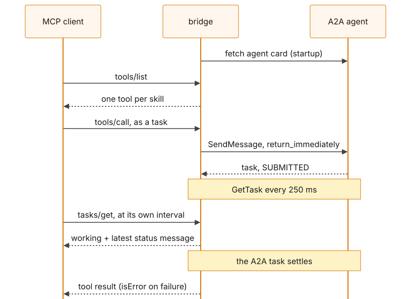
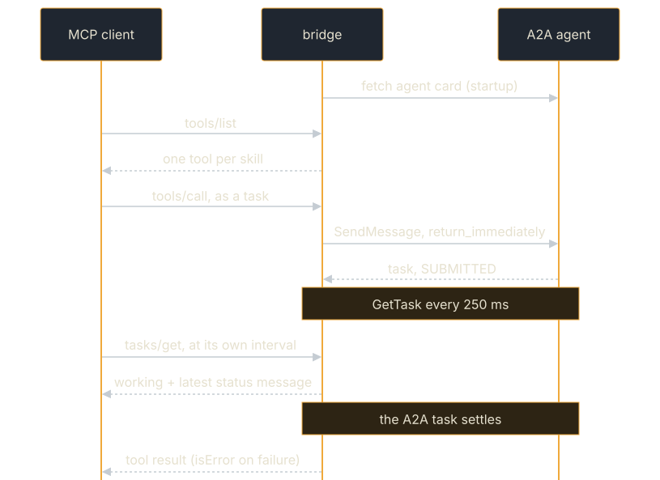

# A2A → MCP Bridge

Exposes a remote A2A agent as an **MCP server**, so any MCP client can call
it without knowing A2A exists.

**Source:** [`examples/mcp-bridge/`](https://github.com/tomtom215/a2a-rust/tree/main/examples/mcp-bridge)
(package `a2a-mcp-bridge`, binaries `a2a-mcp-bridge` and `bridge-demo`)

This is the reverse of [MCP Agent](./mcp-agent.md), which is an agent that
*uses* MCP tools. This one makes an A2A agent *be* one.

## What it shows

- An agent card's skills published as MCP tools, one tool per skill.
- A long-running A2A task carried as an MCP task (SEP-2663), with its status
  message and cancellation crossing between the two.
- A failed A2A task becoming an MCP `isError` result without ending the
  session.
- What does not cross, said out loud: `input-required`.

### Why this direction is the interesting one

The other direction serves A2A agents. This one serves everyone else: an MCP
client needs no A2A library, no A2A concept and no new code to call a remote
agent. It needs a command in its server list:

```jsonc
// in any MCP client's server configuration
{ "command": "a2a-mcp-bridge", "args": ["http://agent.internal:8080"] }
```

One bridge process fronts one agent, because that is how MCP clients are
configured anyway. Three agents are three entries, not one bridge with a
routing table.

## Run it

The bridge speaks MCP on its own stdin and stdout, the way MCP clients start
servers. It needs no model; it needs an A2A agent to front.

```bash
cargo build --release -p a2a-mcp-bridge --bin a2a-mcp-bridge   # target/release/a2a-mcp-bridge
target/release/a2a-mcp-bridge http://127.0.0.1:8080            # or set A2A_AGENT_URL
```

The crate is not published: the absolute path of the built binary is the
`command` in an MCP client's configuration (the example above assumes it is on
`PATH`; `cargo install --path examples/mcp-bridge --bin a2a-mcp-bridge` puts
it there).

To see the whole path without wiring up a client, `bridge-demo` stands up a
sample A2A agent, spawns the bridge against it as a real child process, and
acts as an MCP client:

```bash
cargo build -p a2a-mcp-bridge                    # both binaries
cargo run -p a2a-mcp-bridge --bin bridge-demo
```

`cargo run --bin bridge-demo` builds only the demo, and the demo spawns the
bridge from its own directory, so without the `cargo build` it stops with
"could not spawn …/a2a-mcp-bridge". No model and no network: the bridge is
protocol only, so the demo is deterministic.

## What you'll see

From `cargo run -p a2a-mcp-bridge --bin bridge-demo` on 2026-09-19, as the
README records it (verbatim except that the bridge's absolute path is
shortened):

```console
1. Sample A2A agent listening on http://127.0.0.1:35831
2. Spawned the bridge: target/debug/a2a-mcp-bridge
a2a-mcp-bridge: 'Sample Reporting Agent' at http://127.0.0.1:35831, 2 tool(s): slow_report, always_fails
3. MCP session up, tasks extension declared

Tools the bridge published from the agent card:
  slow_report — Produce a service report. Takes a few hundred milliseconds. (A2A skill 'slow_report' on remote agent 'Sample Reporting Agent'; one call is one agent task)
  always_fails — A skill that always fails, so an error has something to cross. (A2A skill 'always_fails' on remote agent 'Sample Reporting Agent'; one call is one agent task)

--- calling 'slow_report' (completes after a few polls)
    materialized as MCP task 9da79eca-a880-4fb0-a044-28f0ff230c60
    poll 1: working — contacting the A2A agent
    poll 2: working — Submitted
    poll 3: working — Submitted
    poll 4: working — Submitted
    poll 5: working — Working: writing up
    poll 6: working — Working: writing up
    poll 7: working — Working: writing up
    settled after 8 poll(s)
    isError: false
      Report for 'how are the payment services?': 3 services checked, 1 degraded (payments-api). [answered via A2A skill 'slow_report']

--- calling 'always_fails' (comes back as an MCP error result)
    materialized as MCP task 991b72d0-f7fd-446e-aac7-92587e0a965b
    poll 1: working — contacting the A2A agent
    poll 2: working — Submitted
    poll 3: working — Submitted
    poll 4: working — Submitted
    settled after 5 poll(s)
    isError: true
      [-32603] this skill always fails, so the bridge has an error to map

Demo complete. A2A tasks crossed to MCP as tasks, and back as results.
```

Three things that transcript settles:

- **The skill hint arrives.** `[answered via A2A skill 'slow_report']` is the
  sample agent echoing back the metadata the bridge sent, so the "advisory
  hint" described below is demonstrated rather than asserted.
- **A2A progress reaches the MCP caller.** `Working: writing up` is the A2A
  agent's own task status message, crossing two protocols to land in
  `tasks/get`.
- **It arrives coarsened.** The agent emits three steps (`gathering`,
  `correlating`, `writing up`) 120 ms apart. The caller saw only the last,
  because the bridge polls A2A every 250 ms. That is the cost of polling rather
  than streaming, visible in the output rather than discovered later.

## Key code

Each MCP `tools/call` becomes one A2A message. Adapted from `drive` in
`src/bridge.rs`:

```rust,no_run
use a2a_protocol_types::{Message, MessageSendParams, SendMessageConfiguration};

const SKILL_METADATA_KEY: &str = "a2a-mcp-bridge/skill";

/// The A2A message one MCP `tools/call` becomes.
fn params(tool: &str, message: String) -> MessageSendParams {
    MessageSendParams::new(Message::user_text(
        format!("mcp-bridge-{}", uuid::Uuid::new_v4()),
        message,
    ))
    // `return_immediately` so the task id is in hand before the agent
    // finishes. Without it a cancel arriving mid-call would have nothing
    // to cancel.
    .with_configuration(SendMessageConfiguration {
        return_immediately: Some(true),
        ..SendMessageConfiguration::default()
    })
    .with_metadata(serde_json::json!({ SKILL_METADATA_KEY: tool }))
}
```

The bridge then polls `GetTask` until the task is terminal, `input-required`
or `auth-required`, passing each new status message to the MCP task. When the
MCP caller cancels, it sends `CancelTask`; after 5 minutes (`MAX_WAIT`) it
cancels the task itself and reports an error.

## How it fits together

<figure class="diagram">
<a href="../images/diagrams/ex2-mcp-bridge.light.svg"></a>
<a href="../images/diagrams/ex2-mcp-bridge.dark.svg"></a>
<figcaption>One tool call: an MCP task in front, an A2A task behind, each side polled on its own clock.</figcaption>
</figure>

### How much of A2A survives the crossing

| A2A | MCP | Bridged |
|---|---|---|
| agent card `skills` | `tools/list` | ✅ one tool per skill, the agent's own descriptions |
| `Completed` | tool result | ✅ |
| `Failed`, `Rejected`, `Canceled` | tool result with `isError` | ✅ |
| long-running task | SEP-2663 task, polled with `tasks/get` | ✅ |
| task status message | MCP task status message | ✅ at poll granularity |
| `CancelTask` | `tasks/cancel` | ✅ cooperative on both sides |
| `InputRequired` | `CallToolResponse::InputRequired` | ❌ reported, not bridged |

MCP gained long-running tasks in the `2026-07-28` specification (SEP-2663),
and that is what makes the task rows possible at all. Before it, a
long-running A2A task had nowhere to go but a blocked request.

### Three asymmetries worth knowing before you copy this

**A2A skills carry no argument schema.** An MCP tool has one; an A2A skill
has a description, tags and examples, because A2A's calling convention is
fixed: you send a `Message`. Every published tool therefore takes one
string, and the skill's description is what tells a caller's model which to
use. Inventing a schema per skill would publish a contract the agent never
agreed to.

**A2A has no skill selector.** `SendMessage` has no field naming a skill, so
every tool sends to the same agent and the choice is advisory. The chosen
tool travels in the message metadata under `a2a-mcp-bridge/skill`, which an
agent may route on or ignore. The demo's sample agent routes on it.

**`input-required` is reported, not bridged.** MCP has a counterpart, and
wiring it up needs the bridge to hold an A2A task id across MCP calls and
translate `input_responses` into an A2A continuation message: real work with
a real chance of being subtly wrong, where a half-built version would strand
tasks with no way to answer them. A paused task comes back as an error whose
text says what the agent is waiting for, so a caller can tell "waiting" from
"broken".

### Why it polls A2A instead of streaming it

A2A has `SendStreamingMessage`, and it would give finer progress. Two reasons
against. An agent card may not advertise streaming at all, and a bridge that
worked only against streaming agents would be a bridge with a footnote. And
MCP's own task model *is* polling (the client drives `tasks/get` at its own
interval), so poll-to-poll has one clock instead of translating between two.

### Failure semantics

| Condition | Result |
|-----------|--------|
| A2A task completes | tool result with the artifact text |
| A2A task fails, is rejected or cancelled | tool result with `isError` and the agent's reason |
| A2A task pauses on `input-required` | `isError`, saying what the agent is waiting for |
| A2A agent unreachable at startup | the bridge refuses to start |
| Agent card advertises no skills | the bridge refuses to start |
| Two skill ids collide as tool names | the bridge refuses to start, naming both |
| A2A task never settles | cancelled after 5 minutes, reported as an error |
| Non-text artifact parts | dropped, with a line saying how many |

Refusing to start is deliberate in three of those rows: an MCP server that
came up with an empty or wrong tool list is indistinguishable, to its caller,
from an agent with nothing to offer.

### Tests

`cargo test -p a2a-mcp-bridge` runs fifteen, in two layers. The mapping is
pure, so its awkward cases are asserted on values: a skill id that is not a
legal tool name, two that collide (refused, naming both), a card with no
skills, and each task state's rendering including the `input-required` gap.
The bridge needs a real agent, so those tests start one on localhost and
connect a real MCP client over an in-process pipe, covering discovery, a
returned artifact, the skill hint arriving, a failed A2A task becoming an
`isError` result without killing the session, unknown tools and missing
arguments, and both refusals-to-start.

They need no model and no network beyond localhost, and run under `cargo test
--workspace`. The child-process spawn is what `bridge-demo` exercises; no CI
job runs the demo.

## What it does not cover

- **`input-required` and `auth-required` round trips.** Reported, not bridged.
- **Streaming progress.** Status messages arrive at the 250 ms poll's
  granularity.
- **Non-text artifacts.** Dropped, with a line saying how many.
- **More than one agent per process.** Run one bridge per agent.

## Where next

- [MCP Agent](./mcp-agent.md): the other direction, an A2A agent whose tools
  are MCP.
- [Streaming Responses](../client/streaming.md): the A2A streaming the bridge
  chooses not to use.
- The example's
  [README](https://github.com/tomtom215/a2a-rust/blob/main/examples/mcp-bridge/README.md)
  has the same walkthrough and transcript.
