# Multi-Language Team

Demonstrates a Rust coordinator agent that delegates work to worker agents implemented in Python, JavaScript, Go, Java — and Rust, so the package shows both halves of the SDK. It shows the shape of cross-language delegation; it does not prove it on its own — CI runs it with every worker unreachable. Cross-SDK interoperability is measured by `tck.yml`'s cross-language jobs and `scripts/go_sdk_interop.sh` instead (see [Example Harness and Go Interop](./harness.md)).

**Source:** [`examples/multi-lang-team/`](https://github.com/tomtom215/a2a-rust/tree/main/examples/multi-lang-team)

## What it shows

| Feature | How |
|---------|-----|
| **Cross-language A2A** | Rust coordinator talks to Python/JS/Go/Java agents via the A2A protocol |
| **Fan-out pattern** | Coordinator sends to every reachable worker concurrently, collects results |
| **A worker in this SDK** | `src/worker.rs`: `agent_executor!` + `EventEmitter`, one card, one artifact — the server half, `--bin rust-worker` |
| **Graceful degradation** | Connection errors and timeouts are reported, not fatal |
| **Agent card** | Coordinator publishes its own `AgentCard` with skills |
| **`ClientBuilder`** | Used to create A2A clients for each worker |
| **Timeout handling** | 10s per-worker timeout via `tokio::time::timeout` |

The package has two binaries. The coordinator (`src/main.rs`) is the
**client** side of this SDK: it builds a client per worker, fans out, and
parses replies. The Rust worker (`src/bin/rust-worker.rs`, agent in
`src/worker.rs`) is the **server** side: the same echo agent the four
`itk/agents/` workers are, in about forty lines.

## Run it

Rust is enough: the Rust worker needs nothing but this repository. The other
four workers each need their own toolchain (Python with `pip`, Node.js with
`npm`, Go, Java with Maven), and all of them are optional.

### 1. Start the worker agents

```bash
cd itk/agents/python && pip install -r requirements.txt && python agent.py &
cd itk/agents/js-agent && npm ci && node index.js &
cd itk/agents/go-agent && go run . &
cd itk/agents/java-agent && mvn compile exec:java &
cargo run -p multi-lang-team --bin rust-worker &
```

Ports: Python 9100, JavaScript 9101, Go 9102, Java 9103, Rust 9104
(`RUST_WORKER_ADDR=host:port` moves the Rust one). Any subset is fine; the
coordinator probes each at startup and says which it found. Start the Rust
worker first if the other toolchains are not installed.

### 2. Start the Rust coordinator

```bash
cargo run -p multi-lang-team
```

Without `A2A_BIND_ADDR`, this is a self-driving run: it starts the
coordinator on ephemeral ports (one per binding), sends one request through
the fan-out and prints the combined artifact, drives every A2A method over
every binding against itself, prints the coverage matrix, then exits (`0`
complete, `1` a call failed, `2` a matrix cell never ran). Set
`A2A_BIND_ADDR=127.0.0.1:8080` to serve the coordinator over JSON-RPC until
Ctrl+C instead.

## What you'll see

With only the Rust worker running, the state a fresh clone can reach with
`cargo` alone, as recorded in the example's README (abridged there: ports,
the task id and the rest of the sweep are elided):

```text
Multi-Language Agent Team Example
=================================

Worker agents:
  Python      http://127.0.0.1:9100    not reachable
  JavaScript  http://127.0.0.1:9101    not reachable
  Go          http://127.0.0.1:9102    not reachable
  Java        http://127.0.0.1:9103    not reachable
  Rust        http://127.0.0.1:9104    REACHABLE

Coordinator:
  JSON-RPC  http://127.0.0.1:<port>
  HTTP+JSON http://127.0.0.1:<port>
  gRPC      127.0.0.1:<port>
  WebSocket ws://127.0.0.1:<port>

=== Demo round-trip: one SendMessage, fanned out to every reachable worker ===

  Artifact: cross-lang-result
    [Rust Echo] Hello from the multi-language team demo!

=== Coverage: every A2A method over every binding ===

  --- JSONRPC ---
    [ok]   SendMessage                        task <uuid>
    ...
44 exercised, 0 not applicable, 0 missing, of 44 cells
...
Cross-language delegation exercised against 1 worker(s): Rust.
```

Each reachable worker contributes one line to the `cross-lang-result`
artifact: `[Python Echo] …`, `[JS Echo] …`, `[Go Echo] …`, `[Java Echo] …`,
`[Rust Echo] …`. A worker that is down is not in the artifact at all — it was
never delegated to, and the startup table says so — while one that goes down
*after* the probe is reported inline as `[<Language>] Error: …`. With no
workers at all the artifact says nothing was delegated, and the closing line
says the delegation was **not** exercised.

## Key code

The Rust worker is the smallest agent that satisfies the coordinator's
contract: a `SendMessage` reply that is a task whose first artifact's text is
the answer.

```rust,no_run
use a2a_protocol_server::agent_executor;
use a2a_protocol_server::executor_helpers::EventEmitter;
use a2a_protocol_types::message::Part;
use a2a_protocol_types::task::TaskState;

const REPLY_PREFIX: &str = "[Rust Echo] ";

/// The worker. It has no state: the reply depends only on the message.
struct RustWorker;

agent_executor!(RustWorker, |ctx, queue| async {
    let emit = EventEmitter::new(ctx, queue);
    emit.status(TaskState::Working).await?;

    // Every text part, in order; a message with no text part echoes an
    // empty string rather than failing, which is what the other workers do.
    let text = ctx.message.texts().collect::<Vec<_>>().join(" ");
    let reply = Part::text(format!("{REPLY_PREFIX}{text}"));

    emit.artifact("echo", vec![reply], None, Some(true)).await?;
    emit.status(TaskState::Completed).await?;
    Ok(())
});
```

On the coordinator's side, each worker call is bounded, and every way it can
go wrong becomes a line in the combined artifact rather than a failed task:

```rust,no_run
# use std::time::Duration;
# use a2a_protocol_client::ClientBuilder;
# use a2a_protocol_types::message::{Message, Part, PartContent};
# use a2a_protocol_types::params::MessageSendParams;
# use a2a_protocol_types::responses::SendMessageResponse;
# struct Worker { language: &'static str, url: &'static str }
# fn extract_text(parts: &[Part]) -> String {
#     parts
#         .iter()
#         .filter_map(|p| match &p.content {
#             PartContent::Text(text) => Some(text.as_str()),
#             _ => None,
#         })
#         .collect::<Vec<_>>()
#         .join(" ")
# }
# fn user_message(text: &str) -> MessageSendParams {
#     MessageSendParams::new(Message::user("m", vec![Part::text(text)]))
# }
async fn call_worker(worker: &Worker, user_text: &str) -> String {
    let client = match ClientBuilder::new(worker.url).build() {
        Ok(c) => c,
        Err(e) => return format!("[{}] Error connecting: {}", worker.language, e),
    };

    let send = client.send_message(user_message(user_text));
    match tokio::time::timeout(Duration::from_secs(10), send).await {
        Ok(Ok(response)) => match response {
            SendMessageResponse::Task(task) => task
                .artifacts
                .as_ref()
                .and_then(|arts| arts.first())
                .map(|a| extract_text(&a.parts))
                .unwrap_or_else(|| format!("[{}] (no artifact)", worker.language)),
            SendMessageResponse::Message(msg) => extract_text(&msg.parts),
            _ => format!("[{}] (unknown response type)", worker.language),
        },
        Ok(Err(e)) => format!("[{}] Error: {}", worker.language, e),
        Err(_) => format!("[{}] Timeout after 10s", worker.language),
    }
}
```

The executor spawns one `call_worker` per reachable worker and joins them, so
a slow or down worker costs one timeout window in total, not one per worker.

## How it fits together

<figure class="diagram">
<a href="../images/diagrams/ex-multi-lang-team.light.svg"></a>
<a href="../images/diagrams/ex-multi-lang-team.dark.svg"></a>
<figcaption>One request, fanned out to every worker the startup probe found.</figcaption>
</figure>

The coordinator:

1. Probes the workers once at startup and reports which are reachable.
2. Receives a user message via A2A.
3. Fans out the request to the reachable workers concurrently, with a 10 s
   timeout per worker.
4. Collects responses, or an error line for a worker that fails or times out.
5. Combines all results into a single artifact — or, with no worker
   reachable, answers on its own and says so in the artifact.

The workers are probed once rather than per request: with all five down, a
per-request fan-out would cost a full timeout window on every call.

## What it does not cover

This example does not prove cross-SDK interoperability: CI runs it with every
worker unreachable, and the worker agents under `itk/agents/` are echo agents,
not other SDKs' full surfaces. The coordinator does no authentication and
keeps its tasks in memory.

- [Example Harness and Go Interop](./harness.md): this SDK against the
  official Go SDK, in both directions, over three bindings.
- [Swarm](./swarm.md): fan-out through two hops, retries by failure class,
  and cancellation.
- [Incident-Response Team](./incident-response.md): delegation with
  multi-turn tasks and cancellation.
