# Rig Agent

A real [rig](https://github.com/0xPlaygrounds/rig) agent served over the
A2A protocol: incoming A2A messages are passed to `RigAgent`, which the
example defines over `rig_core::completion::CompletionModel`, runs a **tool
loop**, and returns the answer as an A2A artifact. The executor is generic
over that same `CompletionModel`, so swapping providers (Anthropic, Gemini,
Ollama, …) only changes the client construction in `main`.

**Source:** [`examples/rig-agent/`](https://github.com/tomtom215/a2a-rust/tree/main/examples/rig-agent)
(package `rig-a2a-agent`)

## What it shows

- A tool loop written by hand over rig-core, behind an `AgentExecutor`: many
  model turns, one A2A task.
- The three rules a tool loop needs: send the catalogue every turn, hand a
  tool's error back to the model, bound the turns.
- A `tool-trace` artifact beside the answer, so a caller can check the answer
  against what the tools returned.
- Which local models can call tools at all, measured.

If you want tool calling without writing the loop, the
[Tool-Loop Agent](./tool-loop-agent.md) does the same job with the SDK's
`ToolLoop`.

## Tool calling, and where it sits relative to A2A

A2A has no tool concept. It carries messages, tasks and artifacts *between*
agents; what an agent does inside one task is its own business. Tool calling
lives one layer down, between `RigAgent` and its model, and the A2A server
never sees it: `src/tools.rs` imports no `a2a-protocol-*` type at all.

That is the layering to copy: an A2A server does not become a tool runtime,
it hosts one.

The catalogue is two tools over a hard-coded inventory of three services:

| Tool | Arguments | Returns |
|---|---|---|
| `list_services` | none | every service name |
| `service_status` | `{"service": "<name>"}` | state, version, uptime |

Two, because between them they cover both JSON Schema shapes a provider has to
encode, and because they compose: a model asked about a service it does not
recognise has to discover the inventory first, which is a two-round loop. One
round is the case that still works when the loop is written wrong.

## Run it

```bash
# Hosted OpenAI:
export OPENAI_API_KEY=sk-...
RIG_MODEL=gpt-4o-mini cargo run -p rig-a2a-agent   # RIG_MODEL defaults to qwen3:1.7b

# Fully local: any OpenAI-compatible server (llama-server, vLLM, Ollama)
export OPENAI_BASE_URL=http://127.0.0.1:11434/v1
RIG_MODEL=qwen3:1.7b cargo run -p rig-a2a-agent
```

With `OPENAI_API_KEY` unset the example uses the placeholder `local`, which
local servers ignore and hosted providers reject, and prints a line saying so.
`RIG_MAX_TOKENS` caps each model turn's output (default 1024), and unless
`RIG_THINKING=1` every request asks the server not to reason first
(`chat_template_kwargs`); set `RIG_THINKING=1` for a hosted provider that
refuses that field.

The README's verified walkthrough with llama.cpp's `llama-server`, built from
source (about three minutes on four cores; needs cmake and a C++ compiler):

```bash
git clone --depth 1 https://github.com/ggml-org/llama.cpp
cmake -S llama.cpp -B llama.cpp/build -DLLAMA_CURL=OFF
cmake --build llama.cpp/build --target llama-server -j"$(nproc)"

curl -L -o model.gguf \
  'https://huggingface.co/ggml-org/Qwen3-1.7B-GGUF/resolve/main/Qwen3-1.7B-Q4_K_M.gguf'

./llama.cpp/build/bin/llama-server -m model.gguf --port 11434 --alias qwen3:1.7b \
  --jinja \
  -c 8192 --reasoning off &   # direct answers, no thinking preamble; 8K context bounds memory

export OPENAI_BASE_URL=http://127.0.0.1:11434/v1
RIG_MODEL=qwen3:1.7b A2A_BIND_ADDR=127.0.0.1:8080 cargo run -p rig-a2a-agent
```

`--jinja` is load-bearing: without it `llama-server` applies no chat template,
and no model emits a tool call however capable it is.

### vLLM

vLLM serves the same OpenAI-compatible API, from the unquantized weights
rather than a GGUF. Use it when you want throughput or a GPU; llama.cpp is the
lighter option for a laptop CPU.

```bash
pip install vllm
vllm serve Qwen/Qwen3-1.7B --port 11434 --served-model-name qwen3:1.7b
```

`--served-model-name` matters: the example sends the model name in the request
body, and vLLM rejects a name it was not started with. Setting it to the string
llama.cpp's `--alias` uses means the same `RIG_MODEL` works against either
server. Ollama works the same way; it already listens on `:11434`.

### Two modes

**The default run checks itself and exits.** Without `A2A_BIND_ADDR`, the
binary serves all four bindings on random loopback ports, says whether a
provider answered (`LLM leg: EXERCISED` or `LLM leg: NOT EXERCISED`), drives
every A2A method over every binding, prints the coverage matrix, and exits `0`
when all 44 cells ran, `1` when a call failed, or `2` when a cell never ran.
With no provider reachable, each task completes with a labelled mechanical
reply, so the protocol surface is measured either way.

**Server mode** starts when `A2A_BIND_ADDR` is set, serves JSON-RPC there until
Ctrl+C, and has the failure semantics below. It passes the in-repo TCK: 21/21
graded checks, 1 not applicable, on the JSON-RPC binding, gated by `tck.yml`'s
`tck-example-agents` job on every push and pull request with no model
configured. It permits push-notification webhooks on loopback and private
addresses (`allow_private_urls`), so it is a local test server, not a
deployment template; [Genai Agent](./genai-agent.md)'s server mode shows the
guarded default.

### The local model has to be tool-capable

Measured 2026-09-19 against the same `llama-server` build (llama.cpp
`b23701f`, `--jinja`), with this example's catalogue:

| Model | Result |
|---|---|
| Qwen3.5-0.8B-Q4_0 | **Cannot.** Answers in prose. Forced with `tool_choice: "required"` it still emits no tool call, and runs to `finish_reason: "length"`. |
| Qwen3-1.7B-Q4_K_M | **Can.** First request returns `finish_reason: "tool_calls"`. |

Re-measured 2026-10-20 on llama.cpp b11751, after the loop began running a
call the model wrote as its whole reply's text when it names a declared tool
(`src/leaked.rs`) and the preamble told the model to call tools itself:
Qwen3-1.7B-Q4_K_M went to 20 of 20 on each of two prompts (the example's
README says what is counted), and Qwen3.5-0.8B-Q4_0 now emits tool calls (9 of
10 billing runs made at least one) but answers wrongly too often to rely on.
Use Qwen3-1.7B or larger.

Hence the default, which differs from the sibling LLM examples': they do not
call tools, so 0.8B remains right for them.

## What you'll see

In server mode, talk to the agent with `curl`:

```bash
# Agent discovery
curl http://127.0.0.1:8080/.well-known/agent-card.json

# Send a message (JSON-RPC binding)
curl -X POST http://127.0.0.1:8080 -H 'Content-Type: application/json' -H 'A2A-Version: 1.0' -d '{
  "jsonrpc": "2.0", "id": 1, "method": "SendMessage",
  "params": {"message": {"messageId": "m1", "role": "ROLE_USER",
             "parts": [{"text": "How is the checkout service doing? Give me its version."}]}}
}'

# Full conformance suite: 21/21 graded, 1 N/A on this binding
cargo run -p a2a-tck -- --url http://127.0.0.1:8080 --binding jsonrpc
```

The README records two tool-calling turns: Qwen3-1.7B on four CPU cores, a
debug build, about 5 s each. Below is its summary of each JSON-RPC response
(the artifacts and trace lines verbatim, the response's JSON abridged away).
One round, because the service exists:

```text
state: TASK_STATE_COMPLETED
[ rig-response ]
The checkout service is in a healthy state. Its current version is 2.8.0, and
it has been running for 7200 seconds (2 hours).
[ tool-trace ]
service_status({"service":"checkout"}) -> {"service":"checkout","state":"healthy","uptimeSeconds":259200,"version":"2.8.0"}
```

**Read those two artifacts against each other.** The tool returned
`uptimeSeconds: 259200`, three days. The model reported 7200 seconds, a number
it invented. The version and the state it took from the tool are right. It is
what a 1.7B model does, and it is why the trace artifact exists: without it the
caller sees one confident paragraph and has no way to check it. A grounded
answer and a verifiable one are different properties, and only the second is
something the protocol can carry. (In the README's 20 runs after the
2026-10-20 change, all 20 checkout answers reported the tool's 259200 s.)

Two rounds, because the service does not exist; the tool error is handed back
and the model recovers from it:

```text
state: TASK_STATE_COMPLETED
[ rig-response ]
The services in the inventory are: payments-api, checkout, search.

Which service would you like to check the status of?
[ tool-trace ]
service_status({"service":"billing"}) -> error: no service named 'billing'; call list_services for the inventory
list_services({}) -> ["payments-api","checkout","search"]
```

The error text names the recovery tool because the model is its reader, and
the model followed the hint.

## Key code

The loop, abridged from `RigAgent::prompt` in `src/agent.rs` (shown as text:
the book's doctests do not depend on rig-core):

```text
for round in 0..MAX_TURNS {
    let response = self
        .model
        .completion_request(turn.clone())
        .preamble(self.preamble.clone())
        .messages(history.clone())
        .tools(catalogue.clone())          // rule 1: the catalogue on every request
        .send()
        .await?;
    // No tool calls (and none written as text): the reply is the answer.
    // Otherwise run each call:
    for call in &calls {
        let outcome = match tools::invoke(&call.function.name, &call.function.arguments) {
            Ok(output) => output,
            Err(e) => format!("error: {e}"), // rule 2: an error is a result
        };
        trace.push(format!("{}({}) -> {outcome}", call.function.name, call.function.arguments));
        // ... becomes a tool result in the next turn
    }
}
Err(AgentError::TurnLimit(MAX_TURNS))      // rule 3: the loop is bounded
```

Each rule is a bug if you copy the shape without it:

1. **The catalogue goes on every request**, not just the first. A provider
   holds no state between turns.
2. **A tool error is a result, not a failure.** An unknown service is
   something the model recovers from; a failed A2A task is not.
3. **The loop is bounded** (`agent::MAX_TURNS`, 6). Unbounded, a model that
   calls tools forever holds the A2A task open until the server's executor
   timeout, an hour by default.

## How it fits together

<figure class="diagram">
<a href="../images/diagrams/ex2-rig-layers.light.svg"></a>
<a href="../images/diagrams/ex2-rig-layers.dark.svg"></a>
<figcaption>Many model turns inside one A2A task; the A2A server never sees a tool call.</figcaption>
</figure>

### Failure semantics

In server mode:

| Condition | Task state |
|-----------|-----------|
| Answer, no tools called | `TASK_STATE_COMPLETED`, artifact `rig-response` |
| Answer after tool calls | `TASK_STATE_COMPLETED`, artifacts `rig-response` and `tool-trace` |
| A tool errored | **not** a task failure: the error returns to the model, and the trace records it |
| Model never stops calling tools | `TASK_STATE_FAILED` after `MAX_TURNS` |
| Provider unreachable or errors | `TASK_STATE_FAILED` |
| Message has no text part | `TASK_STATE_FAILED` (invalid params) |

Errors surface through the task state; they are never folded into a
"successful" artifact. The one deliberate exception is a *tool* error, which is
information the model is expected to act on. In the self-driving demo, the
last two provider rows instead produce a reply labelled
`[no model reachable — mechanical fallback, not an LLM answer]`, and the run
ends by reporting whether the LLM leg was exercised.

## What it does not cover

- **Tools from another process.** [MCP Agent](./mcp-agent.md) keeps this loop
  and discovers its tools from an MCP server.
- **Signing, budgets or approvals around the loop.** See
  [Live Model](./live-model.md).
- **Streaming the model's tokens.** The answer is one artifact.

## Where next

- [Tool-Loop Agent](./tool-loop-agent.md): the same tools and inventory, with
  the SDK's `ToolLoop` instead of a hand-written loop.
- [MCP Agent](./mcp-agent.md): the same loop, tools discovered over MCP.
- The example's
  [README](https://github.com/tomtom215/a2a-rust/blob/main/examples/rig-agent/README.md)
  has the full measurements, including the 2026-10-20 before-and-after table.
