# Swarm

A coordinator, a tier of supervisor agents and a tier of worker agents, every
hop a real A2A call between separate servers on loopback. It measures what a
swarm needs from the protocol layer, and fails if the numbers do not add up. It
is a measurement of the SDK's overhead, not of an orchestrator: the supervisor
is a fixed fan-out, and everything is on one machine.

**Source:** [`examples/swarm/`](https://github.com/tomtom215/a2a-rust/tree/main/examples/swarm)

## What it shows

- Throughput and per-job latency through two delegation hops.
- Retry decided by [failure class](../client/failure-classes.md): a
  `Transient` failure is retried once on another worker, an `InvalidRequest`
  never.
- Cancellation through two hops with [`Delegation`](../client/delegation.md),
  and what happens without it: A2A has no parent/child link between tasks.
- Optionally, the same tree with a model behind every worker.

## Run it

```bash
cargo run --release -p swarm
```

It needs nothing else; only the `llm` scenario needs a model. It runs every
scenario once and exits. With the defaults that is 64 workers under 8
supervisors and 32 jobs in flight per supervisor, with 4,000 jobs in each of
`fanout` and `faults`. CI's `example-surface` job (`ci.yml`) runs it with the
defaults; the `llm` scenario is skipped there, because CI has no model.

| Variable | Default | Effect |
|---|---|---|
| `SWARM_WORKERS` | `64` | Worker agents, split evenly into one pool per supervisor |
| `SWARM_SUPERVISORS` | `8` | Supervisor agents |
| `SWARM_JOBS` | `4000` | Jobs in the `fanout` and `faults` scenarios |
| `SWARM_INFLIGHT` | `32` | Jobs each supervisor keeps outstanding |
| `SWARM_LLM_URL` | unset | An OpenAI-compatible chat endpoint over plain HTTP, e.g. `http://127.0.0.1:11434/v1/chat/completions`. Enables the `llm` scenario |
| `SWARM_LLM_JOBS`, `SWARM_LLM_WORKERS`, `SWARM_LLM_SUPERVISORS`, `SWARM_LLM_INFLIGHT` | `32`, `8`, `2`, `2` | The `llm` scenario's size |
| `SWARM_DEBUG` | unset | Print why a supervisor lost contact with a worker |

The `llm` scenario sends the model name `swarm`, so the endpoint must serve one
model whatever the request names, as `llama-server` does.

## What you'll see

The repository records no full run of this example. With the defaults, the
first line is (from the format string in `src/main.rs`):

```text
swarm: 64 workers under 8 supervisors, 32 in flight per supervisor
```

Then one JSON object per line, one per scenario, each with a `scenario` field.
What the others carry, from the same file:

| Scenario | Fields |
|---|---|
| `fanout` | `jobs`, `outcomes` (a count per outcome), `retried`, `wall_s`, `jobs_per_s`, `job_us` (`p50`, `p90`, `p99`, `max`) |
| `faults` | `jobs`, `injected_transient`, `injected_invalid`, `outcomes`, `retried`, `wall_s`, `accounting_exact` |
| `cancel`, `cancel-control` | `result`: `jobs_live_before_cancel`, `expected_live`, `root_cancel_rpcs_ms`, `quiesce_ms`, `still_executing_after_5s` |
| `llm` | the run's size, `outcomes`, `retried`, `wall_s`, `jobs_per_s`, `job_ms`; or `"skipped": "SWARM_LLM_URL unset"` |

The exit status is `0` when every scenario's accounting adds up and `1`
otherwise, with the reason on stderr. For scale,
[`docs/swarm-orchestration.md`](https://github.com/tomtom215/a2a-rust/blob/main/docs/swarm-orchestration.md)
records two delegation hops sustaining 3,773–3,909 jobs/s on two cores in the
`fanout` rows.

| Scenario | What it measures | Fails the run when |
|---|---|---|
| `fanout` | Jobs per second and per-job latency (p50, p90, p99, max) through two delegation hops | Any job does not complete |
| `faults` | One job in ten fails `Transient`, one in fifty `InvalidRequest`. A supervisor re-sends a `Transient` failure once, to a different worker, with the fault removed; any other class is final | The completed jobs, the `InvalidRequest` failures or the retries differ in number from what was injected |
| `cancel` | Cancelling the root tasks: how long until no worker is still executing. The supervisor cancels each child it created, through the client's `Delegation` | Any worker is still executing 5 seconds after the roots were cancelled |
| `cancel-control` | The same, with the supervisor walking away from its children instead of cancelling them | Never: it demonstrates the lesson below |
| `llm` | The same tree with a model behind every worker | Any job does not complete. Skipped, and its JSON line says so, when `SWARM_LLM_URL` is unset |

A worker's job is the message text: `sleep:<ms>`, `flaky:<ms>` (fails
`Transient`), `bad:<ms>` (fails `InvalidRequest`) or `llm:<prompt>`.

## Key code

A supervisor follows each child with `Delegation`, which cancels the child when
the supervisor's own task is cancelled. Adapted from `run_once` and `run_job` in
`src/supervisor.rs`:

```rust,no_run
use std::sync::Arc;

use a2a_protocol_client::A2aClient;
use a2a_protocol_client::delegation::{Delegation, Outcome};
use a2a_protocol_server::CancellationToken;
use a2a_protocol_types::{Message, MessageSendParams, Part};

/// Sends one job to one worker and follows it to a terminal state,
/// cancelling the child if `stop` (the supervisor's own task) fires first.
async fn run_once(worker: &Arc<A2aClient>, job: &str, stop: &CancellationToken) -> &'static str {
    let params = MessageSendParams::new(Message::user(
        uuid::Uuid::new_v4().to_string(),
        vec![Part::text(job)],
    ));
    let Ok(child) = Delegation::start(Arc::clone(worker), params).await else {
        return "lost";
    };
    match child.wait(stop.cancelled()).await.outcome {
        Outcome::Completed(_) => "completed",
        // Retry by class: only a retryable failure goes to another worker.
        Outcome::Failed { class, .. } if class.is_retryable() => "retry once, elsewhere",
        Outcome::Failed { .. } => "failed, final",
        _ => "canceled or lost",
    }
}
```

`Delegation::start` sends with `SendStreamingMessage`, and `wait` follows the
stream until the child settles or the future it is given completes; in the
second case it sends `CancelTask` for the child. The `cancel-control` arm
detaches from the child instead, which is what an orchestrator that wrote no
cascade does.

## How it fits together

<figure class="diagram">
<a href="../images/diagrams/ex2-swarm-tiers.light.svg"></a>
<a href="../images/diagrams/ex2-swarm-tiers.dark.svg"></a>
<figcaption>Three tiers, two A2A hops; each supervisor owns a disjoint worker pool.</figcaption>
</figure>

The coordinator deals the jobs round-robin into one `batch:` message per
supervisor and sends them concurrently. Each supervisor keeps at most
`SWARM_INFLIGHT` jobs outstanding across its pool, and answers with one
`summary` artifact tallying what became of every job. Every agent is its own
`RequestHandler` on its own loopback port, with its own store and queues.

### The lesson in `cancel-control`

A2A has no parent/child link between tasks. Cancelling a task cascades nothing
unless the orchestrator does it. In the control scenario the supervisor walks
away from its children, and the result shows that cancelling the roots did not
stop them. A supervisor that delegates has to cancel what it delegated, which is
what [`Delegation`](../client/delegation.md) does when its handle is dropped or
cancelled.

The `faults` scenario makes the companion point: whether to retry is decided by
the *failure class* ([Why a Task Failed](../client/failure-classes.md)), not by
the fact of failure.

## What it does not cover

- **Durability.** Every store is in memory and a restarted agent forgets its
  tasks. [Resilient Agent](./resilient-agent.md) covers restarts.
- **More than one machine.** The latency figures are the SDK's overhead, not a
  network's.
- **The orchestration above A2A:** planning, judging a result, escalating to a
  person.

## Where next

- [`docs/swarm-orchestration.md`](https://github.com/tomtom215/a2a-rust/blob/main/docs/swarm-orchestration.md)
  is the analysis these runs feed.
- [Delegating to Another Agent](../client/delegation.md) covers `Delegation`.
- [Benchmark Results](../reference/benchmarks.md) reports measured figures.
- The example's
  [README](https://github.com/tomtom215/a2a-rust/blob/main/examples/swarm/README.md)
  has the same tables.
