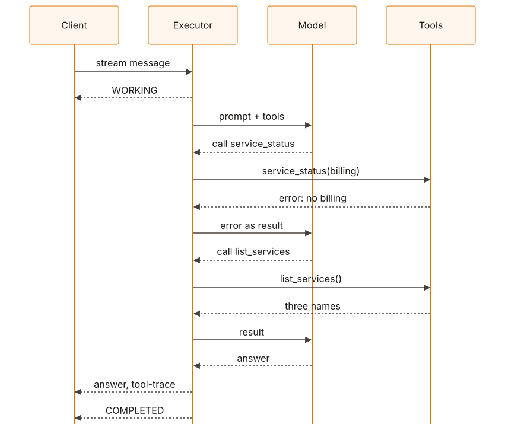
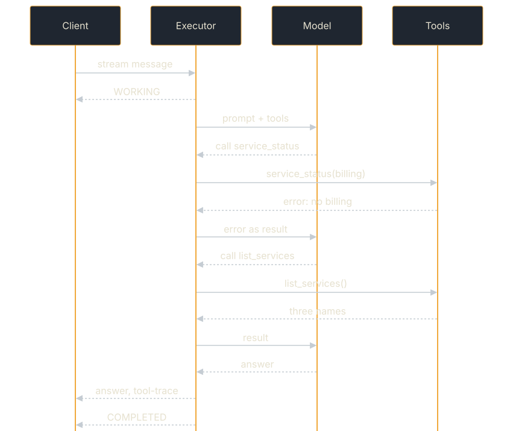

# Tool-Loop Agent

An agent that calls tools, with no tool loop of its own. [Rig Agent](./rig-agent.md)
and [MCP Agent](./mcp-agent.md) each write their loop over rig-core. This one
writes none: `ToolLoopExecutor` runs the SDK's `ToolLoop` over
`OpenAiChatModel`, and the agent is two tools (`list_services`,
`service_status`), a preamble and an agent card. Besides `tokio` and
`serde_json`, its only dependency is `a2a-protocol-sdk` with the `tool-loop`
feature (see
[ADR 0022](https://github.com/tomtom215/a2a-rust/blob/main/docs/adr/0022-tool-calling-loop.md)).
It is the example of the SDK's own tool loop; the
[Tool Loop](../building-agents/tool-loop.md) guide explains the loop itself.

**Source:** [`examples/tool-loop-agent/`](https://github.com/tomtom215/a2a-rust/tree/main/examples/tool-loop-agent)

## What it shows

- A tool-calling agent built from `ToolLoop::new(model, tools)`,
  `with_preamble` and `ToolLoopExecutor::new`, served like any other executor.
- Recovery from a tool error inside one A2A task: the default question names a
  service the inventory does not have.
- Two artifacts per answer: `answer`, what the model said, and `tool-trace`,
  what the tools returned.
- A client that streams, because a blocking send can outlast the server's idle
  timeout.

## Run it

You need an OpenAI-compatible chat endpoint serving a tool-capable model:
llama.cpp's `llama-server`, vLLM, Ollama or a hosted API. With `llama-server`,
`--jinja` is required, or no model emits a tool call (see
[Rig Agent](./rig-agent.md#the-local-model-has-to-be-tool-capable)).

```bash
llama-server -m qwen3-1.7b-q4_k_m.gguf -c 8192 --port 8080 --jinja
TOOL_LOOP_BASE_URL=http://127.0.0.1:8080/v1 \
  cargo run -p tool-loop-agent -- "How is the billing service doing?"
```

A run serves the agent over JSON-RPC on an ephemeral loopback port, asks it one
question with the A2A client, prints the `answer` and `tool-trace` artifacts,
and exits non-zero unless the task completed. With no question on the command
line it asks "How is the billing service doing?".

| Variable | Default |
|---|---|
| `TOOL_LOOP_BASE_URL` | `http://127.0.0.1:8080/v1` |
| `TOOL_LOOP_MODEL` | `qwen3:1.7b` |
| `TOOL_LOOP_API_KEY` | none; sent as `Authorization: Bearer` when set |
| `TOOL_LOOP_THINKING` | unset: each request carries `"chat_template_kwargs": {"enable_thinking": false}`; `1` sends nothing extra |
| `TOOL_LOOP_MODEL_TIMEOUT_SECS` | 120, `OpenAiChatModel`'s default: how long one model turn may take |
| `TOOL_LOOP_EXTRA_BODY` | none: a JSON object merged into every request (sampler, seed) |

The standard `OTEL_*` variables turn on the SDK's `Telemetry`: the server's
call span, the executor's `invoke_agent` span, a `chat` span per model call and
an `execute_tool` span per tool call. With no endpoint set, nothing is built.

`cargo test -p tool-loop-agent` needs no model. It plays the billing run with a
scripted `ToolModel` through the same server, client and tools.

## What you'll see

The README records a live run on 2026-10-20: llama.cpp `llama-server` build
b11751, `qwen3:1.7b` (Qwen3-1.7B Q4_K_M), four shared CPU cores, ten runs of
each prompt with thinking off. Abridged:

| Prompt | Completed | Tool calls | Answer |
|---|---|---|---|
| billing (unknown name: two rounds) | 10 of 10 | 10 of 10 called `service_status("billing")`, read the error, then called `list_services` | 10 of 10 named the three services and said billing is not among them |
| checkout (one call) | 10 of 10 | 10 of 10 called `service_status("checkout")` once | 10 of 10 gave the state and version 2.8.0; the uptime was right (259200 s) in 3, a number the tool never returned in 6, and converted wrongly in 1 |

No run hit the turn bound, and a run took 14 to 104 s. One transcript of each,
verbatim from the README (the program prints `model:`, `agent:` and `asked:`
lines before these):

```console
state: TASK_STATE_COMPLETED
[ answer ]
The services in the inventory are: payments-api, checkout, search. The billing service is not listed among them.
[ tool-trace ]
service_status({"service": "billing"}) -> error: no service named 'billing'; call list_services for the inventory
list_services({}) -> ["payments-api","checkout","search"]
```

```console
state: TASK_STATE_COMPLETED
[ answer ]
The checkout service is in a healthy state. Its current version is 2.8.0, and it has been running for 7200 seconds (2 hours).
[ tool-trace ]
service_status({"service": "checkout"}) -> {"service":"checkout","state":"healthy","uptimeSeconds":259200,"version":"2.8.0"}
```

### Why there are two artifacts

The second transcript is the reason. The answer is fluent and its uptime is
invented; the trace line beneath it shows what the tool returned (259200 s,
three days). Six of ten checkout answers did this, against the preamble's
instruction to report values exactly as returned. Counts that small say what
those runs did, not a rate; the point is that the trace is there to be read.

## Key code

The whole agent is a `ToolLoop` handed to `ToolLoopExecutor`, from
`serve_agent` in `src/main.rs`. It is shown as text because the book's doctests
do not build the `tool-loop` feature:

```text
let tool_loop = ToolLoop::new(model, tools::catalogue()?).with_preamble(PREAMBLE);
let handler = Arc::new(
    RequestHandlerBuilder::new(ToolLoopExecutor::new(tool_loop))
        .with_agent_card(card(&url))
        .build()?,
);
serve_with_addr(addr, JsonRpcDispatcher::new(handler)).await?;
```

Each tool implements `Tool`: a name, a description, a JSON Schema for its
parameters, `read_only`, and `call`. An `Err(ToolError::Failed(…))` from `call`
goes back to the model as that call's result, not as a task failure, so
`service_status` writes its error for the model to read. For an unknown name it
says "no service named '…'; call list_services for the inventory", which is
the hint the model follows in the first transcript.

## How it fits together

<figure class="diagram">
<a href="../images/diagrams/ex2-tool-loop-turn.light.svg"></a>
<a href="../images/diagrams/ex2-tool-loop-turn.dark.svg"></a>
<figcaption>The billing question: one A2A task, three model turns, two tool calls.</figcaption>
</figure>

Every model turn and tool call happens inside one A2A task. The caller sees
`WORKING`, the `answer` artifact, the `tool-trace` artifact (when at least one
tool ran) and `COMPLETED`. The loop is bounded: `ToolLoop` allows 8 turns by
default (`DEFAULT_MAX_TURNS`), and a run still calling tools at the bound fails
the task with failure class `budget-exhausted`.

### Why the client streams

A blocking `SendMessage` moves no bytes until the run is over, and the server
closes a connection idle for 75 seconds (`DEFAULT_IDLE_TIMEOUT`). A model turn on
a small local model can outlast that, so the blocking send fails in the client
with `client error (SendRequest)`. The stream does not: the server sends a
keep-alive after 30 seconds without an event
(`DispatchConfig::sse_keep_alive_interval`). The first version of this example
sent a blocking request, and 3 of its 15 runs failed that way. A caller of any
agent whose turn can outlast the idle timeout should stream, or poll a
`return_immediately` send. See [Streaming Responses](../client/streaming.md).

## What it does not cover

- **Other bindings, signing, budgets, a halt or approvals.** The
  [Live Model](./live-model.md) example runs this same loop with all of them.
- **Tools from outside the process.** [MCP Agent](./mcp-agent.md) discovers its
  tools from an MCP server.
- **Whether the answer is right.** The `tool-trace` artifact lets a caller
  check; nothing checks for it.

## Where next

- [Tool Loop](../building-agents/tool-loop.md) explains `ToolLoop`,
  `ToolLoopExecutor` and `OpenAiChatModel`.
- [Dogfooding Against a Real Model](../deployment/dogfooding-real-model.md) and
  the [Live Model](./live-model.md) example run this same loop on every binding,
  with provenance, budgets, a halt and an approval quorum.
- [API Quick Reference](../reference/api-reference.md) lists `ToolLoop`,
  `ToolLoopExecutor` and `OpenAiChatModel`.
- The example's
  [README](https://github.com/tomtom215/a2a-rust/blob/main/examples/tool-loop-agent/README.md)
  has the full recorded run.
