# Installation

## Requirements

- **Rust 1.94+** (stable; CI tests the MSRV and current stable)
- A working internet connection for downloading crates
- **`protoc`** (Protocol Buffers compiler) — bundled automatically: the `grpc`/`proto` build scripts use a vendored `protoc` (`protoc-bin-vendored`), so a clean `cargo build -p a2a-protocol-sdk --features grpc` works with no system install. Set the `PROTOC` environment variable only to override with your own binary (or on a platform the vendored binaries don't cover).

## Adding to Your Project

The easiest way to use a2a-rust is through the umbrella SDK crate, which re-exports everything you need:

```toml
[dependencies]
a2a-protocol-sdk = "0.16"
tokio = { version = "1", features = ["full"] }
```

The SDK crate re-exports `a2a-protocol-types`, `a2a-protocol-client`, and `a2a-protocol-server` so you only need one dependency.

## Individual Crates

If you prefer fine-grained control, depend on individual crates:

```toml
# Types only (no I/O, no async runtime)
a2a-protocol-types = "0.16"

# Client only
a2a-protocol-client = "0.16"

# Server only
a2a-protocol-server = "0.16"
```

This is useful when:
- You're building a **client only** and don't need server types
- You're building a **server only** and don't need client types
- You want to minimize compile times and dependency trees

## Feature Flags

Features are off by default to minimize compile times and dependency trees, with
these exceptions. **`tls-rustls` is on by default** for `a2a-protocol-client`
and `a2a-protocol-sdk`, because the A2A spec serves agents over HTTPS and the
client (and the bundled push sender) must reach them out of the box.
**`tracing` and `otel` are on by default** for `a2a-protocol-client`,
`a2a-protocol-server` and `a2a-protocol-sdk`, so a default build logs through,
and records OpenTelemetry spans and metrics with, whatever `tracing` subscriber
and provider the application installs. **`webhook` is on by default** for the
client and the SDK. **`otlp`** (`Telemetry` and OTLP export) **is on by default
in `a2a-protocol-sdk` only.**
`default-features = false` removes a crate's defaults — on the SDK too, which
takes the client and server without theirs: an SDK built that way has no rustls,
no logging, no OpenTelemetry and no webhook receiver.

Some features turn on others. The arrows below are the `[features]` tables of
the four crates' `Cargo.toml`, as the SDK forwards them. `websocket`, `sqlite`,
`postgres`, `axum`, `tool-loop`, `auth-jwt` and `encryption` turn on no other
feature, and are left out:

<figure class="diagram">
<a href="../images/diagrams/gs-feature-map.light.svg"></a>
<a href="../images/diagrams/gs-feature-map.dark.svg"></a>
<figcaption>Which feature turns on which. The box holds the SDK's default set.</figcaption>
</figure>

### `a2a-protocol-types`

| Feature | Description |
|---------|-------------|
| `signing` | JWS agent card signing, ES256 or EdDSA (Ed25519), with RFC 8785 canonicalization |
| `audit` | Audit record schema, hash chains, ES256/Ed25519-signed checkpoints and chain verification (`audit::verify_chain`); implies `signing` |
| `proto` | Canonical protobuf message types and the JSON⇄proto conversions (turned on by `grpc`) |

### `a2a-protocol-client`

| Feature | Description |
|---------|-------------|
| `tls-rustls` | HTTPS via rustls (no OpenSSL required); on by default |
| `signing` | Forwards `a2a-protocol-types/signing`, and lets card discovery verify signatures: pass the keys you trust to `CardFetchOptions::with_signature_keys` and a `_with_options` fetch verifies the card, refusing an unsigned one unless `with_require_signature(false)`; `fetch_jwks` fetches a key set. Nothing is verified by default, and the client never signs. `verify_agent_card` checks a card you already hold |
| `tracing` | Structured logging via the `tracing` crate, and a `CLIENT` span per call; on by default |
| `otel` | Each call's `traceparent` names the call's own span when a `tracing-opentelemetry` layer records it (implies `tracing`); on by default |
| `websocket` | WebSocket transport via `tokio-tungstenite` |
| `grpc` | gRPC transport via `tonic` (plaintext) |
| `grpc-tls` | gRPC over TLS — `grpc` + tonic's rustls connector (independent of `tls-rustls`); needed for `https://` gRPC endpoints and for the default dialling of a bare non-loopback `host:port` target |
| `testing` | A scripted hostile peer (`testing::ScriptedPeer`) that stalls, cuts off, mis-frames or refuses on each binding, for testing code that calls agents |
| `webhook` | The push-notification webhook receiver (`webhook::WebhookReceiver`): token and `Authorization` checks, task-id check, duplicate suppression, optional rate limit (spec §4.3.3, §13.2); on by default |

### `a2a-protocol-server`

| Feature | Description |
|---------|-------------|
| `signing` | Forwards `a2a-protocol-types/signing`; adds `RequestHandlerBuilder::with_content_signer`, which signs every artifact, status message and direct reply the server sends, not a task's history (ADR 0027). The server never signs or verifies the card it serves: sign it with `sign_card_es256` before handing it to the builder |
| `tracing` | Structured logging via the `tracing` crate (on by default) |
| `tls-rustls` | HTTPS delivery for the bundled push-notification sender; HTTPS on the server's own listener (`Server::with_tls`, `Server::with_tls_pem`); `MutualTlsAuthInterceptor`, which names a caller from its client certificate (also available with `grpc-tls`) |
| `sqlite` | SQLite-backed task and push config stores via `sqlx` |
| `postgres` | PostgreSQL-backed task and push config stores via `sqlx` |
| `websocket` | WebSocket transport via `tokio-tungstenite` |
| `grpc` | gRPC transport via `tonic` |
| `grpc-tls` | TLS on the gRPC listener (`GrpcDispatcher::with_tls`); implies `grpc` |
| `otel` | `OtelMetrics` and the spans' OpenTelemetry bridge, through the API only (on by default) |
| `otlp` | `Telemetry`: OTLP export of traces, metrics and logs, gRPC or HTTP/protobuf, with a Langfuse preset (implies `otel`) |
| `otlp-json` | OTLP/HTTP with JSON bodies (`OtlpProtocol::HttpJson`); off by default because it would also make JSON the default of an application's own `opentelemetry-otlp` exporters (implies `otlp`) |
| `otel-prometheus` | `OTEL_METRICS_EXPORTER=prometheus`: serve the metrics at `/metrics` for a Prometheus that scrapes, with no collector in between; off by default because it adds `opentelemetry-prometheus` and a listener (implies `otlp`) |
| `conformance` | A harness that grades an `AgentExecutor` against the protocol's invariants |
| `axum` | Axum framework integration (`A2aRouter`) |
| `tool-loop` | Tool calling inside a task: `tool_loop::ToolLoop`, `ToolLoopExecutor` and the chat-completions client `OpenAiChatModel` |
| `auth-jwt` | JWT bearer-token authentication (`JwtAuthInterceptor`) |
| `encryption` | Encryption at rest for task content (`EncryptedTaskStore`) |
| `audit` | Tamper-evident audit trail (`RequestHandlerBuilder::with_audit`, ADR 0015): calls, runs, task events and cancel requests in a SHA-256 hash chain per tenant, signed checkpoints, legal holds, a six-month retention floor; SQLite/PostgreSQL audit stores with those features |

### `a2a-protocol-sdk` (umbrella)

| Feature | Description |
|---------|-------------|
| `signing` | Enables signing across types, client, and server |
| `tracing` | Enables tracing across client and server (on by default) |
| `tls-rustls` | Enables HTTPS in the client, TLS push delivery in the server, and `Server::with_tls` on the server's own listener (on by default) |
| `grpc` | Enables gRPC across client and server |
| `grpc-tls` | Enables gRPC over TLS in the client and on the server's gRPC listener |
| `websocket` | Enables WebSocket across client and server |
| `sqlite` | Enables SQLite stores in the server |
| `postgres` | Enables PostgreSQL stores in the server |
| `otel` | Enables `otel` in the server and the client (on by default) |
| `otlp` | Enables the server's `otlp`: `Telemetry` and OTLP export (on by default) |
| `otlp-json` | Enables the server's `otlp-json`: OTLP/HTTP with JSON bodies (off by default) |
| `otel-prometheus` | Enables the server's `otel-prometheus`: `OTEL_METRICS_EXPORTER=prometheus` serves `/metrics` (off by default; implies `otlp`) |
| `axum` | Enables Axum integration in the server |
| `tool-loop` | Enables `tool-loop` in the server (`server::tool_loop`) |
| `auth-jwt` | Enables JWT bearer-token authentication in the server |
| `encryption` | Enables encryption at rest for task content in the server |
| `audit` | Enables the audit trail in the server and its record types in `a2a-protocol-types` |
| `webhook` | Enables the webhook receiver in the client (on by default) |

Enable features in your `Cargo.toml`:

```toml
[dependencies]
a2a-protocol-sdk = { version = "0.16", features = ["signing", "sqlite"] }

# Or with individual crates:
a2a-protocol-server = { version = "0.16", features = ["sqlite", "axum"] }
a2a-protocol-client = { version = "0.16", features = ["websocket"] }
```

## Verifying the Installation

Create a simple `main.rs` to verify everything compiles:

```rust,no_run
use a2a_protocol_sdk::prelude::*;

fn main() {
    // Create a task status
    let status = TaskStatus::new(TaskState::Submitted);
    println!("Task state: {:?}", status.state);

    // Create a message with a text part
    let part = Part::text("Hello, A2A!");
    println!("Part: {:?}", part);

    // Verify agent capabilities builder
    let caps = AgentCapabilities::none()
        .with_streaming(true)
        .with_push_notifications(false);
    println!("Capabilities: {:?}", caps);
}
```

Run it:

```bash
cargo run
```

If this compiles and runs, you're ready to go.

## Next Steps

- **[Quick Start](./quick-start.md)** — Run the echo agent example in 5 minutes
- **[Your First Agent](./first-agent.md)** — Build an agent from scratch
