  <picture>
    <source media="(prefers-color-scheme: dark)" srcset="/brand/og-card-editorial-dark.png">
    
  </picture>

# Introduction

**a2a-rust** is a pure Rust implementation of the [Agent2Agent (A2A) protocol](https://a2a-protocol.org/) — an open standard for connecting AI agents over the network. It is written against the v1.0.1 specification; the version carried on the wire is `1.0`, since §3.6 excludes patch numbers from requests, responses and Agent Cards.

If you're building AI agents that need to talk to each other, discover capabilities, delegate tasks, and stream results — this library gives you the full protocol stack — all eleven methods over four bindings — with no `unsafe` in its library code and hardening measured by the gates this book describes. It is `0.x`: [Stability](https://github.com/tomtom215/a2a-rust/blob/main/STABILITY.md) says what may still change, and [the readiness bar](https://github.com/tomtom215/a2a-rust/blob/main/docs/readiness-bar.md) says what "ready for production" would have to mean and how much of it is measured.

## Who it is for

- **You are building an agent** that other agents or applications call: you write an `AgentExecutor`, and the server crate handles the protocol, the bindings, task storage and streaming.
- **You are calling agents**: the client crate discovers an agent from its card, sends messages, follows streams and manages tasks, with retries, timeouts and authentication.
- **You are building an orchestrator** that does both: an agent whose executor delegates to other agents, and cancels, leases and budgets the work it hands out.
- **You run agents in production**: the deployment chapters cover hardening, multi-tenancy, observability and the compliance records.

## Where to start

Read in this order; each step assumes the one before it.

1. **[Quick Start](./getting-started/quick-start.md)** — run the smallest agent and the full-surface echo agent from a clone of the repository.
2. **[Your First Agent](./getting-started/first-agent.md)** — build a calculator agent and a client for it in a new crate.
3. **[Examples overview](./examples/overview.md)** — pick the example closest to what you are building: model integrations, multi-agent teams, delegation, durability.
4. **[Building Agents](./building-agents/executor.md)** — the executor, the request handler, dispatchers, stores and authentication in depth. Its counterpart for callers is **[Client Usage](./client/builder.md)**.
5. **[Production Hardening](./deployment/production.md)** — what to configure before an agent faces real traffic, then observability and multi-tenancy.

[Installation](./getting-started/installation.md) lists the crates and their feature flags, and [Protocol Overview](./concepts/protocol-overview.md) explains the protocol model the rest of the book assumes.

## What is the A2A Protocol?

The Agent2Agent protocol defines how AI agents discover, communicate with, and delegate work to each other. Think of it as HTTP for AI agents: a shared language that lets any agent talk to any other, regardless of implementation.

The protocol defines:

- **Agent Cards** — Discovery documents describing what an agent can do
- **Tasks** — Units of work with well-defined lifecycle states
- **Messages** — Structured payloads carrying text, data, or binary content
- **Streaming** — Real-time progress via Server-Sent Events (SSE)
- **Push Notifications** — Webhook delivery for async results

## Why Rust?

What Rust gives this library, stated as narrowly as it holds:

- **Predictable cost** — no garbage collector or runtime beyond tokio. The extension points are trait objects (`Arc<dyn AgentExecutor>`, boxed futures), so each call pays a dynamic dispatch and an allocation; the benchmark pages measure what that costs
- **No `unsafe` in library code** — every published crate is `#![forbid(unsafe_code)]`. The attribute does not reach build scripts: the three protobuf-compiling crates' `build.rs` wrap `std::env::set_var("PROTOC", …)` in `unsafe`, which edition 2024 requires, and so do the TCK runner's and the ITK's
- **Thread safety at compile time** — the compiler checks every cross-thread use; `Send + Sync` is asserted by test for the core types (`Task`, `TaskState`, `Message`, `Part`, `AgentCard` and the three error types), not for every public type
- **Forward-compatible enums** — protocol enums such as `TaskState` are `#[non_exhaustive]`, so a variant a later specification revision adds is a patch-level addition ([Stability](https://github.com/tomtom215/a2a-rust/blob/main/STABILITY.md) §4), not a break for a `match` that has a wildcard arm. The cost is that your `match` needs that wildcard arm, and the compiler cannot tell you a state is new. A state number this SDK does not know is refused by the gRPC conversion (`unknown TaskState number`), not mapped to a variant
- **Errors, not panics** — HTTP is hyper's. Fallible operations return `Result`; a CI gate (`scripts/check_panic_paths.py`) freezes the set of `unwrap`, `expect`, `panic!`, `unreachable!` and `todo!` in library code, and the 13 `expect` calls it allows each assert an internal invariant (a poisoned lock, a retry loop that always runs once, a TLS provider that supports its own defaults). The gate cannot see arithmetic overflow or slice indexing, so "never panics" is not a claim it supports

## Architecture at a Glance

a2a-rust is organized around four published library crates in one Cargo workspace. A fifth crate, the SLIMRPC binding, lives in the same repository but outside the workspace, with its own lockfile:

<figure class="diagram">

<figcaption>The crates, what each depends on, and the features each turns on by default.</figcaption>
</figure>

The SDK and the SLIMRPC binding also depend on the types crate directly. The SDK takes the client and server with `default-features = false`, so the SDK's feature list is the only one in force when you depend on it. The SLIMRPC binding takes the client with `otel` only, the server at its defaults, and the types crate with `proto`. [Installation](./getting-started/installation.md#feature-flags) lists every feature and maps which ones turn on which.

| Crate | Purpose |
|-------|---------|
| **`a2a-protocol-types`** | All A2A wire types with serde serialization. Pure data — no I/O, no async. |
| **`a2a-protocol-client`** | HTTP client for calling remote A2A agents. Supports JSON-RPC and REST transports, plus WebSocket and gRPC behind feature flags. |
| **`a2a-protocol-server`** | Server framework for *building* A2A agents. Pluggable stores, interceptors, and dispatchers. |
| **`a2a-protocol-sdk`** | Umbrella crate that re-exports everything with a convenient `prelude` module. |
| **`a2a-protocol-slimrpc`** | The [SLIMRPC binding](./bindings/slimrpc.md) over AGNTCY SLIM. Not part of the A2A specification, outside the workspace, and not yet published to crates.io. |

## Key Features

- **v1.0 wire types** — every A2A type, serialized to the specification's JSON and protobuf shapes and checked by golden-byte fixtures and the official TCK; the TCK's gaps are listed in the README's Project Status
- **Quad transport** — JSON-RPC 2.0, REST and gRPC (`grpc` feature flag), the three bindings the specification names, plus WebSocket (`websocket` feature flag), a custom binding this project defines under spec §12; client and server. A fifth, [SLIMRPC](./bindings/slimrpc.md), is a community-contributed crate outside the workspace
- **SSE streaming** — Real-time `SendStreamingMessage` and `SubscribeToTask`
- **Push notifications** — Pluggable `PushSender` with SSRF protection
- **Agent card discovery** — Static and dynamic card handlers with HTTP caching (ETag, Last-Modified, 304)
- **Pluggable stores** — `TaskStore` and `PushConfigStore` traits with in-memory, SQLite, PostgreSQL, and tenant-aware backends
- **Multi-tenancy** — `TenantAwareInMemoryTaskStore`, `TenantAwareSqliteTaskStore`, and `TenantAwarePostgresTaskStore` with full tenant isolation
- **Interceptor chains** — Client and server middleware for auth, logging, metrics, rate limiting
- **Rate limiting** — Built-in `RateLimitInterceptor` with per-caller fixed-window limiting
- **Client retry** — Configurable `RetryPolicy` with exponential backoff for transient failures
- **Server startup helper** — `serve()` reduces ~25 lines of hyper boilerplate to one call
- **Request ID propagation** — `CallContext::request_id` auto-extracted from `X-Request-ID` header
- **Task store metrics** — `TaskStore::count()` for monitoring and capacity management
- **Task state machine** — `TaskState::can_transition_to` enforces the two rules the specification implies: terminal states are final, and nothing re-enters `Submitted` (or the proto default, `Unspecified`). The specification itself defines no transition matrix
- **Executor ergonomics** — `boxed_future`, `agent_executor!` macro, `EventEmitter` reduce boilerplate
- **Executor timeout** — an executor still running after the limit (default one hour, `with_executor_timeout`) has its task marked failed with a timeout error
- **CORS support** — Configurable cross-origin policies
- **Configurable** — the handler's timeouts, limits and intervals are overridable via builders, and the book's defaults table is checked against the code. A few bounds are fixed constants (the client's 2 MiB cap on an agent card body is one)
- **Mutation-tested** — every pull request must pass `cargo-mutants` over the functions it changes: the shards run once the PR carries the `mutation-test` label, the required aggregator fails until they have, and a surviving mutant fails them. That gate is `--in-diff`: code no pull request has touched since the gate existed is covered only by the weekly full sweep, which is advisory and has recorded survivors ([mutation history](reference/mutation-history.md))

## All 11 Protocol Methods

| Method | Description |
|--------|-------------|
| `SendMessage` | Synchronous message send; returns the task once it is terminal or interrupted (`INPUT_REQUIRED`, `AUTH_REQUIRED`), or a direct `Message` |
| `SendStreamingMessage` | Streaming send with real-time SSE events |
| `GetTask` | Retrieve a task by ID |
| `ListTasks` | Query tasks with filtering and pagination |
| `CancelTask` | Request cancellation of a running task |
| `SubscribeToTask` | Re-subscribe to an existing task's event stream |
| `CreateTaskPushNotificationConfig` | Register a webhook for push delivery |
| `GetTaskPushNotificationConfig` | Retrieve a push config by ID |
| `ListTaskPushNotificationConfigs` | List all push configs for a task |
| `DeleteTaskPushNotificationConfig` | Remove a push config |
| `GetExtendedAgentCard` | Fetch authenticated agent card |

## What's Next?

Follow [Where to start](#where-to-start), or jump to the part you need:

- **[Installation](./getting-started/installation.md)** — Add a2a-rust to your project
- **[Protocol Overview](./concepts/protocol-overview.md)** — Understand the A2A protocol model
- **[Building a Client](./client/builder.md)** — Call an existing agent
- **[Pitfalls & Lessons Learned](./reference/pitfalls.md)** — Mistakes others have already made
